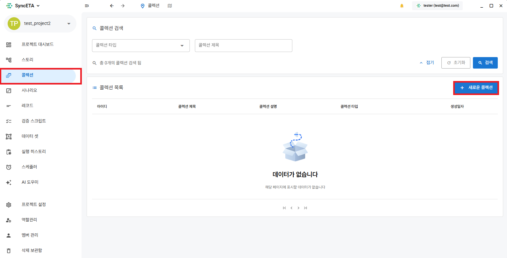
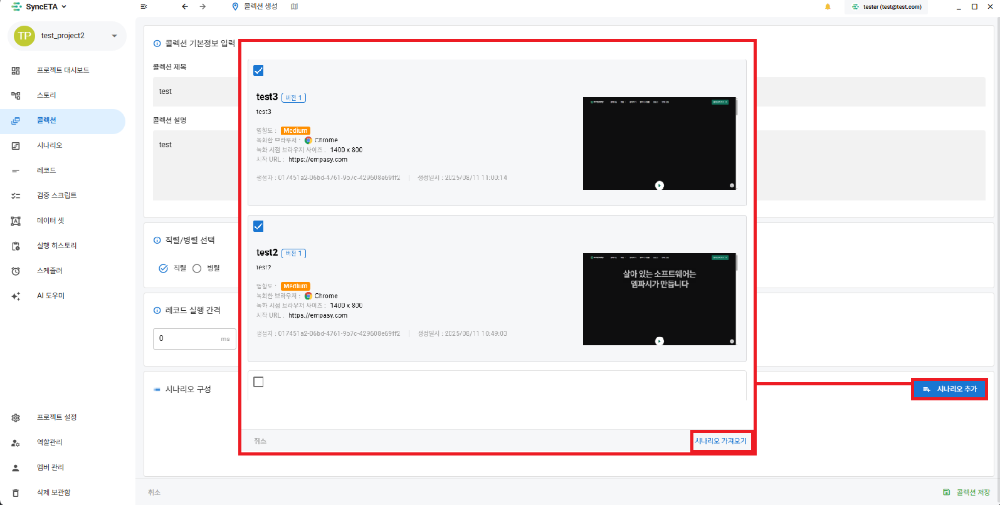

# コレクション管理および一括実行

**「コレクション（Collection）」** は、関連する複数のテストシナリオをグループ化し、1つのテストスイート（Test Suite）単位で管理・一括実行する機能です。

---

## 1. コレクションの主な用途

- **エンドツーエンドシナリオの一括順次実行**：ログイン -> 商品検索 -> 注文決済 -> 注文キャンセルのような個別シナリオを連続して順次検証します。
- **マルチブラウザ同時並列実行**：同一のシナリオセットをChrome、Firefox、Edgeなど複数のブラウザ環境で同時に並列駆動し、クロスブラウジング互換性を点検します。

---

## 2. コレクション作成手順

### ステップ1：コレクションメニューへの移動および新規作成
左メニューの **「コレクション」** へ移動し、右上の **「新しいコレクション」** ボタンをクリックします。

### ステップ2：含めるシナリオおよび実行順序の選択
コレクションに含めるシナリオ一覧にチェックを入れ、ドラッグ＆ドロップによって実行順序を構成します。

---

## 3. コレクション実行モードおよび戦略の比較

コレクションは、テスト目的やCI/CDパイプラインの段階に応じて2つの実行モードを選択して駆動できます。

| 実行モード | 動作方式 | セッションおよびCookieの共有可否 | 主な活用シナリオ |
| :--- | :--- | :---: | :--- |
| **順次実行（Sequential Mode）** | 指定された順序（`1 -> 2 -> 3`）でシナリオを1つずつ実行 | 分離または選択的維持 | スモークテスト（Smoke Test）、前後データ依存関係のある業務検証 |
| **並列実行（Parallel Mode）** | 多数のPlaywrightブラウザワーカーでシナリオおよびマルチブラウザ（`Chromium`、`Firefox`、`WebKit`）を同時駆動 | シナリオごとに完全分離 | 大規模夜間回帰テスト（Nightly Regression）、クロスブラウジング互換性検証 |

---

## 4. コレクション実行および結果集計

コレクション実行時、各シナリオ別の成功/失敗ステータスがリアルタイムで集計され、コレクション全体の実行完了後に総合結果レポートがダッシュボードに記録されます。

<iframe width="100%" height="400" src="https://www.youtube.com/embed/dsb0XpGy7A0" frameborder="0" allowfullscreen allow="autoplay; encrypted-media"></iframe>
