# ダッシュボードおよび結果分析ガイド

SyncETAダッシュボードは、プロジェクト全体のテスト成功率および失敗原因を一目で把握できる総合管制インターフェースを提供します。

---

## 1. 実行統計およびトレンド分析

実行期間およびテスト実行タイプ（**`バッチ`**、**`手動`**）ごとにフィルタリングし、総合的な品質指標を照会できます。

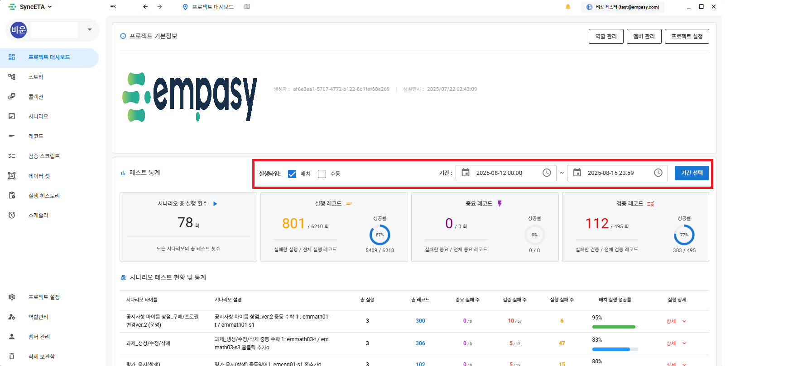

### 主なモニタリング指標
- **総実行回数（`Total`）**：選択した期間および実行タイプ（`バッチ` / `手動`）に応じたシナリオおよびレコードの全体成功・失敗累計集計
- **優先度別成功率（`Priority High`）**：重要度が高い（「高」ランク）コアビジネスシナリオの実行成功/失敗件数および合格率の集中モニタリング
- **検証レコード合格率**：Assertions（DOM/値/Vision）の段階別検証一致率

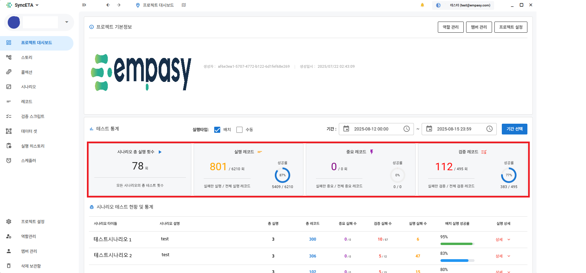

---

## 2. 失敗時点の精密診断および同期動画再生

失敗したテストケースをクリックすると、エラー発生当時のブラウザ状態を精密に分析できます。

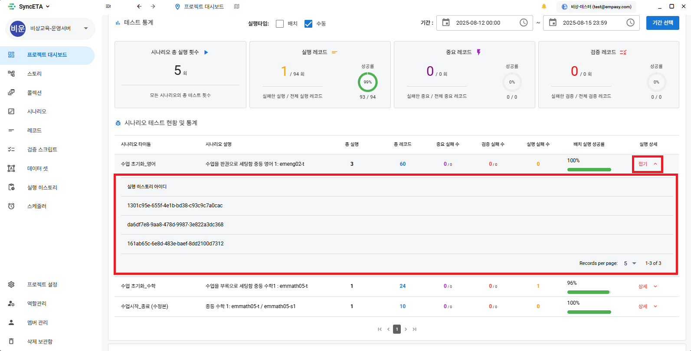

### タイムライン同期ビデオ再生
テスト実行時に録画されたビデオとステップ別レコードタイムラインが同期されており、特定のレコードをクリックすると、その動作が実行された時点の動画位置へ即座にジャンプします。

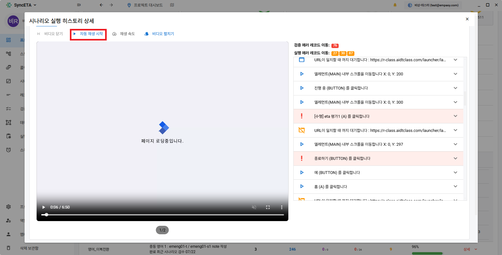
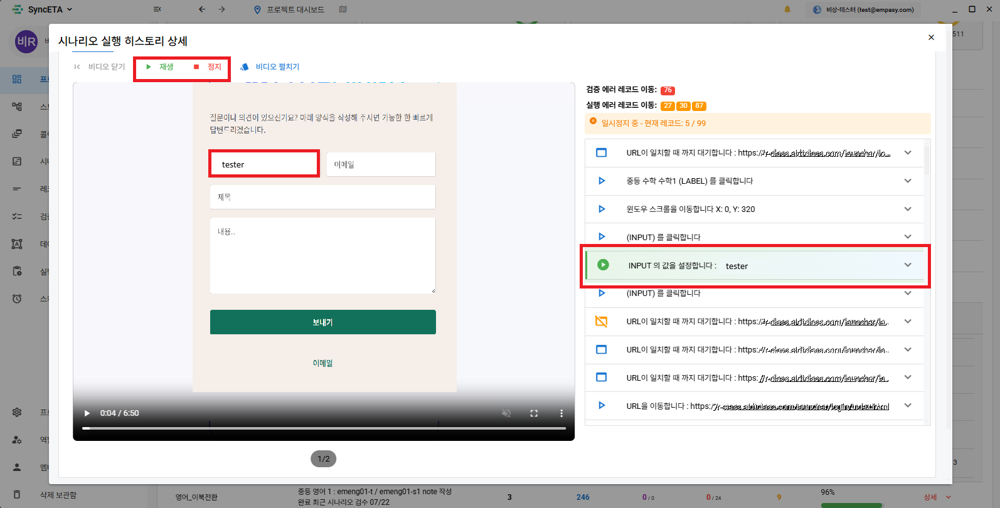
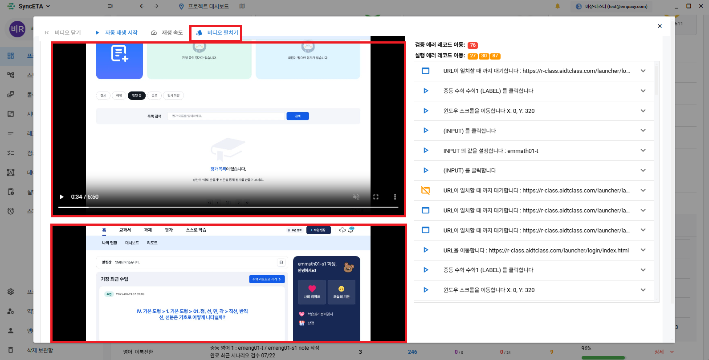

### エラーレコード位置への移動
エラーログをクリックすると、該当エラーを発生させたレコード一覧の位置へ自動的にスクロールします。

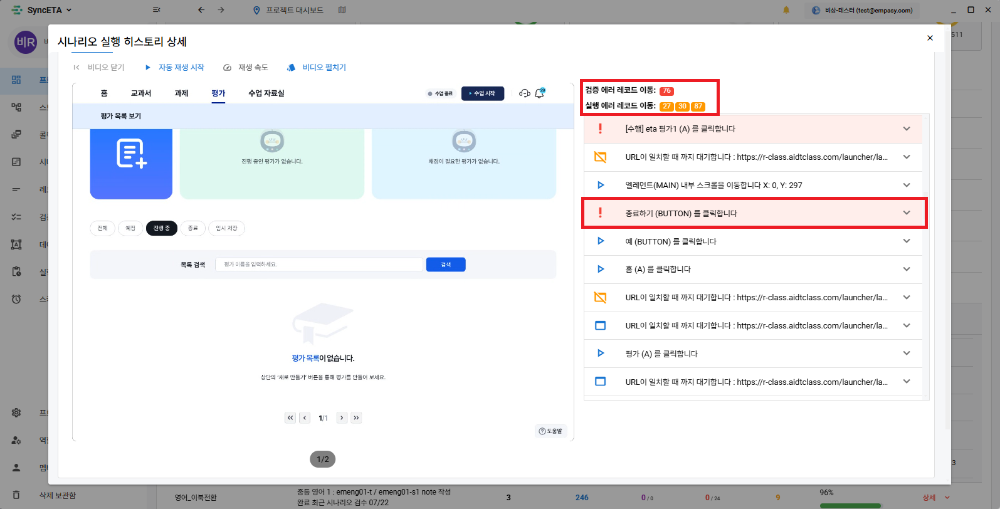
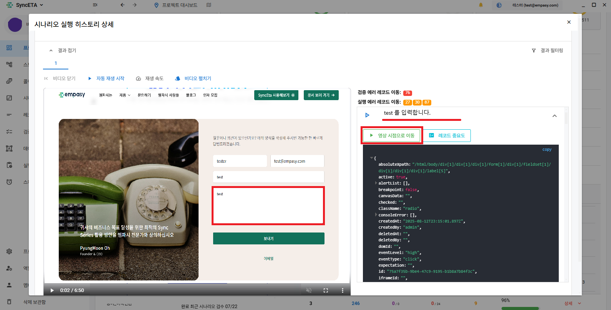

---

## 3. チームコラボレーションおよびコメント機能

テスト結果の特定ステップに課題コメントを作成し、チームメンバー（`@ユーザー名`）をメンションすることで、迅速な不具合共有とコミュニケーションを支援します。

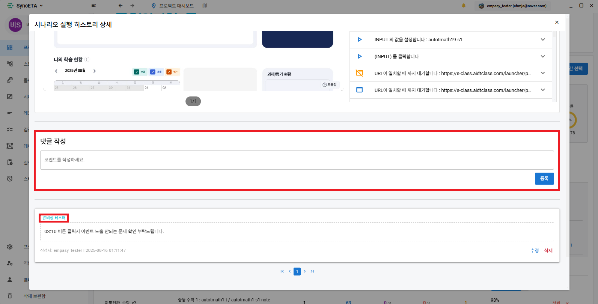
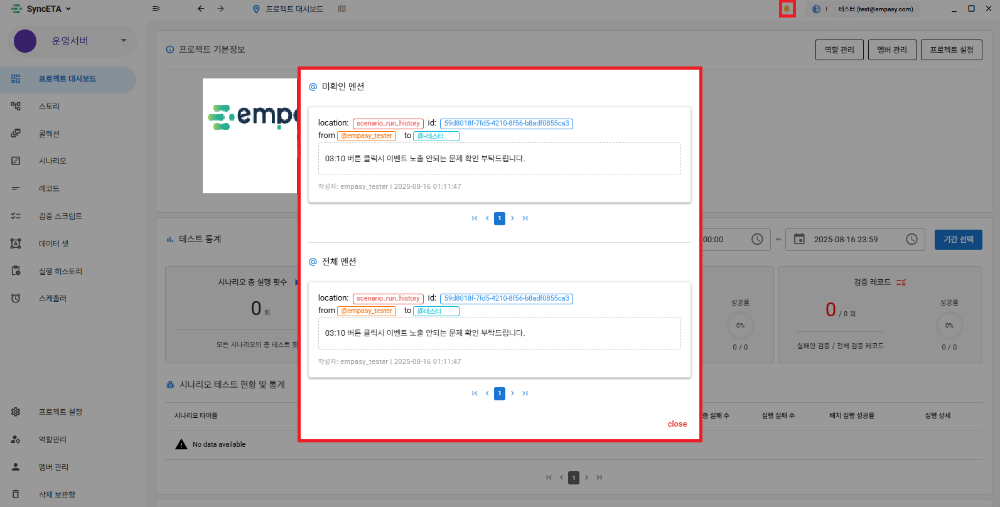

---

## 4. 自動収集診断情報

SyncETAは、テスト実行過程においてブラウザおよびインフラレベルの付帯診断データを自動的に収集します。

| 収集項目 | 説明 |
| :--- | :--- |
| **DOM階層スナップショット** | イベント発生当時の全DOMツリーおよびノード属性情報の保存 |
| **ブラウザConsole Error** | 実行中にWebページコンソールへ出力されたJavaScriptランタイムエラーおよび警告の自動収集 |
| **SSL証明書有効期限** | 対象サービスドメインのSSL/TLS証明書有効期間の点検および期限切れ間近の通知 |

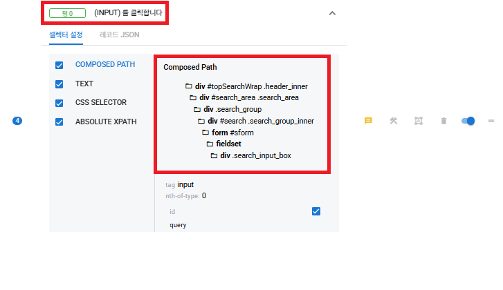
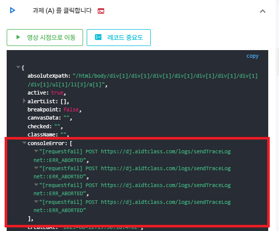
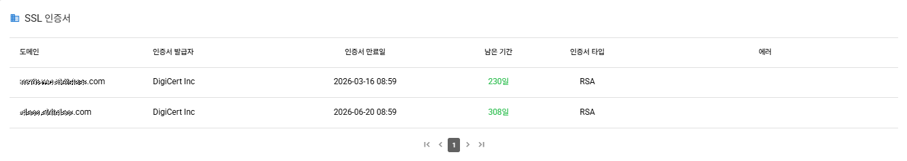
