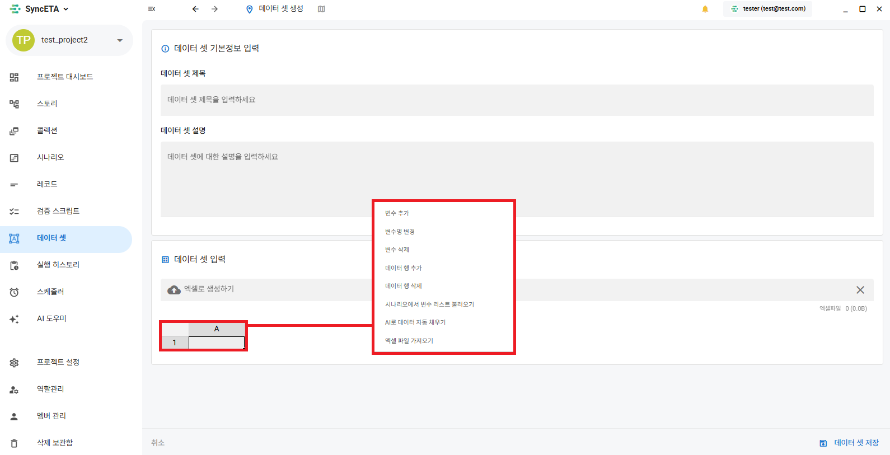
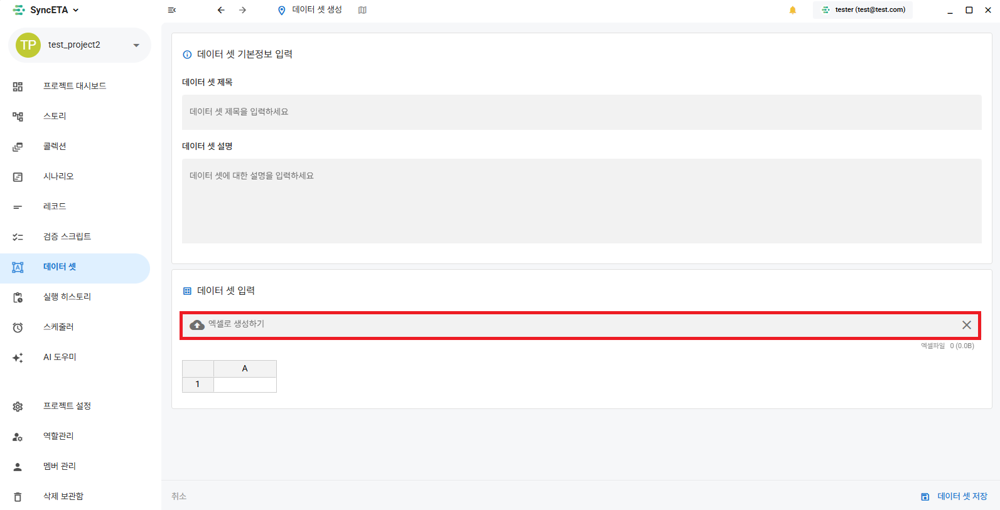
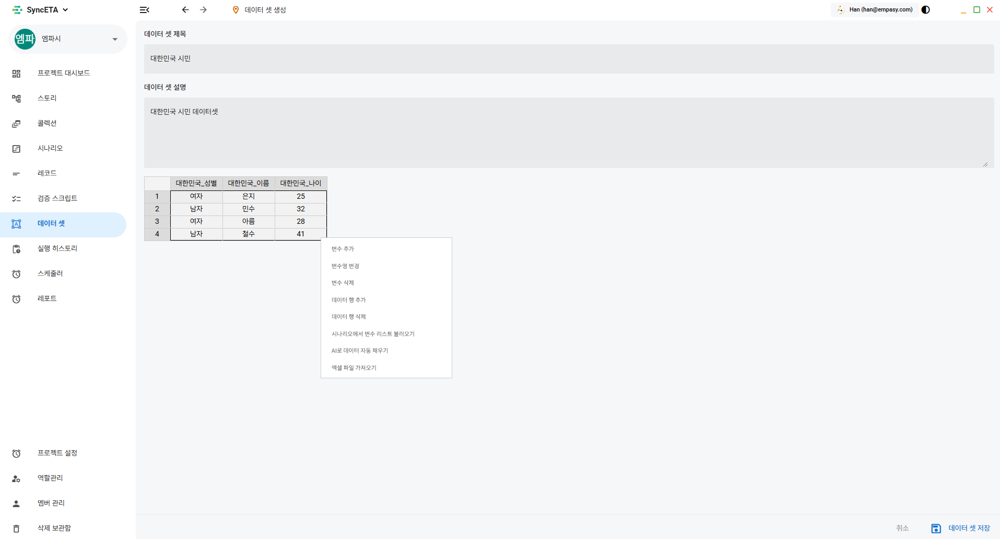
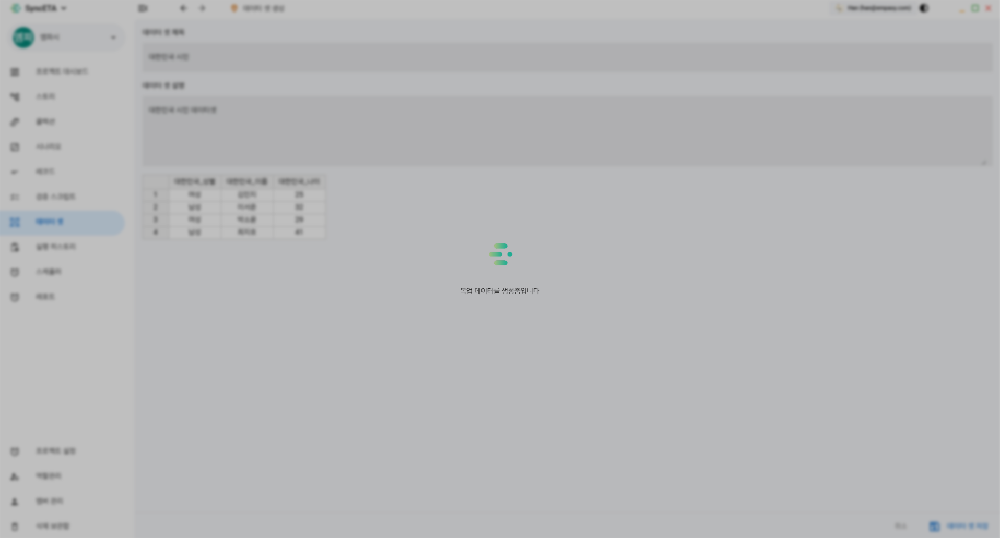

# データセット管理およびパラメータ化（Data-Driven Testing）

**「データセット（Dataset）」** は、テストシナリオにハードコーディングされた入力値を外部データテーブルの変数と動的にマッピングし、1つのシナリオを無数の入力組み合わせ（境界値、例外値、多言語テキスト）で反復検証できるように支援する機能です。

---

## 1. データセットの構造および特徴

- **スプレッドシート形式UI**：行（Row）と列（Column）ベースの親しみやすいテーブルインターフェースでテストパラメータを管理します。
- **Excelファイル Import/Export**：大量の既存テストデータをExcelシート形式で簡単にアップロードまたはダウンロードできます。
- **動的変数バインディング**：シナリオレコード内で `{{username}}`、`{{search_keyword}}` の形式で変数を指定すると、実行時にデータセットの該当列の値が順次注入されます。

---

## 2. データセットの作成および管理方法

### 直接テーブル編集
データセット管理画面で、列（変数名）と行（テストデータセット）を自由に追加・編集・削除できます。

### Excelファイルによる一括アップロード
標準提供されるテンプレート様式をダウンロードしてデータを作成した後、一括アップロードできます。

- **テンプレートファイルダウンロード**：[dataset_form.xlsx](../../ko/synceta/image/dataset/dataset_form.xlsx)

### データ生成補助機能
変数属性（氏名、メールアドレス、電話番号など）に合わせて、右クリックコンテキストメニューの **「AIでデータを自動入力」** を実行すると、有効な形式のテストサンプルデータを自動生成します。

---

## 3. シナリオへのデータセット適用および実行

シナリオ実行オプションで作成したデータセットを指定すると、データセットの各行（Row）ごとに独立したテストケースが順次または並列で実行されます。

<iframe width="100%" height="400" src="https://www.youtube.com/embed/d2RU8aabXIQ" frameborder="0" allowfullscreen allow="autoplay; encrypted-media"></iframe>
