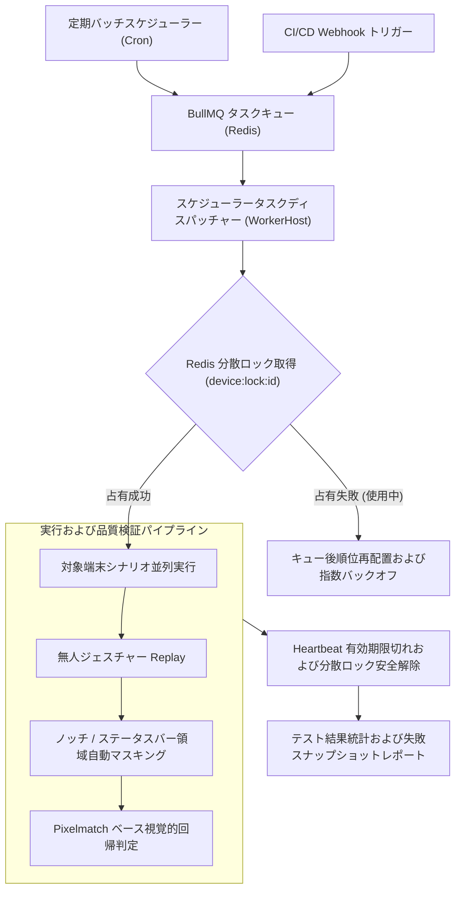

# サーバー無人バッチスケジューラーおよび分散ロックベースのデバイスファーム運用

## 1. 概要および大規模テストの課題

開発者がローカル PC で 1:1 でテストする環境を超え、社内に構築された数十台のモバイル実機（Android ラック、Mac mini ベースの iOS ラック、Docker redroid 仮想デバイスプール）を対象に**夜間無人回帰テスト**を実行する際、次のような同時実行性の問題が発生します：

1. **デバイス占有競合（Device Contention）**: 異なるプロジェクトやビルドパイプラインが同一の物理端末に同時にアクセスし、テストが相互干渉したり異常終了したりする現象。
2. **異常終了時のデバイスロック（Deadlock）**: テスト実行中にランナープロセスが強制終了されると、端末セッションが占有されたまま放置され、後続テストが永久に待機状態となる現象。
3. **ノッチおよびステータスバーによる視覚的誤検知**: バッテリー残量表示、時計の分・秒の変化、フロントカメラのノッチ領域により、画像ピクセル比較時に実際のアプリ欠陥ではないにもかかわらず失敗と誤認する問題。

`SyncETA` は **NestJS Scheduler & BullMQ キュー**、**Redis 分散ロック**、および**インテリジェント領域マスキングエンジン**を通じて、大規模デバイスファームの無人自動化を実現しました。

---

## 2. Redis 分散ロックベースのデバイス占有制御

端末の重複制御を防ぐため、Redis を活用した分散ロックメカニズムを適用します。

- **ロック取得仕様**:
  - キー形式: `device:lock:{platform}:{deviceId}`（例: `device:lock:android:emulator-5554`）
  - アトミック演算: Redis `SET key value NX PX 120000`（デフォルトタイムアウト 120秒）
- **Heartbeat 更新および安全解除**:
  - テストランナープロセスは 30秒ごとにロックの有効期限（TTL）を更新します。
  - ネットワーク切断やプロセスの異常クラッシュが発生した場合でも、120秒後に Redis キーが自動的に期限切れ（Auto-Release）となり、端末が永久ロック状態に陥ることを防ぎます。

---

## 3. ノッチおよびステータスバー自動マスキングによる視覚的回帰検証

モバイル画面のピクセル単位回帰検証（Visual Regression Testing）において不要な誤検知を排除するため、3段階のマスキングパイプラインを稼働させます。

1. **上部ステータスバー（Status Bar）静的マスキング**:
   - デバイスごとの OS 設定から収集された上部バーの高さ（例: Android 24dp、iOS Dynamic Island 54pt）領域を比較対象から除外（Zero-Alpha 処理）します。
2. **下部ジェスチャーナビゲーションバー（Home Bar）マスキング**:
   - フルスクリーンモードでない場合、下部 16〜20dp 領域のシステムバーをマスキングします。
3. **Pixelmatch ベース有効しきい値比較**:
   - マスキングされた領域を除く本文コンテンツ領域に対して `pixelmatch` ライブラリを実行し、ピクセル差分率が事前に定義された許容しきい値（例: 0.1% 以下）以内である場合に正常と判定します。

---

## 4. 夜間バッチパイプライン運用基準

- **スケジューリング周期**: 毎日深夜 02:00 〜 05:00 に全社登録シナリオの全数回帰テストを実行。
- **失敗時の隔離保存**:
  - テスト失敗検知時に直ちに現在の画面キャプチャ、直前 10秒間のログキャット（Logcat）またはシステムコンソールログをバンドルし、S3/MinIO に永続保存。
  - 失敗箇所の画面とベースライン（Baseline）画面の差分をオーバーレイした Diff 画像をレポートに自動添付し、翌朝開発チームが原因を即座に特定できるよう支援します。
