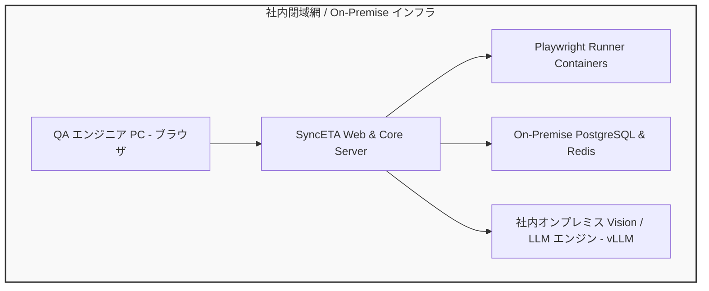

# エンタープライズセキュリティおよびオンプレミスデプロイ

SyncETA は金融、公共機関、大企業の厳格なセキュリティ要件を満たすため、**完全なオンプレミス閉域網（Air-Gapped）デプロイ**と**データガバナンス機能**を提供します。

---

## 1. 閉域網環境およびオンプレミスアーキテクチャ

外部パブリッククラウドへの接続が不可能な閉域網環境でも、SyncETA のすべての機能（レコーディング、実行、視覚分析）を完結して運用できます。

### 社内ローカル Vision / LLM エンジン連携
- **オープンソース Vision モデル**: Llama-3.2-Vision、LLaVA などを社内 GPU インフラ（vLLM、Ollama）にデプロイし、外部 API 通信なしで視覚的回帰分析を実行します。
- **標準 OpenAI 互換インターフェース**: エンドポイント URL（`http://local-vllm.internal:8000/v1`）と API キー設定のみでローカルインスタンスを容易に切り替えられます。

---

## 2. 機密データマスキング（PII Data Masking）

テスト実行中に画面へ露出する個人情報（個人番号・住民登録番号等、電話番号、クレジットカード番号、パスワードなど）の漏洩を防ぐため、多段階マスキングを適用します。

- **DOM レベルテキストマスキング**: パスワード（`type="password"`）フィールドおよび指定された正規表現パターンに一致するテキストは、レコード収集時に `********` で即座にマスキング処理されます。
- **スクリーンショット / ビデオ視覚的ぼかし（Blur）**: 指定されたマスキング領域（CSS Selector）に該当するレンダリング領域は、画面キャプチャおよびビデオ保存前にピクセル化ぼかし処理されます。

---

## 3. ロールベースアクセス制御（RBAC）およびテナント分離

プロジェクト単位で最小権限の原則（Principle of Least Privilege）を適用し、安全なコラボレーション環境を保証します。

| デフォルトロール | シナリオ作成 / 編集 | テスト実行 | データセット編集 | CI/CD API キー発行 | ユーザー招待 / 権限 |
| :--- | :---: | :---: | :---: | :---: | :---: |
| **System Admin** | O | O | O | O | O |
| **Project Lead** | O | O | O | O | O |
| **QA Engineer** | O | O | O | X | X |
| **Viewer / Tester** | X | O（閲覧 / 実行） | X | X | X |

---

## 4. 監査ログおよびトレーサビリティ（Audit Trail）

- **セレクター自己修復承認ログ**: いつ、誰が、どのような理由でシナリオセレクターの変更を承認したかについての全履歴を永続保存します。
- **テスト実行記録の保存**: テスト実行者 ID、実行日時、対象 URL、ブラウザ環境、結果の合否、およびエラースタックトレースを 1年間アーカイブします。
