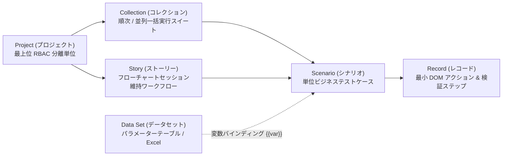

# 技術用語集

SyncETA プラットフォームで使用されるコア概念および技術用語の定義です。

---

### Record（レコード）
ユーザーのブラウザイベントおよび DOM 情報を記録する最小実行単位です。クリック、キーボード入力、スクロール、タブ切り替えなどのユーザー操作を、URL、XPath、CSS Selector、タグ属性情報とともにリアルタイムでキャプチャして保存します。

### Scenario（シナリオ）
一連のレコードを特定のビジネスフロー（例: ログイン、商品検索、決済など）に合わせて順次構成した基本テストケース単位です。待機条件、検証条件、失敗リカバリスクリプトを含めることができます。

### Collection（コレクション）
複数の独立したシナリオをグループ化し、1つのテストスイート単位として順次または並列実行する一括実行機能です。

### Story（ストーリー）
フローチャート（Flowchart）キャンバスインターフェースを通じて複数のシナリオを条件付きで連結し、単一ブラウザセッション内でセッション状態（Cookie、ログイン）を維持しながら連続実行する上位統合ワークフローです。

### Data Set（データセット）
シナリオに定義された入力変数にマッピングするテストデータをスプレッドシート（Key-Value）形式で管理する機能です。Excel ファイルの Import/Export をサポートし、Data-Driven Testing を実行します。

### Playwright MCP
Model Context Protocol（MCP）標準に準拠して Playwright ブラウザインスタンスをリモート制御する分散テスト実行エンジンです。Chromium、Firefox、WebKit のマルチブラウザ並列駆動をサポートします。

### Visual Regression AI（視覚的回帰分析）
ピクセル単位の単純比較の限界を克服するため、ビジョンモデルを活用して画面内のコンポーネント重なり（Overlapping）、テキスト切れ（Clipping）、レイアウト崩れ現象をユーザー認知の観点から分析する機能です。

### Self-Healing（自己修復）
Web アプリケーションのデプロイにより既存の DOM 識別子（XPath/CSS Selector）が変更された際、ビジョンモデルと DOM ツリーを分析して新たな代替セレクター候補を算出し、承認キューへ送信する機能です。

### Human-in-the-Loop ガバナンス
AI が生成したテストケースや自己修復セレクターをシステムへ自動反映する前に、QA エンジニアおよび管理者の明示的なレビューと承認を経るようにする品質管理原則です。

### Air-Gapped / On-Premise デプロイ
外部インターネット通信が遮断された社内閉域網環境でも、ローカルのオープンソース Vision/LLM エンジン（vLLM など）と組み合わせて独立稼働できるエンタープライズデプロイ方式です。

---

## テスト資産階層構造のまとめ

