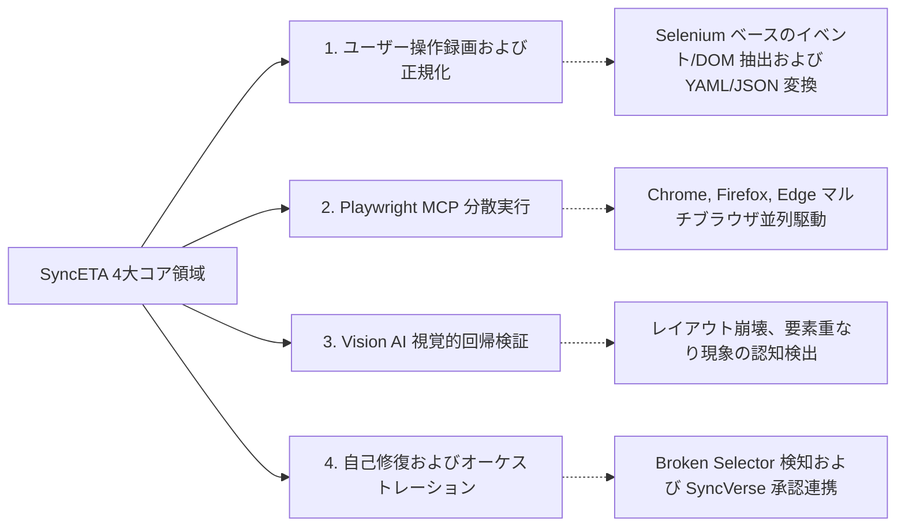
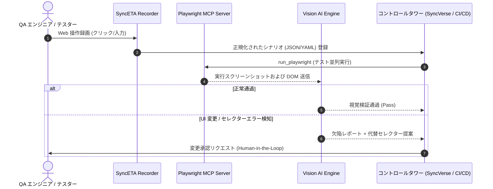
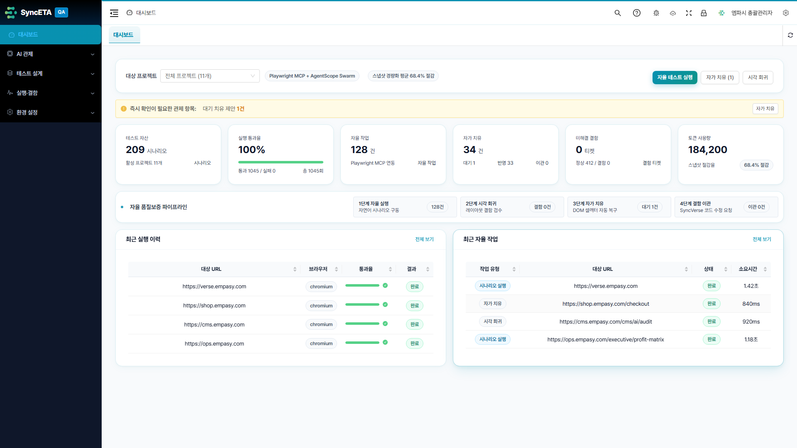
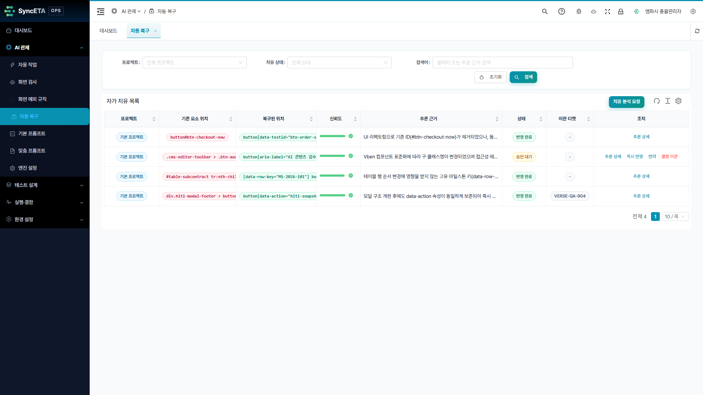
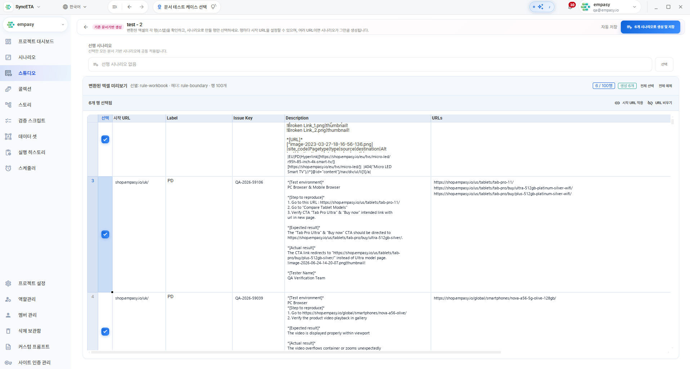
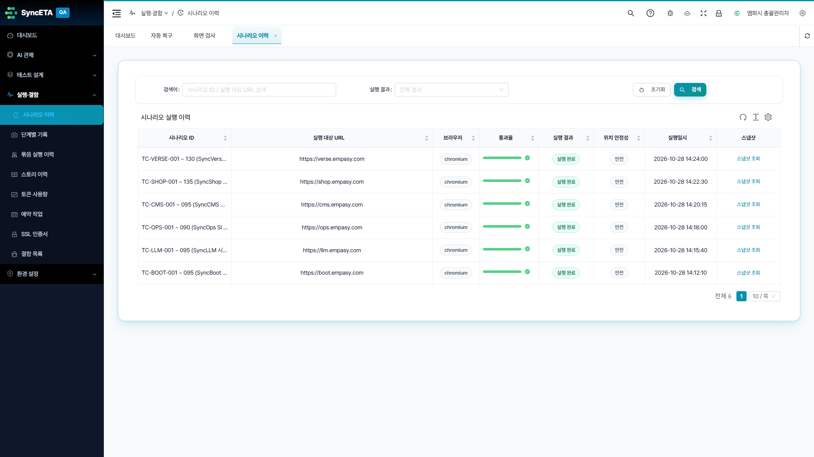
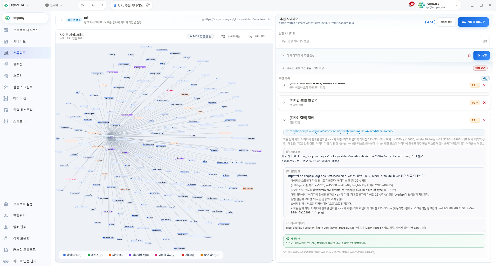
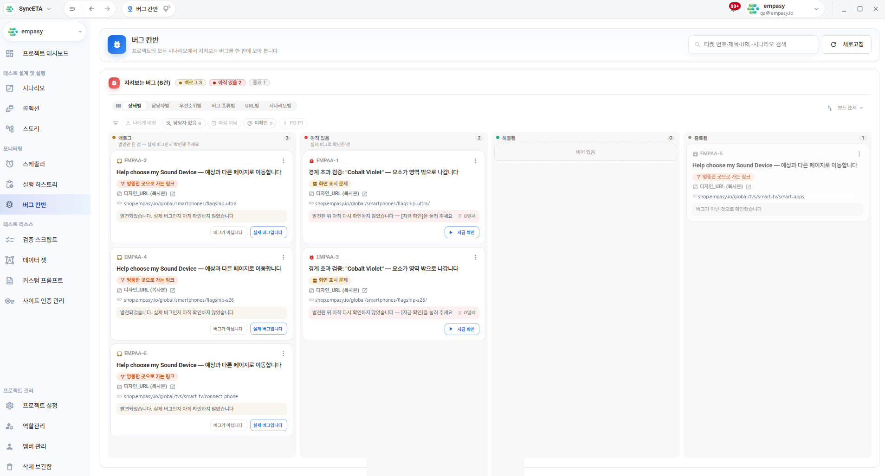

# SyncETA: AIテスト自動化 · 自己修復（Self-Healing）Web QAプラットフォーム

> **非開発者・導入検討ガイド**: わかりやすい製品紹介は[SyncETA製品ホームページ（empasy.io）](https://empasy.io/ja/solutions/sync-eta.html){target="_blank" rel="noopener"}で、デスクトップインストールおよび体験は[統合デモポータル](https://demo.empasy.io/ja/products/sync-eta/#demo){target="_blank" rel="noopener"}でご利用いただけます。また、最新の紹介書（15p）PDFは[提案書ライブラリ](/ja/proposals/)からダウンロードできます。

**SyncETA**は、**ブラウザ操作録画（仮想キーパッド・Cookieバナー自動通過・個人情報マスキング）、代表・標本URLを活用したExcel/一行文テスト変換、マルチアカウント同時テスト、シナリオ不要の下位リンク・画面デザイン欠陥（文字重なり・空白領域）全数検査、バグカンバンボードおよび`[今すぐ確認]`ワンクリック再検証**までを一貫自動化するプラットフォームです。Playwright MCP並列実行と画面変更時の要素自動探索（Self-Healing）も備えています。

::: tip デスクトップアプリケーション即時実行ガイド
SyncETAは、別途サーバーインフラを構築することなく、ローカルおよびステージングWebサイトを即座にテストできるデスクトップアプリケーション（v0.0.58）を提供しています。  
Windows（x64、arm64）およびmacOS（Apple Silicon、Intel）用インストーラーは、**[株式会社エムパシー公式ダウンロードページ（empasy.io）](https://empasy.io/ja/download_eta.html)**から無料でダウンロードして、1分で最初のテストを実行できます。
:::

---

## 主なAIテスト自動化方式の比較（コード生成 vs 自律E2Eエージェント）

| 区分 | 既存スクリプト自動化（Selenium・単独Playwright） | コード生成支援AI（Claude Code・GitHub Copilot） | 自律E2E QAエージェント（**株式会社エムパシー SyncETA**） |
| :--- | :--- | :--- | :--- |
| **シナリオ作成** | 開発者がCSS/XPathセレクターコードを手動記述 | プロンプトで単体・統合テストコードのドラフト生成 | **ブラウザ操作のノーコード録画および自然言語・Excelシナリオの自動生成・直接実行** |
| **UI変更時の自己修復（Self-Healing）** | 不可（クラス・DOM変更時に即座にテスト失敗） | 手動再プロンプトおよび開発者によるコード再修正が必要 | **Vision-LLMおよびDOM文脈推論により壊れたセレクターをリアルタイム自己修復（社内1,200回評価基準 93.0%）** |
| **視覚的画面検証（Visual Regression）** | 単純ピクセル比較（バナー・フォントの微細な変更でも誤検知） | コードレベル検証中心（レンダリングレイアウト検証に限界） | **デプロイ前後の画面レイアウト崩壊・要素重なり現象をVision AIで自動検出** |
| **主な活用対象およびコスト** | 自動化専任開発者が必要・保守工数が過大 | 開発者の単体/統合テスト支援・呼び出しごとにトークン課金 | **企画者・QA・開発者共用のノーコードE2E回帰テスト・反復実行AIコスト0円** |

---

## 4大コア機能領域

1. **ユーザー操作録画およびシナリオ正規化（Recording & Normalization）**:
   - 実際のブラウザ操作（クリック、入力、ページ遷移、タブ切り替え）をリアルタイムで収集します。
   - 収集されたイベントは、XPath、CSS Selector、DOM階層構造とともに標準JSON/YAMLフォーマットに正規化されます。

2. **Playwright MCPベースの分散テスト実行（Test Execution）**:
   - Model Context Protocol（MCP）標準ツールを通じて、マルチブラウザ（Chromium、Firefox、WebKit）環境でテストを並列実行します。
   - テスト実行中にエラーが発生した場合、失敗時点のDOMスナップショット、コンソールログ、ビデオ録画データを収集します。

3. **Vision AIベースの視覚的回帰検証（Visual Regression AI）**:
   - 単純なピクセル比較の限界を超え、ビジョンモデルを通じてコンポーネントの重なり現象、テキスト切れ、レイアウト崩れを検出します。
   - 動的レンダリング領域に対するマスキング（Ignored Regions）設定をサポートします。

4. **セレクター自己修復およびコントロールタワー連携（Self-Healing & Governance）**:
   - UI変更により既存の識別子が壊れた場合、画面構造を分析して最適な代替セレクターを算出します。
   - 任意にコードを変更せず、SyncVerseコントロールタワーおよびQAエンジニアの承認（Human-in-the-Loop）を経てテスト資産を更新します。

---

## 5段階エンドツーエンドテストパイプライン

---

## 導入時に期待される効果

- **テストスクリプト保守工数の削減**: UI変更時に発生するスクリプト破損現象を自己修復パイプラインにより迅速に補正します。
- **クロスブラウジング検証時間の短縮**: Playwright MCPベースの並列実行により、回帰テスト全体の所要時間を短縮します。
- **精密な視覚的整合性の確保**: ピクセルノイズの影響を受けないVision AI検証により、リリース前のレイアウトエラーを事前に遮断します。
- **標準プロトコル互換**: HTTP SSEベースのMCPインターフェースを提供し、社内CI/CD（Jenkins、GitHub Actions）およびAIオーケストレーターと有機的に連携します。

---

## 実稼働画面およびコアワークフロー

### 1. プロジェクトダッシュボード・実行状況分析
テスト回数、成功率推移、失敗原因比率、有効スケジュール、運用サイトのSSL証明書有効期限を一画面で監視し、ワンクリックで総合レポートを出力します。

### 2. ブラウザ操作レコーダー・リアルタイムDOM検証
クリック・入力・スクロール操作をリアルタイム録画してブロック再利用でき、金融向け仮想セキュリティキーパッド、海外サイトのCookie同意バナー自動閉鎖、個人情報マスキングに対応します。

### 3. Excel試験表・一行文テスト変換
既存のExcel・CSVテスト仕様書をアップロードして行単位で選択変換し、代表・標本URLの設定および事前実行により複数の国別・商品ページへ共通適用します。

### 4. マルチアカウント同時テスト・録画動画比較
問い合わせ側（タブ0）と管理者側（タブ1）のように異なるアカウントを独立ログイン状態で同時実行し、役割間の連携と録画動画・エラーログを分離管理します。

### 5. サイト知識グラフによるリンク全数検査・デザイン欠陥診断
シナリオ未作成でも下位リンクの404・遷移不一致、文字重なり・空白領域・動画再生異常を自動検出し、判断が曖昧な項目は写真付きで`[確認必要]`へ誠実に分類します。

### 6. バグカンバンボード・`[今すぐ確認]`ワンクリック再検証
問題画面の写真付きチケットをバックログ→未解決→解決済み→終了で管理し、重複起票ブロック・`[バグではありません]`永続記憶・ボタン一つの即時再検証を提供します。

---

## ドキュメント目次

### 1. 概要およびシステムアーキテクチャ
- [システムアーキテクチャおよびパイプライン](./architecture) - 4層アーキテクチャおよびコンポーネント通信構造
- [5分クイックスタートガイド](./quickstart) - ローカルコンテナ起動および初回テスト実行

### 2. 実務ユーザーガイド
- [アカウントおよびワークスペース管理](./account) - アカウント登録、プロフィール設定および環境管理
- [プロジェクト管理](./project) - プロジェクト作成、ロール/権限（RBAC）およびメンバー招待
- [シナリオ録画およびエディター](./scenario-create) - ブラウザ録画、待機条件、検証条件、復旧スクリプト
- [シナリオ実行オプション](./scenario-run) - クロスブラウザ、マルチ解像度、バックグラウンド並列実行およびスケジューラー
- [コレクション管理](./collection) - 複数シナリオの一括順次/並列実行構成
- [ストーリーワークフロー](./story) - フローチャートベースのシナリオ条件分岐および動的Chaining
- [データセット管理](./dataset) - Excel連携、入力値置換（Data-Driven Testing）、境界値データセット
- [ダッシュボードおよび結果分析](./dashboard) - 実行統計、コンソールエラー収集、失敗時点のDOMスナップショットおよび録画映像分析

### 3. モバイルテストエンジニアリング
- [モバイルE2Eシステムアーキテクチャ](./mobile-testing-architecture) - Android & iOS実機キャプチャおよび回帰テスト全体アーキテクチャ
- [デュアル自動化エンジン仕様](./mobile-dual-engine) - Playwright AndroidおよびAppium 3.7+デュアルエンジン構造
- [超低遅延ミラーリング & キャプチャ](./mobile-live-mirroring) - Direct MJPEG 60 FPS画面ストリーミングおよび非同期デュアルトラックキャプチャ
- [デバイスファームスケジューラー](./device-farm-scheduler) - Redis分散ロックベースの無人夜間バッチおよび視覚的回帰検証

### 4. 高度な連携およびエンタープライズ
- [視覚的回帰および自己修復](./self-healing-and-vision) - Vision AIレイアウト検証およびセレクター補正手順
- [MCPプロトコルおよびCI/CD連携](./mcp-and-cicd) - HTTP SSE標準Tool Schemaおよびパイプライン連携仕様
- [エンタープライズセキュリティおよびオンプレミス](./enterprise-security) - ローカルLLM連携、社内閉域網対応、データマスキング
- [技術用語集](./glossary) - Record、Scenario、Collection、Story、MCPなどの用語定義

### 5. コア特許技術
- [大韓民国登録特許第10-2025-0125736号](../patents/registered-web-action-recording) - Webブラウザ操作レコーディングベースのAI自然言語テストケース自動化
- [出願準備特許第21号](../patents/21-mobile-gesture-nlp) - モバイルジェスチャー分析および自然言語テスト自動化システム
