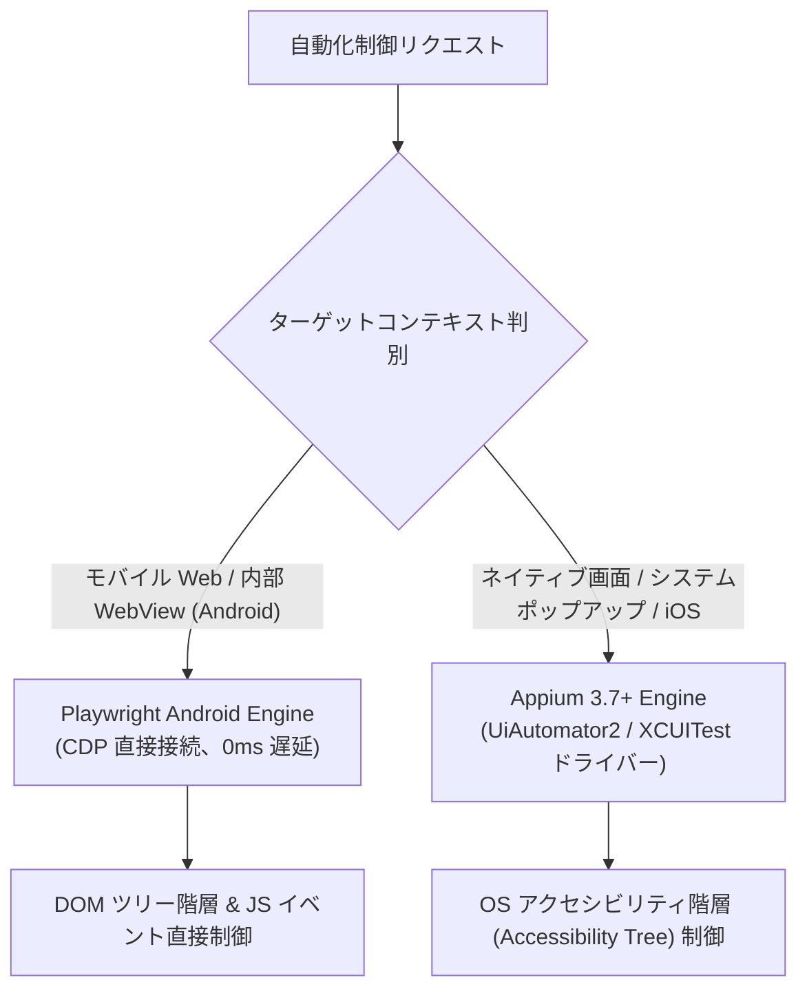

# Playwright Android および Appium 3.7+ デュアル自動化エンジン仕様

## 1. デュアルエンジン導入の背景

モバイルアプリケーション環境は、大きく**純粋ネイティブアプリ**、**モバイル Web**、および Web とネイティブが融合した**ハイブリッドアプリ（Flutter、React Native、WebView）**に分類されます。

単一の自動化フレームワークのみを使用した場合、以下のような限界が生じます：
- **Appium 単独使用時**: モバイル Web や複雑な WebView 環境において DOM イベント追跡やスクリプト実行の遅延時間が長くなり、リアルタイムレコーディングのインタラクション性が低下します。
- **Playwright 単独使用時**: ブラウザコンテキスト外部のモバイルシステム権限ダイアログ（カメラ／位置情報許可ポップアップ）、ハードウェア戻るボタン、プッシュ通知の確認などを制御できません。

`SyncETA` はこのような制約を克服するため、**Playwright Android** と **Appium 3.7+ (UiAutomator2 / XCUITest)** を単一の統合セッション内で組み合わせた**デュアル自動化エンジンアーキテクチャ**を採用しています。



---

## 2. エンジン別の役割およびルーティング戦略

| 制御領域 | 主駆動エンジン | 通信プロトコル | 主な制御対象 |
| :--- | :--- | :--- | :--- |
| **モバイル Web & WebView (Android)** | Playwright Android | Chrome DevTools Protocol (CDP) | DOM 要素操作、Cookie／セッション制御、ネットワークモック |
| **モバイル Web (iOS Safari)** | Playwright WebKit / Appium | WebKit Remote Debug Protocol | Safari Web ページレンダリング検証 |
| **ネイティブコンポーネント** | Appium 3.7+ | W3C WebDriver プロトコル | ネイティブボタン、リストビュー、ナビゲーションバー |
| **システムダイアログ & ハードウェア** | Appium 3.7+ | ADB Shell / WDA エンドポイント | 権限承認ポップアップ、音量／ホーム／戻るキー、生体認証 |

---

## 3. クロスプラットフォーム共通抽象化層 (`IMobileAutomationService`)

フロントエンドレコーダーおよびバックエンドバッチランナーは、対象プラットフォーム（Android／iOS）や使用中のサブエンジンの内部実装を直接意識することなく、単一化された共通インターフェースを通じてコマンドを伝達します。

```typescript
export interface IMobileAutomationService {
  /** デバイスセッション初期化およびターゲットアプリ起動 */
  initSession(config: IMobileSessionConfig): Promise<void>;

  /** 正規化座標基準の単一タップ操作を実行 */
  tapAtCoordinate(normalizedX: number, normalizedY: number): Promise<void>;

  /** 時系列スワイプジェスチャーを実行 */
  swipe(
    startX: number, startY: number,
    endX: number, endY: number,
    durationMs: number
  ): Promise<void>;

  /** 仮想キーボードまたはハードウェアキー入力 */
  pressKey(keyCode: string): Promise<void>;

  /** 端末画面キャプチャバッファを返却 */
  takeScreenshot(): Promise<Buffer>;

  /** ネイティブと WebView 間のコンテキストスイッチング */
  switchContext(contextId: 'NATIVE_APP' | string): Promise<void>;

  /** 現在画面の UI ツリー階層構造 (XML/JSON) を抽出 */
  getPageSource(): Promise<string>;

  /** セッション正常終了およびリソース解放 */
  close(): Promise<void>;
}
```

---

## 4. ハイブリッドアプリ・コンテキストスイッチングの動作原理

ユーザーがハイブリッドアプリを操作中に WebView コンポーネントへ遷移すると、エンジンは自動的に利用可能なコンテキスト一覧をポーリングします：

1. **コンテキスト検知**:
   - `driver.getContexts()` を呼び出し、`['NATIVE_APP', 'WEBVIEW_com.example.app']` リストを受信します。
2. **アトミック切り替え**:
   - WebView 内部要素をクリックすると、コンテキストを `WEBVIEW_*` に切り替えて CDP バインディングを有効化し、高速 DOM 解析を実行します。
3. **ネイティブ復帰**:
   - 決済モジュールやシステムカメラポップアップが表示されると即座にコンテキストを再び `NATIVE_APP` へ切り替え、ネイティブボタンをクリックします。
- これらすべての過程はシナリオレコード内に `contextChange` フラグとして自動記録されるため、再実行時にもエラーなくコンテキストが切り替わります。
