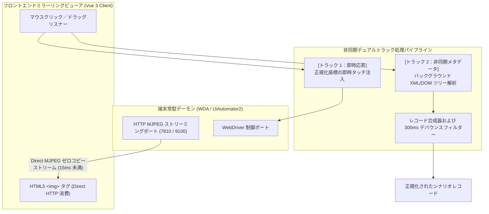

# 超低遅延リアルタイム画面ミラーリングおよび非同期デュアルトラックキャプチャ

## 1. 概要および遅延時間ボトルネックの解消

リモートまたはローカル USB で接続されたモバイル端末を PC 画面で確認しながらマウスで操作するレコーディング環境では、**画面転送遅延（Latency）**と**タッチ応答速度**がユーザー体験の要となります。

従来の単純フレームキャプチャ方式（ADB `screencap` の反復呼び出しおよび Electron IPC バッファコピー）には、以下のようなボトルネックが存在しました：
1. **高い画面転送遅延**: 1フレームあたり 100〜200ms 以上の遅延が蓄積し、高速スクロールやタイピング時に画面が大きく遅れて追従する現象。
2. **同期式 XML ダンプによる UI フリーズ**: ユーザーが画面をタッチするたびに端末のアクセシビリティ XML ツリーを同期的に抽出（`getPageSource`）するため、数百ミリ秒間画面入力が停止する現象。
3. **合成イベントの重複記録**: モバイルブラウザ／WebView 環境で単一タッチ時に発生する `touchstart`、`touchend` と、ブラウザが自動生成する仮想 `click` イベントが 2重・3重に重複記録される欠陥。

`SyncETA` は **Direct MJPEG ストリーミングパイプライン**と**非同期デュアルトラックキャプチャアーキテクチャ**を通じて、これら 3つのボトルネックを解消しました。

---

## 2. Direct MJPEG 超低遅延ストリーミングアーキテクチャ

Electron メインプロセスを経由してレンダラープロセスへ大容量画像バッファをコピー（IPC Transfer）する従来の中継方式を全面的に刷新しました。

- **ポートフォワーディング直接バインディング**:
  - Android の場合、UiAutomator2 の内蔵ストリーミングポート（デフォルト 7810）をローカルポートへフォワーディングします。
  - iOS の場合、WebDriverAgent の MJPEG サーバーポート（デフォルト 9100）をローカルポートへフォワーディングします。
- **クライアント直接消費**:
  - フロントエンドビューア（`MobileLiveMirrorViewer.vue`）は、ローカルフォワーディングされた `http://127.0.0.1:7810` エンドポイントを標準 `` タグの `src` として直接消費します。
  - 別途バイナリ解析や IPC メモリコピーのオーバーヘッドが発生しないため、**毎秒 60 フレーム（60 FPS）および実測遅延時間 15ミリ秒（ms）未満**のレンダリング性能を維持します。

---

## 3. 非同期デュアルトラック・イベントキャプチャメカニズム

タッチ入力と高負荷なメタデータ抽出処理を 2つの独立した非同期トラックに分離することで、操作感度を維持します。

### トラック 1：高速注入トラック（Fast Track）
- ユーザーがマウスをクリックした瞬間、画面ビューポートに対する相対座標（0.0〜1.0）を算出して端末へ送信します。
- 端末画面へタッチフィードバックが遅延なく即座に反映されるため、ユーザーは実機を直接タッチしているのと同等の応答速度を体感できます。

### トラック 2：非同期メタデータ抽出トラック（Metadata Track）
- タッチが注入された直後、バックグラウンドの非同期ワーカーが現在画面のアクセシビリティツリー（Accessibility Hierarchy）および DOM ノード情報を収集します。
- 収集された属性（`resourceId`、`className`、テキスト値、視覚アンカーバウンディングボックス）は、トラック 1 で記録された座標情報と事後マージされ、完全なシナリオカードとして保存されます。

---

## 4. 合成イベントのデバウンスおよび重複防止フィルター

モバイル WebView およびブラウザ環境での単一タップ動作時、ブラウザレンダラーエンジンはタッチ互換性のために `touchstart`、`touchend` イベントに続いて約 300ms 後に人為的な合成 `click` イベントを発生させます。

`SyncETA` はこのような重複記録を防ぐため、**300ms スライディングウィンドウ・デバウンスフィルター**を適用しています：
- 直前のタッチイベントと同一の座標半径（±5px 以内）において 300ms 以内に発生する後続のクリックイベントは、記録リストから自動的に除外されます。
- これにより、シナリオ再実行時に同一ボタンが 2回連続でクリックされ、意図しない重複決済や画面閉じが発生する問題を事前に防止します。
