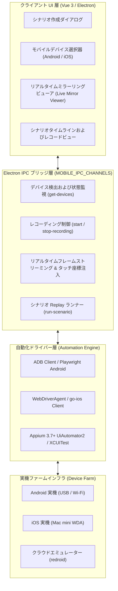

# モバイル (Android & iOS) シナリオ E2E システムアーキテクチャ

## 1. 概要および背景

従来の Web ブラウザベースのビューポート縮小や単純な User-Agent エミュレーション方式では、実際のモバイル端末（Android および iOS）で発生するタッチジェスチャー、モバイルレンダリングエンジンの特性、システム権限ダイアログ（位置情報、カメラ、通知）、およびハードウェアキー入力を完全に検証するには限界があります。

`SyncETA` のモバイルテストアーキテクチャは、USB またはリモートネットワーク（Wi-Fi ADB / WDA）で接続されたモバイル実機をベースに、デスクトップシナリオ作成と統一されたインタラクションによって**モバイルユーザー操作を録画（Record）**し、これを実機上で**無人再実行（Replay）して回帰テストを遂行**できるパイプラインを提供します。



---

## 2. 3層システム構成要素

モバイル自動化システム全体は、役割に応じて 3つのレイヤーに分離されて動作します。

### 1) フロントエンド UI 層（Client Presentation）
- **デバイス選択器**: ローカル PC およびネットワークに接続されたモバイル端末を自動検出し、モデル名、OS バージョン、解像度（DPI）、バッテリー状態およびリアルタイム接続状態を一覧表示します。
- **リアルタイムミラーリングスタジオ**: 端末画面を遅延なくストリーミングし、ユーザーのマウスクリックおよびドラッグ入力をモバイル端末のタッチイベントとしてリアルタイムにリレーします。
- **シナリオタイムライン**: キャプチャされたタッチ、スワイプ、キー入力操作をステップ別のカード形式で可視化し、検証アサーション（Assertion）を追加できるインターフェースを提供します。

### 2) Electron IPC ブリッジ層（System Bridge）
- レンダラープロセスとメインプロセス間の非同期通信を担当し、ストリーミングバイナリデータとデバイス制御信号を分離されたチャネル（`MOBILE_IPC_CHANNELS`）でルーティングします：
  - `mobile:get-devices`: リアルタイム接続端末一覧の更新
  - `mobile:inject-touch`: ユーザークリック座標の実機への即時注入
  - `mobile:stream-frame`: 端末画面バッファフレームの受信

### 3) 自動化エンジン層（Execution Engine）
- 対象端末の OS およびターゲットアプリケーションの特性（WebView、ネイティブアプリ）に応じて最適なドライバーを動的に選択する共通インターフェース（`IMobileAutomationService`）を提供します。

---

## 3. 正規化されたモバイルシナリオデータモデル

モバイルから収集されるすべてのユーザー操作は、端末解像度に依存しないよう正規化された属性を含めて保存されます：

```typescript
export interface IMobileRecord {
  /** レコード一意識別子 */
  id: string;
  /** 操作種別 (TAP, SWIPE, LONG_PRESS, INPUT_TEXT, KEY_EVENT) */
  actionType: MobileActionType;
  /** 無次元正規化相対座標系 (0.0 ~ 1.0) */
  normalizedCoords: {
    x: number;
    y: number;
  };
  /** スワイプ操作時の終了座標 (該当する場合) */
  normalizedEndCoords?: {
    x: number;
    y: number;
  };
  /** ジェスチャー継続時間 (ミリ秒) */
  durationMs: number;
  /** 入力テキスト内容 (テキスト入力操作時) */
  inputValue?: string;
  /** 物理キーコード (BACK, HOME, VOLUME_UP 等) */
  keyCode?: string;
  /** イベント発生時点の視覚アンカーおよびアクセシビリティノードメタデータ */
  nodeMetadata?: {
    accessibilityId?: string;
    resourceId?: string;
    className?: string;
    bounds?: [number, number, number, number];
  };
}
```

---

## 4. 基本特許技術との連携

本モバイルシナリオアーキテクチャは、大韓民国特許庁に正式登録済みの Web レコーディング基本特許（**特許第10-2025-0125736号**）の設計思想をモバイル領域へと拡張したものであり、追加出願準備中の**特許第21号（モバイルジェスチャーレコーディングおよび AI 自然言語テストケース自動化）**における中核的なハードウェア結合実施形態として実装されています。
