# プロジェクトおよび権限(RBAC)管理

SyncETA において**「プロジェクト」**とは、シナリオ、データセット、実行履歴、およびダッシュボードレポートを独立して分離・管理する最上位の運用単位です。プロジェクト単位でチームメンバーを招待し、役割（Role）に応じた権限をきめ細かく付与することができます。

---

## 1. プロジェクトの作成

新規プロジェクトは、次の 3つの経路から作成できます。

### 経路 1：所属プロジェクトがない初期状態
初回ログイン時、画面中央の **「新しいプロジェクト」** ボタンをクリックします。

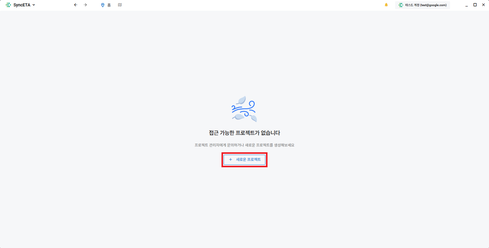

### 経路 2：プロジェクト一覧画面から作成
プロジェクト一覧の左上にある **「新しいプロジェクト」** ボタンをクリックします。

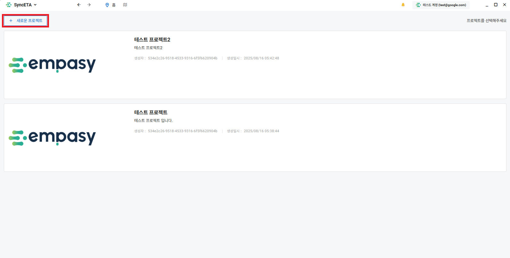

### 経路 3：作業ダッシュボードのツールバーから作成
左サイドバー上部のプロジェクト選択ドロップダウン内にある **「新しいプロジェクト」** ボタンをクリックします。

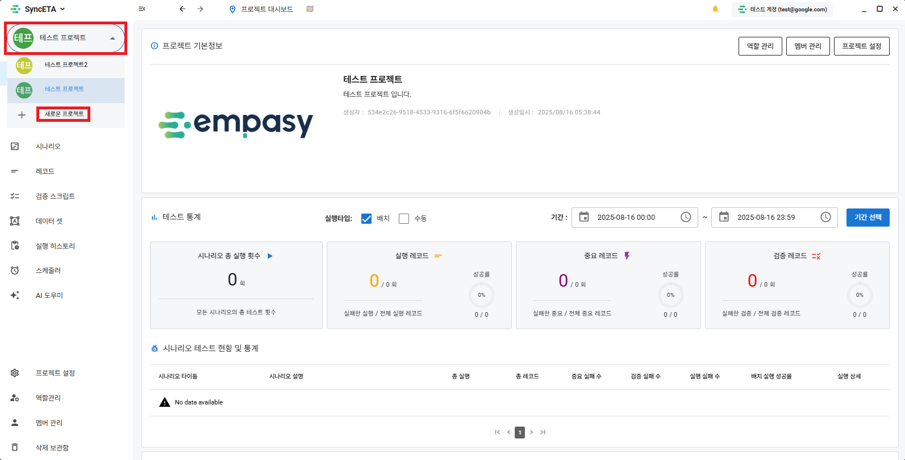

### プロジェクト情報の入力
プロジェクト名、代表画像、プロジェクト説明、および対象ベース URL を入力した後、作成を完了します。

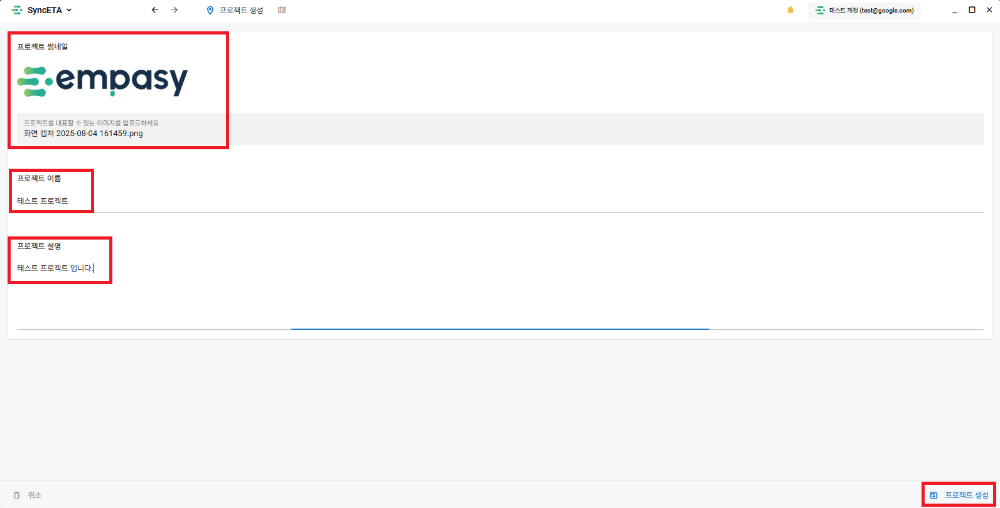

---

## 2. プロジェクト一覧および切り替え

右上の **「プロジェクトを閉じる」** または切り替えアイコンをクリックして所属プロジェクト一覧を確認し、目的のプロジェクトへ移動できます。

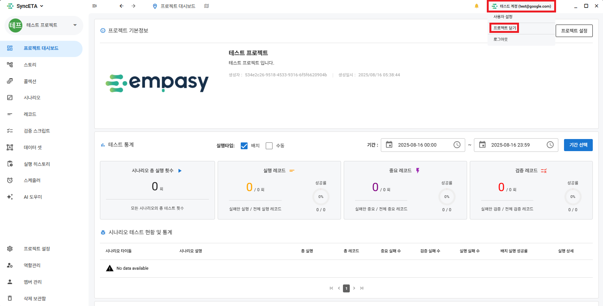
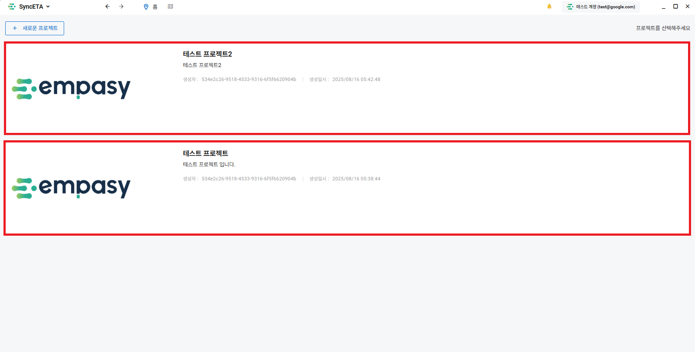

---

## 3. ロールベース権限制御 (RBAC)

プロジェクトのセキュリティおよび運用安定性のために、役割（Role）ごとに作業権限を制御できます。

### ステップ 1：ロールの作成
プロジェクト設定 -> **「ロール管理」** メニューへ移動し、新しいロールを追加します。

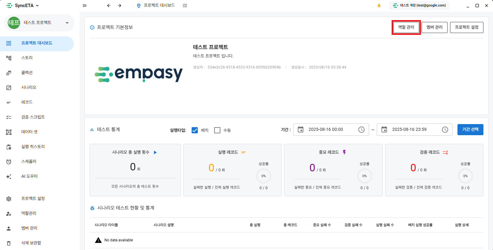

### ステップ 2：権限のマッピング
該当ロールが実行可能な権限（シナリオ作成／編集、実行権限、データセット編集、CI/CD API キー発行など）を選択して保存します。

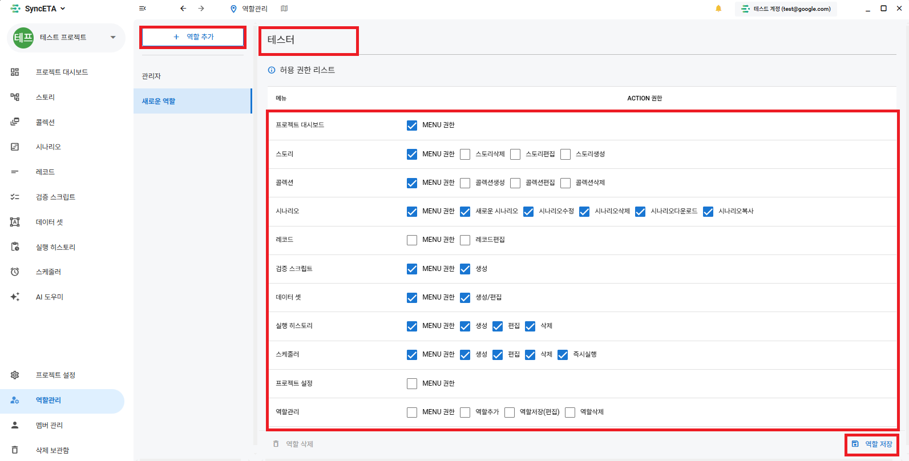

---

## 4. メンバー招待および権限割り当て

1. **メンバー招待画面への移動**: プロジェクト設定 -> **「メンバー管理」** メニューで **「メンバー招待」** ボタンをクリックします。
   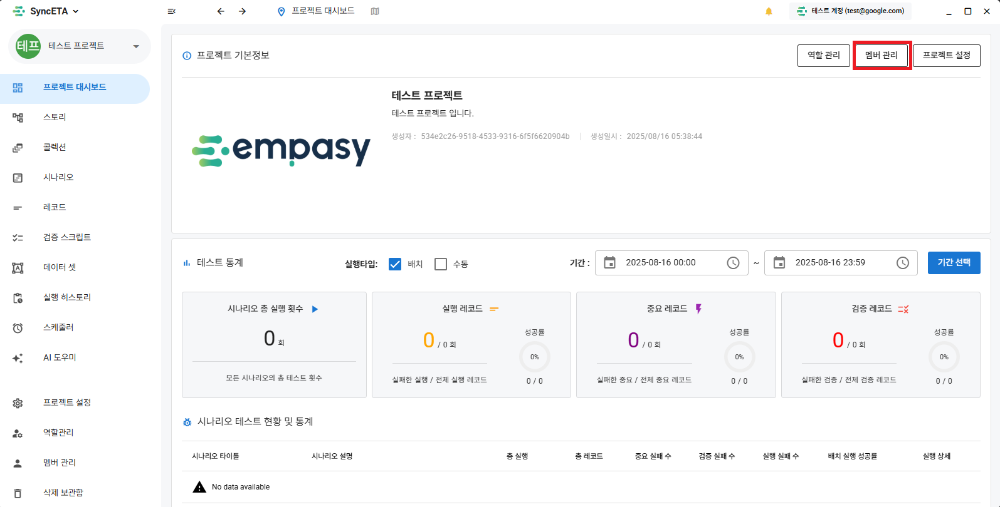
2. **招待対象の指定**: システムに登録されているユーザーのメールアドレスを検索して選択します。
   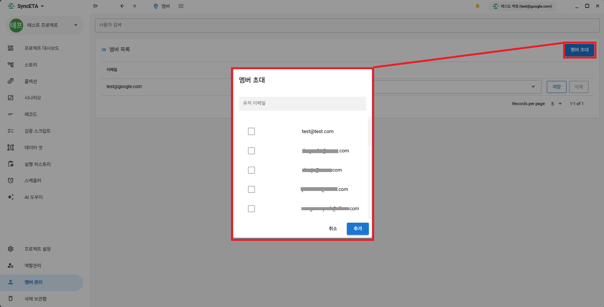
3. **ロールの割り当て**: 招待したユーザーにプロジェクト単位のロールを付与します。（同一ユーザーであっても、プロジェクトごとに異なるロールを付与できます。）
   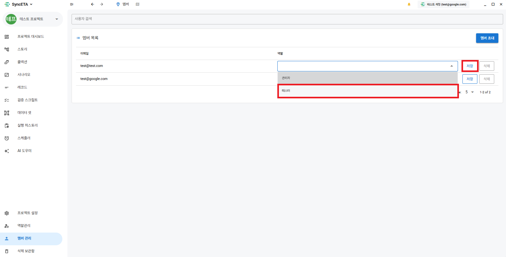
