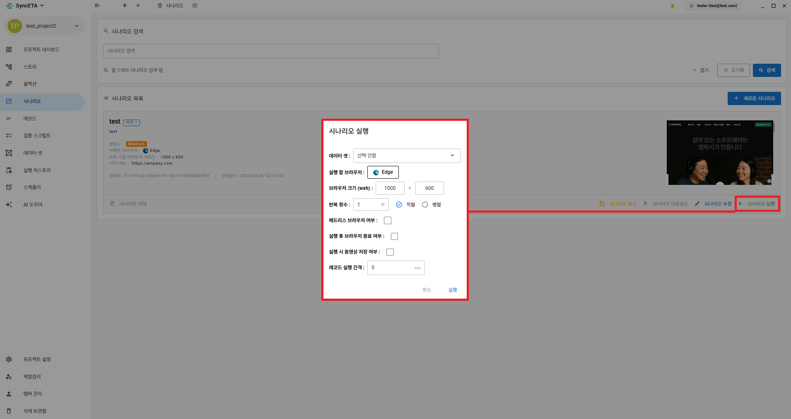
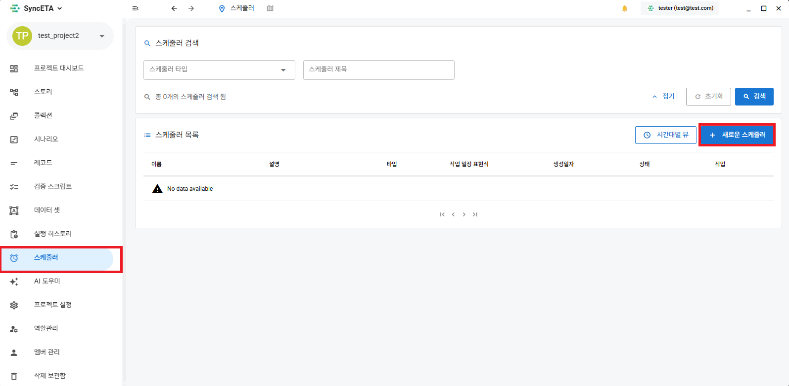
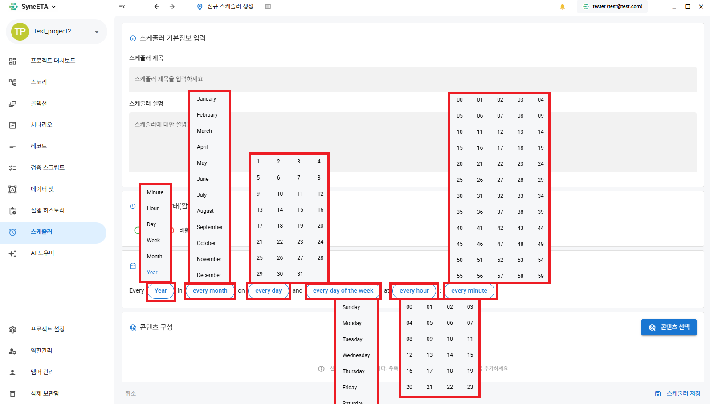
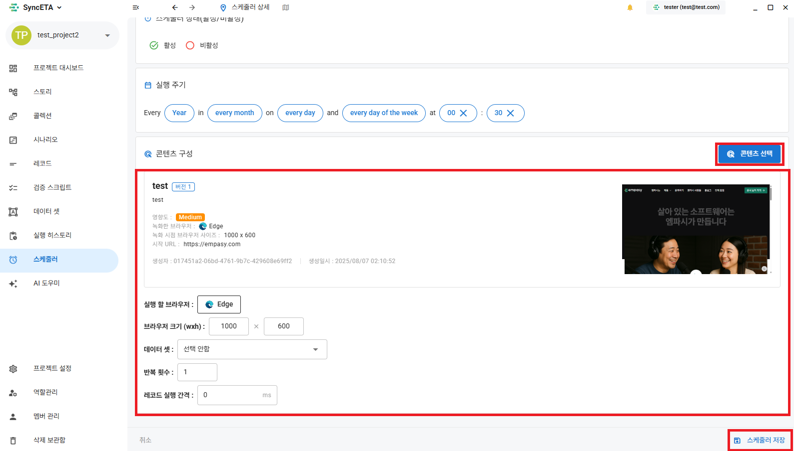
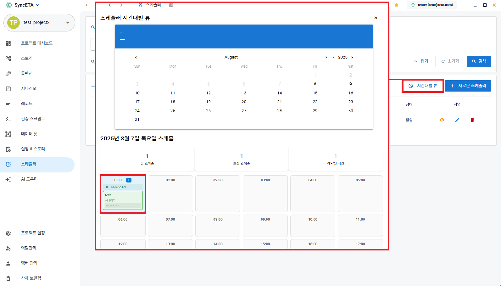

# シナリオ実行およびスケジューラー設定

SyncETA は、単一シナリオの即時実行から大規模なクロスブラウジング検証、時間帯別の自動回帰テストのためのスケジューラー機能までをサポートしています。

---

## 1. シナリオの直接実行（Direct Execution）

シナリオ詳細画面右上の **「実行」** ボタンをクリックすることで、テストを即座に起動できます。

### 主な実行オプション仕様

| 設定項目 | 説明 | デフォルト値 |
| :--- | :--- | :--- |
| **データセット（Data Set）** | テスト実行時に適用するデータセットを選択（変数置換） | 未適用 |
| **実行ブラウザ** | Chromium、Chrome、Microsoft Edge、Firefox、WebKit から選択 | Chrome |
| **ビューポートサイズ** | ブラウザの幅・高さの解像度を指定（レスポンシブテスト） | 1920x1080 |
| **反復実行方式** | **直列**: N 回順次反復実行 **並列**: N 個のブラウザインスタンスを同時起動して並列実行 | 直列 1 回 |
| **ヘッドレスモード（Headless）** | ブラウザ GUI ウィンドウを表示せず、バックグラウンドプロセスとして高速実行 | 無効 |
| **実行後のブラウザ終了** | テスト完了後にブラウザコンテキストを自動クリーンアップするかどうか | 有効 |
| **動画保存（Save Video）** | テスト実行の全過程を MP4 ビデオファイルとしてキャプチャ・保存 | 有効 |
| **ステップ間遅延時間（Step Delay）** | 各レコード実行間のデフォルト待機時間（ms）を設定 | 0ms |

---

## 2. スケジューラーによる定期自動実行

定期的な回帰検証（夜間ビルドテスト、定期デプロイ後のスモークテストなど）のために、Cron ベースのスケジューラーを設定できます。

### ステップ 1: スケジューラーメニューへの移動
左側サイドバーから **「スケジューラー」** メニューへ移動します。

### ステップ 2: 実行周期および時間帯の指定
毎日の特定時刻、毎週の特定曜日、または指定された分単位の間隔で実行周期を設定します。

### ステップ 3: 対象シナリオおよび実行パラメーターのマッピング
スケジュールに従って実行するシナリオ一覧とブラウザタイプ、解像度環境を指定します。

### ステップ 4: スケジュール登録内容および実行履歴の確認
登録されたスケジューラー一覧で、次回実行予定時刻および直近の実行成否をモニタリングします。

