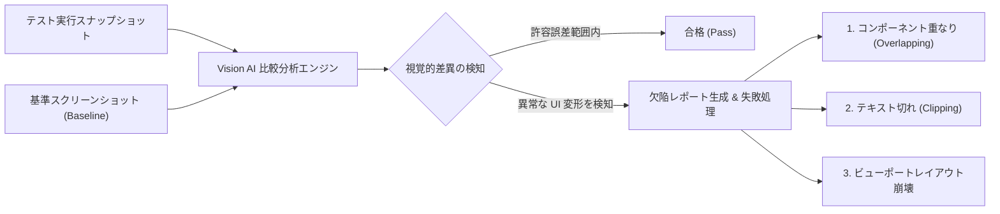
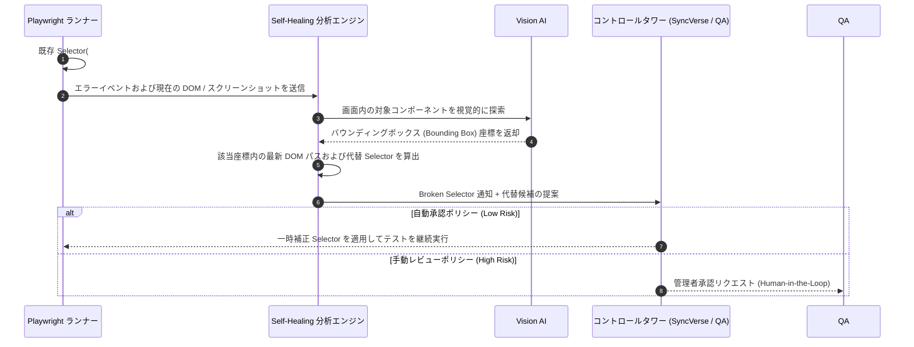

# 視覚的回帰検証およびセレクター自己修復

Web アプリケーションの継続的デプロイ環境では、DOM 構造の微細な変更や CSS レイアウトのずれによって既存のテストスクリプトが壊れたり（Flaky Test）、ユーザーの目にしか見えない UI 欠陥が発生しやすくなります。

SyncETA は、**Vision AI ベースの視覚検証**と**セレクター自己修復（Self-Healing）**パイプラインにより、これらの課題を体系的に解決します。

---

## 1. Vision AI ベースの視覚的回帰検証

従来の単純なピクセル一致（Pixel-by-Pixel Diff）方式では、ブラウザのフォントアンチエイリアシングや 1 ピクセルのレンダリング誤差でもテストが失敗してしまうという限界がありました。SyncETA は視覚認知ビジョンモデルを組み合わせ、実際のユーザーが認識するレベルの異常有無を判定します。

### 主な視覚検証項目
1. **コンポーネント重なり（Overlapping）**: バナーやポップアップレイヤーが決済・カートなどの主要ボタンを覆ってしまう現象を検知
2. **テキスト切れ（Clipping）**: レスポンシブ画面の切り替え時にボタンやラベルのテキストがボックス外へはみ出したり途切れたりする欠陥を検出
3. **領域マスキング（Ignored Regions）**: 現在時刻やリアルタイムバナー広告など、実行ごとに変化する動的領域を検証対象から除外

---

## 2. セレクター自己修復パイプライン（Self-Healing）

フロントエンドフレームワークのアップデートやクラス名の難読化（Webpack/Vite Hash）により既存の識別子（XPath/CSS Selector）が壊れた際、SyncETA は自動的に代替セレクターを探索して修復を提案します。

---

## 3. Human-in-the-Loop ガバナンス

SyncETA は、AI がテストコードを任意に改変することで発生し得る偽陽性（False Positive）を防ぐため、**管理者承認ガバナンス**を遵守します。

- **自己修復提案キュー（Healing Queue）**: 変更された UI 要素と提案された代替 XPath/Selector を管理者画面に一覧表示します。
- **Before/After 比較ビュー**: 以前のセレクターが指していた UI と現在提案されている UI をスクリーンショットで対比し、レビュー担当者がワンクリックで承認または却下できます。
- **承認履歴監査（Audit Log）**: セレクターの変更理由および承認者情報がシステムに永続記録され、テスト資産の整合性を維持します。
