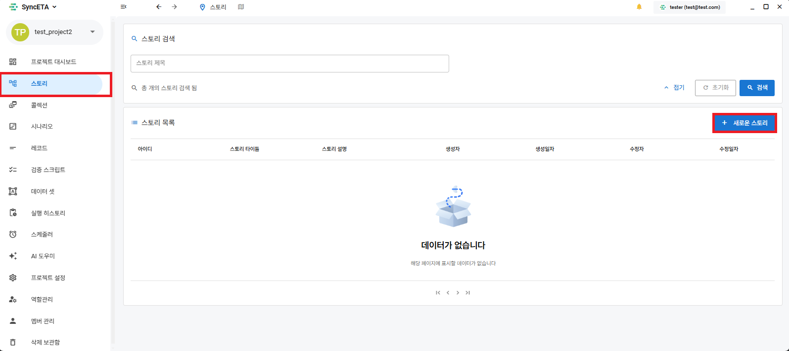
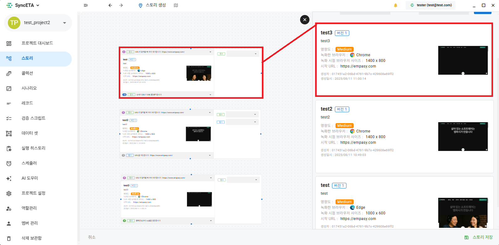
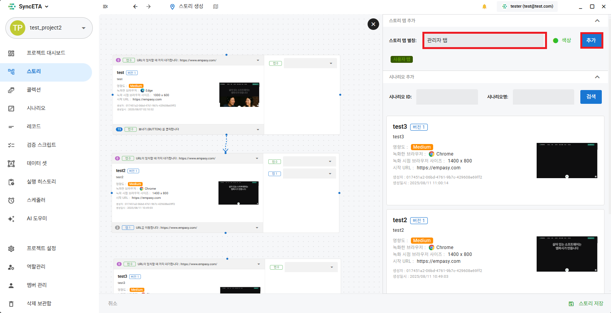
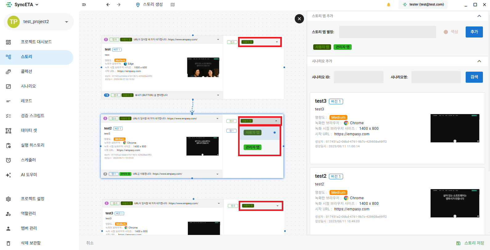
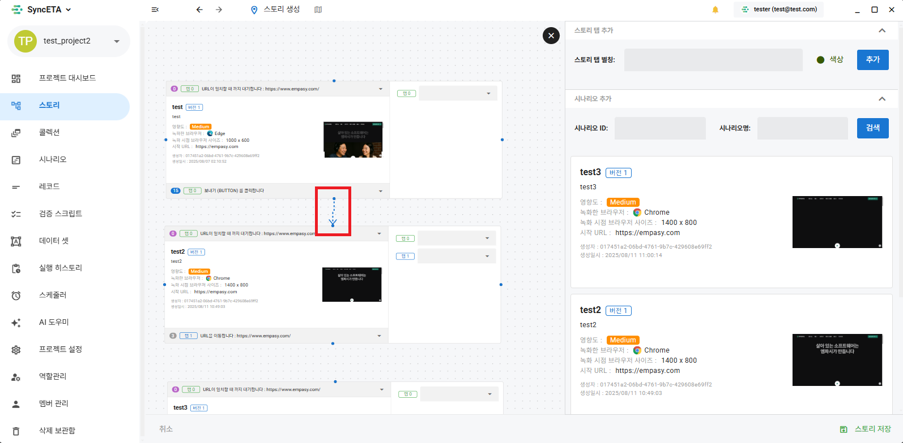
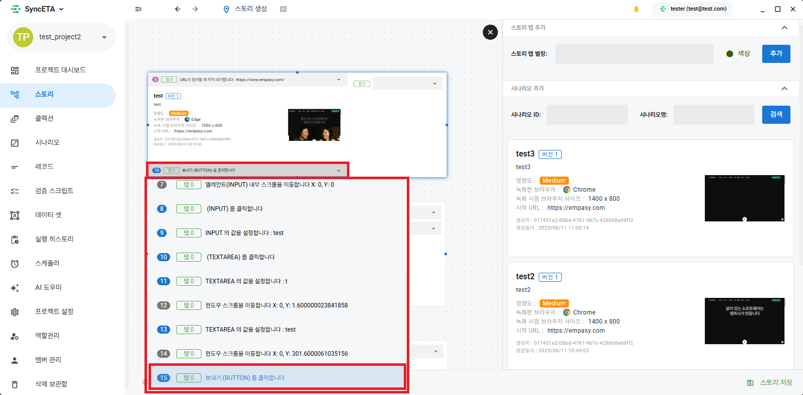

# ストーリーワークフロー（フローチャート連携）

**「ストーリー（Story）」**は、個別のシナリオを視覚的なフローチャート（Flowchart）形式で結合し、単一ブラウザセッションまたはマルチタブ環境で連続実行するための上位ワークフロー構成ツールです。

---

## 1. ストーリーの主な特徴

- **単一ブラウザコンテキストの維持**: セッション Cookie やログイン認証状態を維持したまま、複数のシナリオを段階的にチェイニングします。
- **マルチタブ別名（Tab Alias）制御**: 複数のタブやポップアップウィンドウが開く複合ビジネスフローにおいて、タブごとに別名を付与することで正確なタブへフォーカスを切り替えながらテストを継続します。
- **区間ごとの開始・終了レコード指定**: シナリオ全体のうち、必要な特定ステップ区間のみを選択的に連結できます。

---

## 2. ストーリー作成およびフローチャート構成手順

### ステップ 1: ストーリーメニューへの移動
左側サイドバーから **「ストーリー」** メニューをクリックし、新規ストーリーキャンバスを開きます。

### ステップ 2: キャンバスへのシナリオ配置
右側のシナリオドロワーから、ストーリーに含めるシナリオブロックをキャンバス中央へドラッグ＆ドロップします。

### ステップ 3: タブ別名（Tab Alias）の定義および適用
同一ブラウザ内でタブ間の切り替えが必要な場合、固有のタブ別名を作成して各シナリオノードにマッピングします。

### ステップ 4: シナリオノード間の接続線の作成
シナリオブロックの出力ポートと次のシナリオブロックの入力ポートをドラッグして接続し、実行順序を結合します。

### ステップ 5: 開始および終了レコード範囲の指定
各シナリオブロックをクリックし、実際の実行に含める開始レコードと終了レコードの範囲を微調整します。

