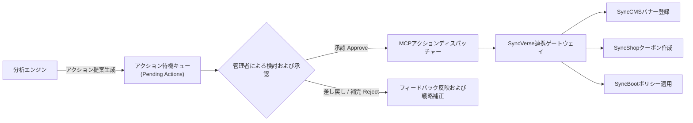
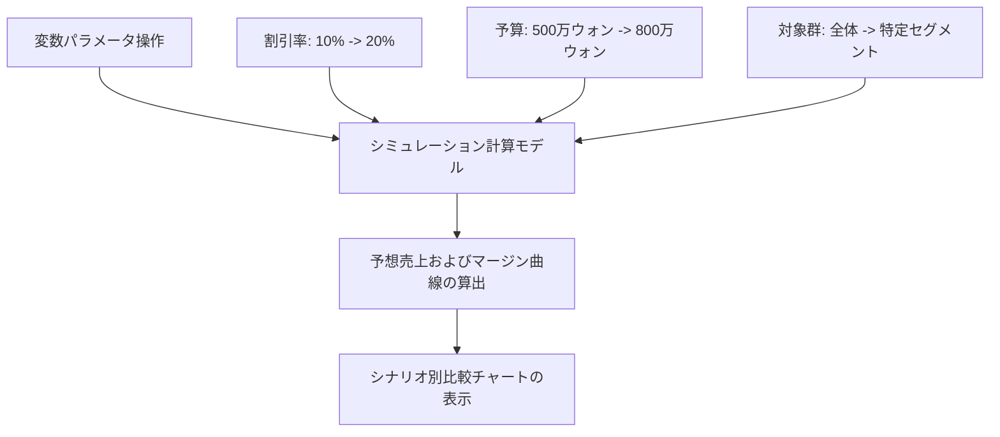
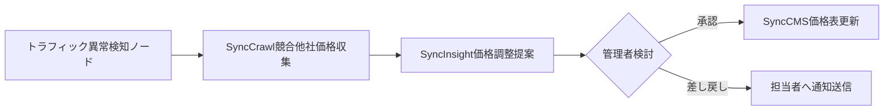

# 自律アクション承認およびWhat-Ifシミュレーター (Action Approval & Simulation)

データ分析の結果を実務へ適用するために、SyncInsightは**実行可能なアクションプランを導出**し、**事前シミュレーション（What-If）**によって検証したうえで、**管理者の承認を経て対象システムへ反映する（HITL Execution）**ワークフローを提供します。

---

## 1. 管理者参加型（HITL）アクション承認センター (SI-009)

運用の安定性を確保するため、SyncInsightは重要なシステム変更時に**管理者承認（Human-in-the-Loop）**の手順を経るように設計されています。

### 1.1. アクション承認カードの主な検討項目
* **Before vs After 比較**: 現在の設定値と変更後の設定値を並べて比較表示します。
* **リスクレベル (Risk Level)**:
  - `LOW`: 参照処理、単純なUI文言の変更
  - `MEDIUM`: ターゲティングバナーの公開、クーポン作成
  - `HIGH`: 全社価格ポリシーの変更、DBスキーマの修正（複数名による承認が必要）
* **期待効果 (Expected Lift)**: 注文コンバージョン率の変動幅、予想コスト削減額などの定量的な推定値を提示します。
* **ロールバック対応可否 (Rollback Support)**: 実行後に異常が発生した場合、元の状態へ復旧できる補償処理が定義されているかを明示します。

---

## 2. What-Ifシミュレーター (SI-010)

実際のシステムへ反映する前に、主要パラメータを変更して予想される指標の推移を事前にシミュレーションします。

* **パラメータスライダー**: 割引率、対象母数、プロモーション予算などを調整し、予想推移グラフをリアルタイムで再計算します。
* **シナリオ比較 (Scenario Comparison)**: 基本シナリオ、楽観シナリオ、保守シナリオを1つの画面上で比較検討できます。

---

## 3. ワークフロービルダー (SI-011)

多段階の業務パイプラインをノード（Node）接続方式で構成し、自動化できます。

* **データフロー監視**: ノード間のデータ受け渡し状況を視覚的に確認します。
* **段階別テスト**: 各ノードの入出力データを個別にテストおよびデバッグできます。

---

## 4. 緊急停止およびセーフガード

システム異常発生時にアクション実行を中断し、復旧できる安全管理機能を提供します。

1. **グローバル緊急停止 (Kill Switch)**: 緊急停止機能を有効にすると、待機中のすべての外部連携アクションが一時停止されます。
2. **履歴に基づく復旧 (Revert Action)**: アクション実行履歴画面から復旧機能を実行し、以前の設定状態へ戻すことができます。
3. **負荷ベースの遮断 (Load-based Throttling)**: サーバーリソースの負荷がしきい値を超過した場合、新規アクションリクエストをキューに保留します。
