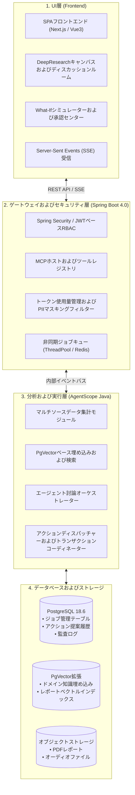
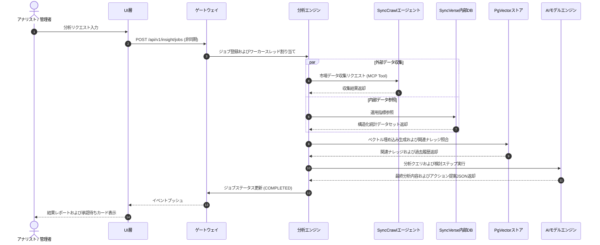

# システムアーキテクチャおよびMCP連携 (Architecture & Protocols)

SyncInsightは、マルチソースデータ処理、LLMベースの推論分析、および管理者承認に基づくアクション配信（Action Dispatching）を実行するため、3層（3-Layer）分散構造を採用しています。

---

## 1. 3層（3-Layer）システム構成



### 1.1. UI層 (Frontend)
- **リアクティブストリーミング**: LLMの分析プロセスとエージェント間の討論内容をServer-Sent Events（SSE）方式でリアルタイムに表示します。
- **ブロック単位のドキュメント編集**: 生成された分析レポートをブロック単位で確認し、直接編集できるインターフェースを提供します。
- **パラメータシミュレーション**: スライダーで変数を調整し、予測指標の変化を画面上で即座に確認できます。

### 1.2. ゲートウェイおよびセキュリティ層 (Spring Boot 4.0)
- **標準APIルーティング**: REST APIリクエストの処理、テナント分離、および細分化されたアクセス権限（RBAC）の検証を行います。
- **個人情報保護フィルター**: 外部または内部の分析エンジンへクエリが送信される前に、住民登録番号や連絡先などの主要な個人識別情報（PII）を検知してマスキング処理を行います。
- **FinOpsコントローラー**: ユーザーおよび部署別のトークン使用量を追跡し、事前設定されたポリシーに従って軽量モデルへの切り替えを支援します。

### 1.3. 分析および実行層 (Core Backend)
- **マルチソースデータ集計**: 内部運用ログ（SyncVerse）と外部市場収集データ（SyncCrawl）を連携させます。
- **PgVector RAGパイプライン**: テキストおよびログデータを埋め込みベクトル化し、類似度検索およびナレッジベース参照を実行します。
- **アクションディスパッチャー**: 管理者が承認したアクションをMCP（Model Context Protocol）仕様に合わせて対象システムへ送信します。

---

## 2. データ処理およびRAGパイプライン

SyncInsightのデータパイプラインは、構造化統計データと非構造化テキストデータを段階的に統合します。



---

## 3. Model Context Protocol (MCP) 連携仕様

SyncInsightは、他エージェントおよび外部ツールと連携するためにModel Context Protocol（MCP）をサポートしています。

### 3.1. 登録済みの主要MCPツール一覧

| ツール名 (MCP Tool) | 説明 | パラメータ例 |
| :--- | :--- | :--- |
| `insight_run_deep_research` | 自然言語プロンプトに基づくディープリサーチ非同期ジョブの開始 | `{"prompt": "下半期市場トレンド分析", "depth": "COMPREHENSIVE"}` |
| `insight_get_system_kpi` | 主要システム指標およびステータスの照会 | `{"target_metric": "REVENUE", "time_range": "LAST_7_DAYS"}` |
| `insight_simulate_what_if` | 変数変更に伴う期待効果のシミュレーション | `{"base_entity": "PROMOTION", "variables": {"discount_rate": 0.15}}` |
| `insight_dispatch_approved_action` | 承認済みアクションの対象エージェントへの送信 | `{"action_id": "b1eebc99-...", "approval_token": "AUTH_XYZ"}` |

### 3.2. アクション提案Payload構造 (JSON Schema)

```json
{
  "action_id": "b1eebc99-9c0b-4ef8-bb6d-6bb9bd380b22",
  "job_id": "a0eebc99-9c0b-4ef8-bb6d-6bb9bd380a11",
  "title": "サマープロモーションバナー掲載およびクーポン登録",
  "target_agent": "SyncCMS",
  "risk_level": "LOW",
  "expected_lift": "+18.5% 予想注文数増加",
  "payload": {
    "command": "PUBLISH_CAMPAIGN",
    "params": {
      "banner_title": "Summer Special Promotion",
      "target_route": "/events/summer-2026",
      "discount_coupon_code": "SUMMER_20",
      "discount_rate": 20,
      "auto_expire_dt": "2026-08-31T23:59:59Z"
    }
  },
  "rollback_strategy": {
    "can_rollback": true,
    "rollback_command": "UNPUBLISH_CAMPAIGN"
  }
}
```

---

## 4. データベーステーブル設計

PostgreSQL 18.6およびPgVector拡張を活用して、分析ジョブとアクション履歴を管理します。

```sql
-- 1. 分析ジョブ管理テーブル
CREATE TABLE analysis_jobs (
    job_id UUID PRIMARY KEY DEFAULT gen_random_uuid(),
    requester_id VARCHAR(100) NOT NULL,
    prompt TEXT NOT NULL,
    status VARCHAR(20) NOT NULL DEFAULT 'PENDING',
    report_s3_url VARCHAR(500),
    created_at TIMESTAMP NOT NULL DEFAULT CURRENT_TIMESTAMP,
    completed_at TIMESTAMP,
    CONSTRAINT chk_analysis_jobs_status CHECK (status IN ('PENDING', 'PROCESSING', 'COMPLETED', 'FAILED'))
);

-- 2. アクション提案および承認履歴テーブル
CREATE TABLE action_proposals (
    action_id UUID PRIMARY KEY DEFAULT gen_random_uuid(),
    job_id UUID NOT NULL,
    description TEXT NOT NULL,
    target_agent VARCHAR(50) NOT NULL,
    payload JSONB NOT NULL,
    status VARCHAR(20) NOT NULL DEFAULT 'PROPOSED',
    reviewed_by VARCHAR(100),
    updated_at TIMESTAMP NOT NULL DEFAULT CURRENT_TIMESTAMP,
    CONSTRAINT fk_action_proposals_job FOREIGN KEY (job_id) REFERENCES analysis_jobs(job_id) ON DELETE CASCADE,
    CONSTRAINT chk_action_proposals_status CHECK (status IN ('PROPOSED', 'APPROVED', 'REJECTED', 'EXECUTED'))
);

-- 3. エージェントメモリおよびナレッジテーブル
CREATE TABLE SYNCINSIGHT_AGENT_MEMORY (
    memory_id VARCHAR(100) PRIMARY KEY,
    agent_name VARCHAR(100) NOT NULL,
    memory_type VARCHAR(50) NOT NULL,
    context_key VARCHAR(100) NOT NULL,
    context_value TEXT NOT NULL,
    confidence_score DECIMAL(5,2) DEFAULT 1.0,
    is_hallucination BOOLEAN DEFAULT false,
    reg_dt TIMESTAMP NOT NULL DEFAULT CURRENT_TIMESTAMP
);
```

---

## 5. トランザクションロールバックおよび補償処理

SyncInsightで承認されたアクションが外部システムへ送信される際、エラーが発生した場合に備えて補償トランザクション（Sagaパターン）を構成できます。

1. **事前チェック (Pre-flight Validation)**: 対象エージェントの応答ステータスを確認します。
2. **順次実行 (Execution)**: アクションステップごとの結果を記録しながら処理を実行します。
3. **補償処理 (Compensating Transaction)**: 実行中に例外が発生した場合、または管理者が復旧を要求した場合、事前に定義された逆方向処理を実行して変更内容を以前の状態へ復旧します。
