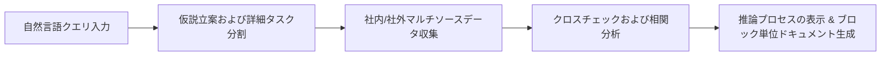
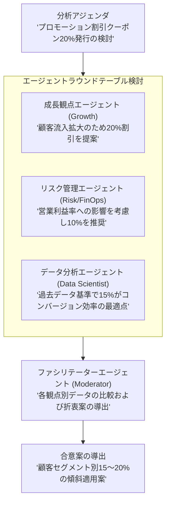

# ディープリサーチおよびエージェントラウンドテーブル討論 (Deep Research & Debate)

単純な質疑応答形式のAIは、偏った結論を下すおそれがあります。  
**SyncInsight**は多角的な分析を支援するため、**「Deep Research Engine」**と**「Agent Roundtable Debate」**機能を提供し、複数の視点からクロスチェックされた分析レポートを生成します。

---

## 1. DeepResearchキャンバス (SI-005)

ユーザーが入力した分析テーマ（「最近の20代顧客における決済離脱要因および競合他社への対応策分析」）に基づき、構造化された詳細レポートを作成します。

### 1.1. 主な機能
* **思考プロセス（Chain of Thought）の表示**: AIが設定した仮説、実行したSQLクエリ、参照したWebドキュメント一覧をタイムライン形式で確認できます。
* **ブロック単位のドキュメント編集**: 生成されたレポートの段落、表、チャートをブロック単位で移動または編集できます。
* **出典注釈 (Citation & Grounding)**: レポート内の主要な数値や分析結果に対して、元データのテーブルおよび出典リンクが脚注形式でマッピングされます。

---

## 2. エージェントラウンドテーブル：マルチペルソナ討論 (SI-006)

単一モデルによる分析バイアスを緩和するため、異なる分析基準を持つ複数のエージェントが検討討論を行います。

### 2.1. ラウンドテーブルの3段階進行プロセス
1. **意見提示 (Opening)**: 各エージェントが割り当てられた役割基準に沿ってデータ根拠を提示します。
2. **相互検討 (Cross-Examination)**: 相手エージェントのデータ解釈基準および前提条件を検証します。
3. **折衷案導出 (Consensus)**: ファシリテーターエージェントが各主張のデータ信頼度とリスク水準を総合し、バランスの取れた代替案をレポートへ反映します。

> [!NOTE]
> **管理者によるリアルタイム介入**:  
> 討論の進行中に管理者が優先条件（「今四半期は収益性の維持を最優先とする」）を入力すると、その内容が反映され、討論の方向性が補正されます。

---

## 3. コラボレーションキャンバスおよび決裁ルーム (SI-019)

意思決定権者と分析担当者がレポートを共同で確認し、承認手続きを進められるコラボレーション環境を提供します。

* **同時アクセスおよび注釈 (Annotation)**: 複数のユーザーがレポート内の特定段落にメモを残し、フィードバックをやり取りできます。
* **マルチシグネチャ (Multi-Signature) 決裁**: 社内の決裁規程に合わせ、マーケティング責任者と財務責任者の複数名による承認を経てアクションが送信されるよう構成できます。

---

## 4. オーディオブリーフィング (SI-013)

レポートの要点を素早く把握できるよう、2〜3分程度の音声要約ブリーフィング（Audio Briefing）に対応しています。

* **対話形式の要約ブリーフィング**: 主な論点と討論結果を問答形式で要約し、オーディオで再生します。
* **テキストスクリプト連携**: 音声の再生に合わせて、レポート内の該当箇所がハイライト表示されます。
* **チャプター別移動**: 背景説明、リスク要因、推奨事項など、任意の区間を選択して聴取できます。
