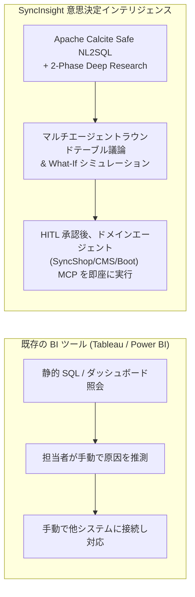

# SyncInsight エンタープライズ導入 FAQ

SyncInsight を全社的な意思決定インテリジェンスおよびデータ監視プラットフォームとして導入する際、アーキテクト、データエンジニア、セキュリティ担当者からよく寄せられる主要な質問と技術的回答です。

---

## 1. 既存 BI ツールとの差別化およびアーキテクチャ



### Q1. Tableau や Power BI がすでにあるのに、なぜ SyncInsight が必要なのですか？
- **回答**: 既存の BI ツールはすでに発生した過去のデータをチャートで可視化 (Descriptive Analytics) するにとどまり、指標低下の原因分析や解決策の導出、他システムへの反映は依然として担当者が手動で行う必要があります。
- 一方、SyncInsight は**社内 DB 指標と外部 Web 市場知識 (`SyncCrawl`) を結合する 2-Phase Deep Research**、**相反する視点 (成長・リスク・顧客体験) のマルチエージェントラウンドテーブル議論**、**What-If 事前損益シミュレーション**、そして管理者承認 (HITL) 直後に **Model Context Protocol (MCP) を通じてドメインシステム (`SyncShop`、`SyncCMS`、`SyncBoot`、`SyncOps`) へ実行戦略を自動反映し、スナップショットロールバックを保証する**エンドツーエンドの意思決定インテリジェンスプラットフォームです。

### Q2. 分析対象のデータソースとして、どのようなデータベースやストレージを接続できますか？
- **回答**: 全社標準である **PostgreSQL 18.6 (`pgvector`)** に加え、社内で稼働中の異種 RDBMS およびデータウェアハウスを読み取り専用コネクターで接続できます。

| データソース区分 | 対応エンジンおよびプロトコル | 主な連携方式およびセキュリティポリシー |
| :--- | :--- | :--- |
| **全社コア RDBMS** | PostgreSQL 18.6 (`pgvector`, `pg_trgm`) | Read Replica JDBC 接続、HNSW ベクトル検索およびセマンティック辞書の自動同期 |
| **基幹系エンタープライズ DB** | Oracle, Tibero, MySQL, MariaDB, MS SQL Server | 読み取り専用アカウント (`SELECT`-Only)、Apache Calcite 関係代数 AST ファイアウォールの適用 |
| **外部市場・非構造化知識** | `SyncCrawl` Web 収集パイプライン、S3 / MinIO ドキュメント | Markdown チャンキング後、`sync-module-rag` Tri-Hybrid RAG ナレッジベースを統合照会 |
| **リアルタイムストリーム & メトリクス** | Redis Stream, Prometheus, `SyncAPIM` トラフィック統計 | 異常兆候 (Anomaly Detection) のリアルタイム検知および RCA の自動トリガー |

---

## 2. データガバナンスおよび Safe NL2SQL セキュリティガードレール

### Q3. AI が自然言語クエリを SQL に変換する際、社内データベースを任意に修正したり過負荷障害を引き起こしたりするリスクはありませんか？
- **回答**: `sync-module-nl2sql` モジュールの **Apache Calcite 1.37.0 および JSqlParser 4.9 ベースの 4 重セキュリティファイアウォール**が、すべての自然言語生成 SQL を実行前に検証します。
  1. **Strict Read-Only AST 検証**: クエリ文字列を抽象構文木 (AST) としてパースし、`SELECT` 単一ステートメントのみを許可し、`INSERT`、`UPDATE`、`DELETE`、`DROP`、`ALTER`、`TRUNCATE`、`GRANT`、複数セミコロン (`;`) チェイニングをパーサーレベルで 100% 遮断します。
  2. **テナントおよび RBAC 行・列分離の自動注入**: 質問者のロール (`sys_role`) と所属テナント (`tenant_id`) 条件を AST の `WHERE` 句に強制注入し、給与や住民登録番号などの未認可機密カラムが参照された場合は即座に実行を拒否します。
  3. **クエリコストおよびタイムアウトガードレール**: デカルト積 (Cartesian Product) 結合やインデックスのない大容量フルスキャンを事前遮断し、最大実行タイムアウト (`10秒`) およびデフォルト結果行制限 (`LIMIT 1000`) を自動付与します。

```json
{
  "requestQuestion": "過去30日間でカテゴリ別の返品率が最も高い上位5商品と主な返品理由を照会してください",
  "validatedAst": {
    "statementType": "SELECT",
    "readOnlyVerified": true,
    "injectedTenantFilter": "tenant_id = 'empasy_prod'",
    "enforcedLimit": 1000,
    "timeoutMs": 10000
  },
  "generatedSql": "SELECT p.category_name, p.product_name, COUNT(r.return_id) AS return_cnt, ROUND(COUNT(r.return_id) * 100.0 / NULLIF(COUNT(o.order_id), 0), 2) AS return_rate FROM oms_order o JOIN pms_product p ON o.product_id = p.product_id LEFT JOIN oms_order_return r ON o.order_id = r.order_id WHERE o.tenant_id = 'empasy_prod' AND o.created_at >= CURRENT_TIMESTAMP - INTERVAL '30 days' GROUP BY p.category_name, p.product_name ORDER BY return_rate DESC LIMIT 5"
}
```

### Q4. 導出されたビジネスアクションが実運用システムに反映された後、予想と異なる結果が出た場合はどのように元に戻せますか？
- **回答**: SyncInsight が提案するすべてのドメイン変更アクション (`Action Proposal`) は、**HITL (Human-in-the-Loop) 管理者の事前承認**なしには絶対に自動執行されません。
- また、承認されて対象エージェント (`SyncShop`、`SyncCMS`、`SyncBoot`) の MCP ツールが呼び出される瞬間、変更直前状態の**アトミックデータスナップショット (`snapshotId`)** と補償トランザクション (`rollback_command`) が自動生成されます。管理者はアクション承認センターで **1-Click ロールバック**ボタンを押すことで、1 秒以内に直前の運用状態へ無損失で復旧できます。

---

## 3. オンプレミス閉域網デプロイおよび FinOps コスト統制

### Q5. 金融機関や公共機関のように外部インターネットが完全に遮断された閉域網 (Air-Gapped) 環境でも、ディープリサーチと NL2SQL は動作しますか？
- **回答**: はい、体系的に動作します。SyncInsight は外部クラウド SaaS への依存なしに社内 Kubernetes またはオンプレミスサーバーへコンテナとしてデプロイされ、社内 GPU サーバーに構築された**オンプレミス LLM (`vLLM` / `Ollama` ベースの Llama-3.3-70B、Qwen-2.5-72B など)** および **`SyncLLM` ゲートウェイ**と連携し、社内ネットワーク内部のみで安全に推論を実行します。

### Q6. 全社員が自然言語データ探索やディープリサーチを多用した場合、LLM トークンコストが急増しませんか？
- **回答**: すべての LLM 呼び出しは `SyncLLM` FinOps ゲートウェイを経由し、以下の 3 段階のコスト最適化ポリシーが標準で適用されます:
  1. **セマンティックキャッシング (Semantic Cache)**: 類似度 \(\ge 0.95\) 以上の反復的な指標クエリや日次ブリーフィング要求は、LLM の再推論を行わずにキャッシュされた SQL テンプレートおよび分析要約構造を再利用し、トークンコストを最大 45% 削減します。
  2. **タスク難易度別のモデルティアリング**: 単純な NL2SQL 変換やスマートシートのセル補助 (`Cell Copilot`) は軽量な Tier 1〜2 モデルで処理し、複合的なラウンドテーブル議論 (`Roundtable Debate`) のみを高性能な Tier 3〜4 モデルへ分岐します。
  3. **部門別の月間クォータガードレール**: 部門・プロジェクトごとの月間トークン予算の消化率に応じて、自動的な軽量モデルへのダウングレードおよび通知ポリシーが作動します。

---

## 4. 推奨インフラ仕様および標準 API エンドポイント概要

| 区分 | 項目 | 標準設定および仕様 |
| :--- | :--- | :--- |
| **コアバックエンドサーバー** | `sync-insight-server` | Java 25, Spring Boot 4.0, `AgentScope Java 2.0.2`, 4 vCPU / 8GB RAM 以上 |
| **データベース** | `PostgreSQL 18.6` | `pgvector/pgvector:pg18` (`vector`, `uuid-ossp`, `pg_trgm`), 6-File DB SSOT 標準 |
| **NL2SQL 安全エンジン** | `sync-module-nl2sql` | Apache Calcite 1.37.0 + JSqlParser 4.9 (`SELECT`-Only AST ファイアウォール、デフォルト `LIMIT 1000`) |
| **主要 REST API** | Canonical Prefix | `POST /api/v1/insight/nl2sql/query`<br>`POST /api/v1/insight/research/jobs`<br>`POST /api/v1/insight/debate/sessions`<br>`POST /api/v1/insight/actions/{actionId}/approve` |
| **MCP サーバーエンドポイント** | A2A ツール公開 | `POST /api/v1/insight/mcp` (`insight_run_deep_research`, `insight_simulate_what_if` など) |

### 4.1 What-If シミュレーション MCP ツール呼び出し例

```json
{
  "jsonrpc": "2.0",
  "id": "insight-sim-108",
  "method": "tools/call",
  "params": {
    "name": "insight_simulate_what_if",
    "arguments": {
      "baseEntity": "CATEGORY_PROMOTION",
      "variables": {
        "discountRate": 0.12,
        "minMarginGuardrail": 0.15
      }
    }
  }
}
```
