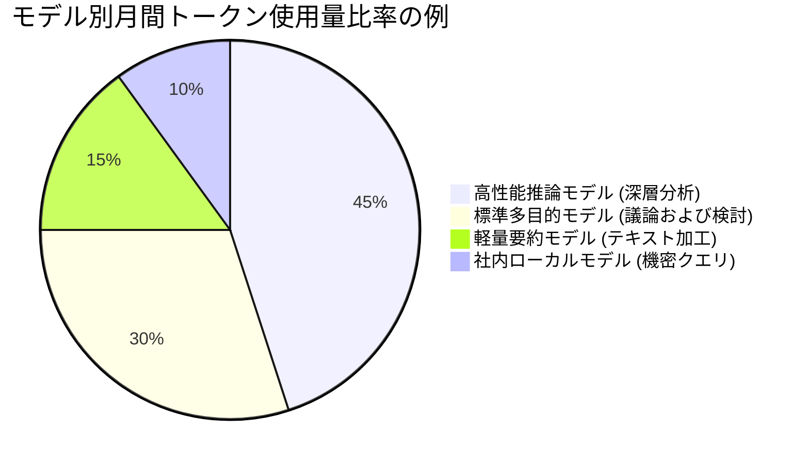
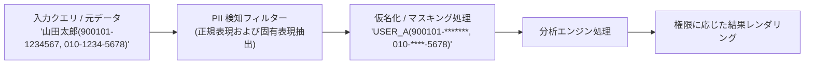
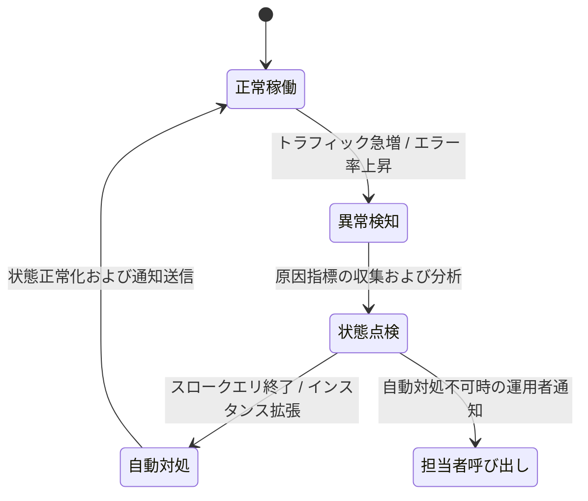

# AI FinOps、ガバナンスおよびシステム監視 (Security & FinOps)

生成 AI モデルを社内業務に導入する際に考慮すべき重要な要素は、**「LLM API トークンコストの管理」**と**「機密データ (PII) の保護」**です。  
**SyncInsight** は、エンタープライズ環境で AI を安定的かつコスト効率よく運用できるよう、**FinOps**、**個人情報ガードレール**、および**ガーディアンシステム監視**を支援します。

---

## 1. AI FinOps およびトークン使用量管理 (SI-004)

社内の部門およびエージェントが使用するモデル別のトークン使用量を集計し、予算範囲内で管理できます。

### 1.1. 主なコスト最適化方式
1. **モデル別分岐処理 (Model Routing)**:
   - 単純な要約やフォーマット変換タスクは軽量モデルへルーティングし、多者間議論やディープリサーチに高性能モデルを割り当てることでコストを調整します。
2. **セマンティックプロンプトキャッシング (Semantic Caching)**:
   - 同一または類似したクエリパターンに対してキャッシュされた結果を活用し、不要な重複呼び出しを削減します。
3. **部門別トークンクォータ (Quota) 設定**:
   - チームまたはプロジェクト単位で月間使用量の上限を設定し、しきい値に到達した際に通知を送信したり承認プロセスへ切り替えたりできます。

---

## 2. AI ガバナンスおよび個人情報 (PII) マスキング (SI-017)

機密性の高い顧客情報や社内データが外部モデルへ送信されないよう、事前フィルタリングを実行します。

* **自動 PII マスキング (Data Masking)**: 住民登録番号、電話番号、メールアドレス、口座番号などの主要な個人識別情報を検知し、識別不可能な形式へ置換します。
* **コンプライアンス点検**: 個人情報保護規制に基づくデータ処理履歴および監査ログを管理します。

---

## 3. ガーディアンモニターおよび自動対処 (SI-003)

システムおよびデータパイプラインの異常兆候を検知し、設定された復旧シナリオを実行します。

* **異常パターン検知**: 単純な CPU / メモリ使用率だけでなく、処理遅延時間やジョブ失敗率など主要な運用指標の変動をモニタリングします。
* **事前定義された復旧措置**: 遅延を引き起こすプロセスの終了、代替エンドポイントへの切り替えなど、準備されたシナリオに従って対処を実行します。

---

## 4. エージェント間通信ログおよびリプレイ (SI-018)

システム内のエージェント間で送受信された MCP リクエストおよびレスポンスログを記録します。

* **履歴照会および再現 (Log Replay)**: 特定の時点で発生したエージェント間のメッセージフロー (Request, Response, Payload) を順次確認します。
* **応答遅延分析**: 各区間ごとの処理時間を確認し、パフォーマンスのボトルネック箇所を把握できます。
