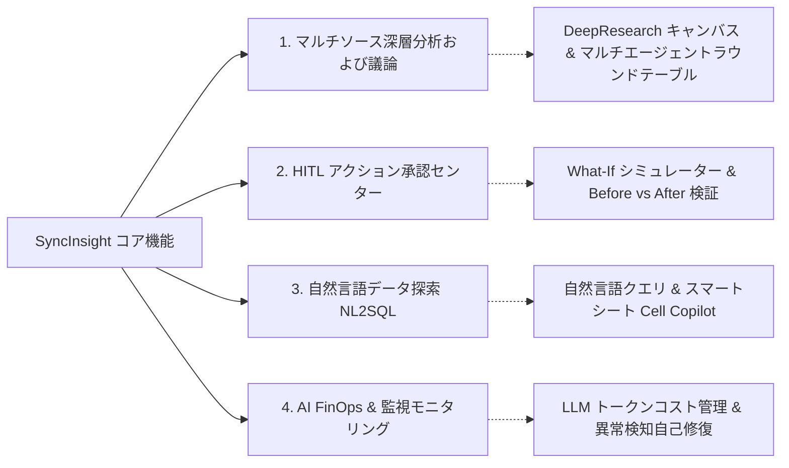
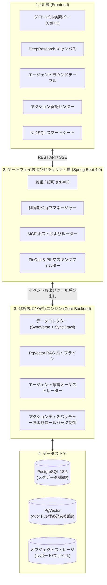
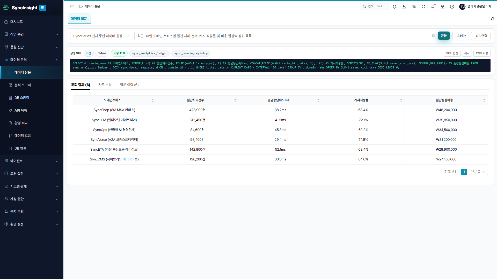
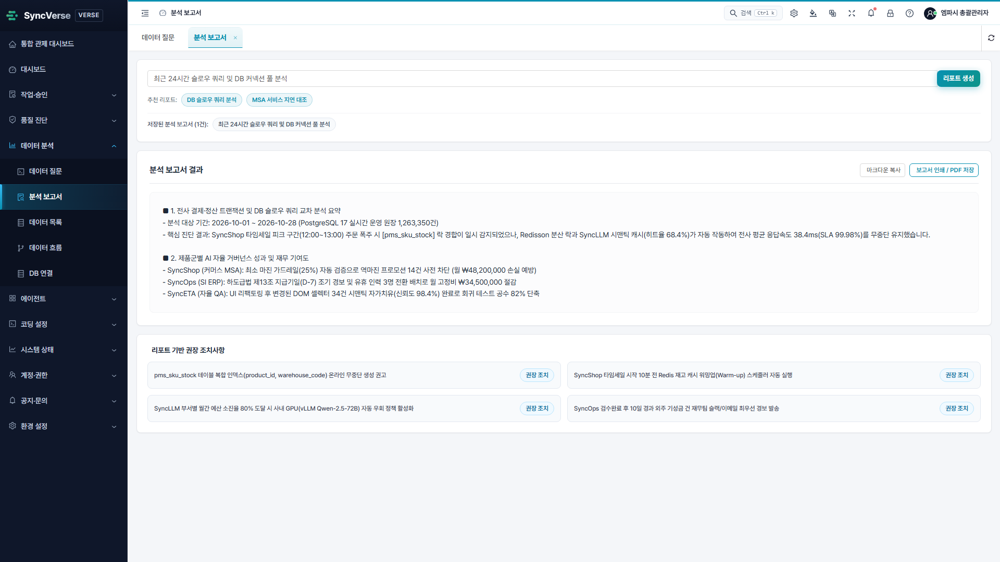
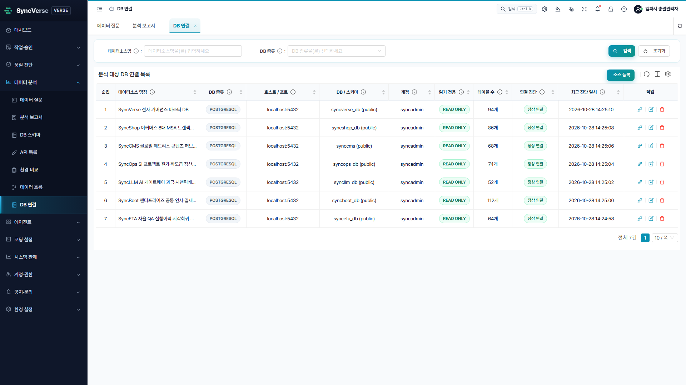
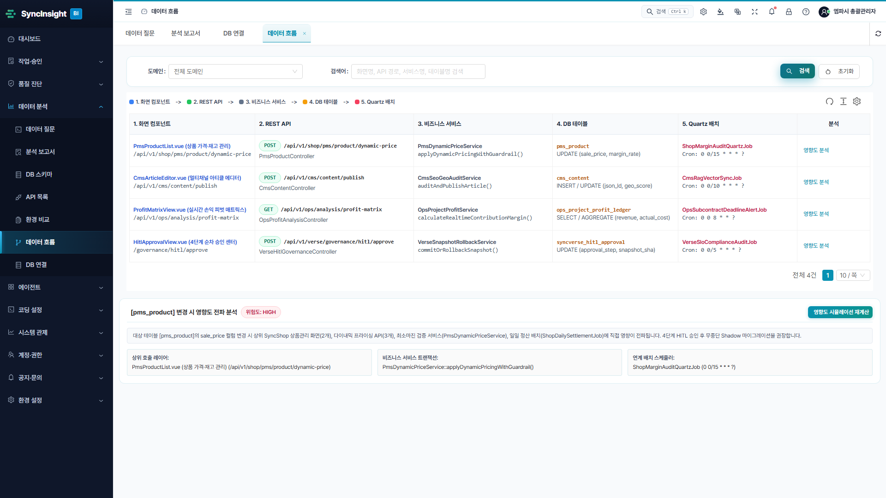

# SyncInsight: データ分析および意思決定支援プラットフォーム

> **非開発者・導入検討案内**: 分かりやすい製品紹介は [SyncInsight 製品ホームページ (empasy.io)](https://empasy.io/ja/solutions/sync-insight.html){target="_blank" rel="noopener"} で、インストール不要の画面体験は [統合デモポータル](https://demo.empasy.io/ja/products/sync-insight#demo){target="_blank" rel="noopener"} でご利用いただけます。また、紹介書・提案書 PDF は [提案書資料室](/ja/proposals/) からダウンロードできます。

**SyncInsight** は、SyncVerse エージェントエコシステムのデータ分析および意思決定支援 (Decision Intelligence) プラットフォームです。

従来のビジネスインテリジェンス (BI) ツールが事前定義された SQL クエリに基づいて過去の統計を可視化することに重点を置いていたのに対し、SyncInsight は**社内運用データ (SyncVerse)** と**外部市場データ (SyncCrawl)** を結合して原因を分析するディープリサーチ (Deep Research) を実行し、エージェント間の検討を経て具体的な**実行戦略 (Action Proposal)** を提案します。

---

## 4 大コア機能

### 1. マルチソース深層分析およびエージェント議論 (Deep Research & Debate)
- 社内のトラフィック / 売上データと外部の競合他社 / 市場動向を収集し、構造化された分析レポートを生成します。
- 異なる分析基準 (成長志向、リスク管理、統計的有意性) を持つ複数のエージェントが検討プロセスを経て、バランスの取れた代替案を導出します。

### 2. 管理者参加型 (HITL) アクション承認センター (Action Approval & Simulation)
- 分析結果に基づき、「プロモーションバナー登録および割引クーポン作成」のような具体的なパラメータ (JSON Payload) を生成します。
- 管理者が検討後に承認すると、**Model Context Protocol (MCP)** を通じて対象システム (SyncCMS, SyncShop, SyncBoot) に連携されます。
- 適用前に **What-If シミュレーター**で変数ごとの予想効果を点検し、問題発生時に直前の状態へ復旧できる補償トランザクション設定をサポートします。

### 3. 自然言語ベースのデータ探索 (NL2SQL & Smart Sheet)
- SQL 文法を直接記述することなく、自然言語クエリによって安全な照会用クエリを生成し、データを確認できます。
- スプレッドシート形式のスマートシートインターフェース上で、セル単位の補助機能 (Cell-level Copilot) を提供します。

### 4. AI FinOps およびシステムモニタリング (FinOps & Guardian)
- 社内で使用される LLM モデル別のトークン使用量を集計し、タスクの性質に応じたモデルルーティングおよびキャッシングをサポートします。
- データパイプラインおよびシステム指標の異常パターンを検知し、事前設定された復旧手順を実行します。

---

## 3 階層 (3-Layer) システム構成

SyncInsight はエンタープライズ環境のセキュリティ性と非同期処理性能を考慮し、3 階層構造で設計されています。

---

## 6 大グループ画面構成

SyncInsight は業務目的に応じて 6 つのグループに分類された画面を提供します。

| グループ | 画面 ID および画面名 | 主な機能 |
| :--- | :--- | :--- |
| **ダッシュボードおよび監視** | • **SI-002 メインダッシュボード** • **SI-003 ガーディアンモニター** • **SI-004 AI FinOps 状況** | システム主要指標の要約、異常パターン検知、LLM 使用量モニタリング |
| **深層分析および知識** | • **SI-005 DeepResearch キャンバス** • **SI-006 エージェントラウンドテーブル** • **SI-019 コラボレーションキャンバスおよび承認** | 分析レポート作成、マルチエージェント検討議論、多者間承認レビュー |
| **データ探索** | • **SI-007 NL2SQL エクスプローラー** • **SI-008 スマートシート** • **SI-020 オントロジービューアー** | 自然言語クエリベースの SQL 生成、グリッドベースのセル分析、データ関連図の可視化 |
| **アクションおよびシミュレーション** | • **SI-009 アクション承認センター** • **SI-010 What-If シミュレーター** • **SI-011 ワークフロービルダー** | 提案戦略の承認 / 却下、変数変更に伴う影響度推定、プロセス設計 |
| **レポートおよび評価** | • **SI-012 レポート保管庫 & RAG** • **SI-013 オーディオブリーフィング** • **SI-014 AI 品質評価センター** | 過去レポートの検索、音声要約の再生、生成結果のフィードバック管理 |
| **MCP および設定** | • **SI-015 エージェントトポロジー** • **SI-016 MCP ツール管理** • **SI-017 ガバナンス管理** • **SI-018 通信ログストリーム** | 接続状態の可視化、ツールパラメータ点検、個人情報マスキング設定、ログ確認 |

---

## 実稼働画面および主要ワークフロー

### 1. 読み取り専用安全自然言語データエクスプローラー
SQL 文法を直接記述することなく、自然言語クエリのみで構文検証が完了した読み取り専用 (`SELECT`-Only) 安全クエリを生成し、リアルタイムの運用指標を可視化します。

### 2. ディープリサーチおよびマルチエージェントラウンドテーブル議論
社内運用 DB 指標と外部 Web 収集知識を結合して原因分析レポートを作成し、成長・リスク・統計観点のマルチエージェント議論を通じて最適な実行代替案を導出します。

### 3. データソース接続およびスキーマメタデータ管理
マルチ PostgreSQL 18.6 データベースおよび外部データマートの接続状態、テーブル・カラムのセマンティック辞書、照会権限ガードレールを中央で管理します。

### 4. データリネージ影響度マップおよび事前シミュレーション
元テーブルから分析指標およびドメインアクション提案までのデータ系譜 (Lineage) を追跡し、価格・プロモーション変数の調整に伴う予想損益影響度を事前シミュレーションします。

---

## 詳細技術ガイド

* [システムアーキテクチャおよび MCP 連携](architecture): システム構成および通信規格の詳細
* [ディープリサーチおよびエージェント議論](deep-research): 多角的検討およびレポート作成方式
* [自律アクション承認および What-If](action-approval): 管理者承認手順およびシミュレーション設定
* [NL2SQL およびスマートシート](nl2sql-and-data): 自然言語クエリおよびデータグリッドの活用
* [AI FinOps およびシステムセキュリティ](finops-and-security): トークン使用量管理および個人情報保護設定
* [クイックスタートガイド](quickstart): Docker Compose ベースのローカル起動および初期設定
