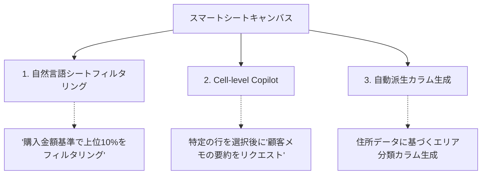

# NL2SQL ポータルおよびスマートシートデータエクスプローラー (Data Exploration)

データを照会・分析するために SQL クエリを直接記述することが難しい環境でも、**SyncInsight** は自然言語をデータベース照会文に変換する **'NL2SQL Portal'** と、スプレッドシート形式の **'Smart Sheet Canvas'** を通じて効率的なデータ探索を支援します。

---

## 1. NL2SQL ポータルエクスプローラー (SI-007)

自然言語で質問を入力すると、事前に登録されたスキーマ情報に基づいて照会用 SQL 構文を生成し、結果を画面に表示します。

### 1.1. 3分割画面レイアウト構成
1. **上部クエリエリア**: ユーザーの自然言語プロンプト入力およびよく使われるサンプルクエリチップを提供します。
2. **左側 SQL 検証エリア**: 生成された SQL 構文、実行計画（Explain Plan）、クエリの詳細条件の説明を確認できます。
3. **右側データ可視化エリア**: 照会結果をレスポンシブグリッドおよびチャート（棒グラフ、折れ線グラフなど）で可視化します。

### 1.2. クエリ安全性検証基準
* **読み取り専用制限 (Read-Only Enforcement)**: `SELECT` 構文のみを許可し、`INSERT`、`UPDATE`、`DELETE`、`DROP` などのデータ変更・削除構文は実行されません。
* **取得件数制限 (Limit Protection)**: 大量データの照会によるデータベース負荷を防ぐため、デフォルトの `LIMIT` 設定が適用されます。
* **パラメータバインディング**: 動的バインディング方式を適用して SQL インジェクションを防御します。

---

## 2. スマートシートキャンバス (SI-008)

スプレッドシート形式のグリッド環境でデータ分析および加工作業を実行できます。

### 2.1. 主な機能
* **自然言語シートフィルター**: 条件フィルタリング画面を複雑に設定することなく、「成長率が前月比で低下した項目のみ表示」といったコマンドでデータをフィルタリングします。
* **セル単位 AI アシスト (Inline Cell Copilot)**: 特定のセルや行を選択して加工を指示すると、行全体の文脈を考慮して要約、分類、感情分析の結果を入力します。
* **ファイルエクスポート**: 作業したデータを CSV または Excel 形式でダウンロードできます。

---

## 3. データコンテキストおよびオントロジービューア (SI-020)

主要データベーステーブル間の関連関係と出所をナレッジグラフ形式で可視化します。

* **データリネージ (Data Lineage) 追跡**: 特定の指標やカラムがどのソーステーブルから生成・加工されたのかを段階別の履歴で追跡できます。
* **オントロジーマップ**: ビジネスドメインエンティティ（会員、注文、商品など）間の接続構造を可視化し、データ整合性を点検できます。
