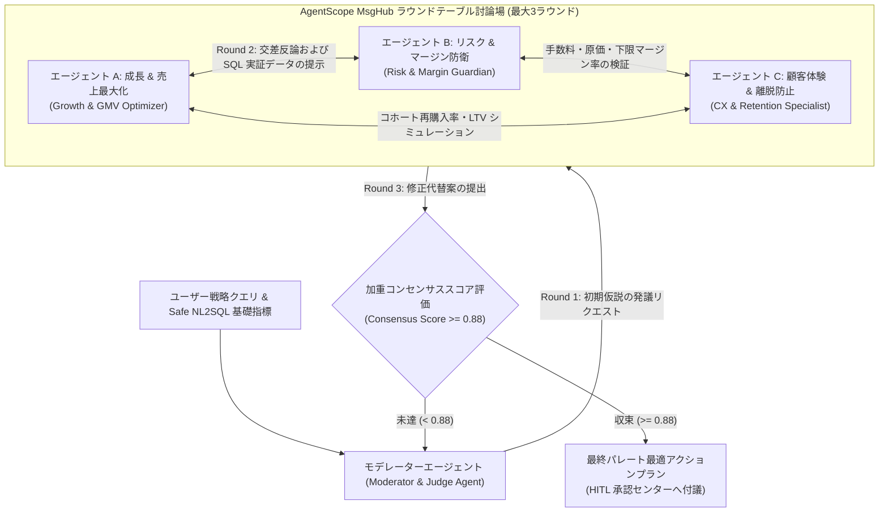

# SyncInsight ラウンドテーブルエージェント討論 (Multi-Agent Roundtable Debate)

## 1. 多角的合意メカニズム (Roundtable Consensus)

単一 LLM による単発の分析結果は、ハルシネーション（Hallucination）や特定のプロンプトバイアス（Confirmation Bias）の影響を受けやすく、エンタープライズの重要意思決定（価格の引き上げ・引き下げ、プロモーション予算の執行、リソース再配置など）に単独で使用することは困難です。

`SyncInsight` はこの課題を解決するため、**`AgentScope Java` (`io.agentscope:agentscope-harness:2.0.2`) の `MsgHub` マルチエージェントブロードキャストバス** 上で、相反する目的関数を持つ複数の専門分析エージェントが交差検証を行い合意案を導出する **ラウンドテーブル討論 (Roundtable Debate) エンジン** を運用しています。



---

## 2. ペルソナ別目的関数および評価ウェイト構成

討論に参加する各エージェントは同一のソースデータ（`SyncInsight` Safe NL2SQL 照会結果および `SyncCrawl` 外部市場ナレッジ）を共有しつつ、異なる評価指標と制約条件を付与されて討論に参加します。

| エージェント役割 (`personaCode`) | コア目的関数 (Objective) | 主な参照データおよび検証制約条件 | デフォルト合意ウェイト |
| :--- | :--- | :--- | :---: |
| **`GROWTH_OPTIMIZER`**<br>(成長 & 売上エージェント) | 総取引額 (GMV)、新規流入トラフィック、コンバージョン率 (CVR) の最大化 | • カテゴリ別クリック率・カート転換率の推移<br>• 競合他社プロモーション価格指数 (`SyncCrawl`) | `0.35` |
| **`MARGIN_GUARDIAN`**<br>(リスク & マージンガーディアン) | 貢献利益率の防衛、逆ザヤの事前遮断、予算上限の遵守 | • SKU 別仕入原価および最低保証マージン率 (`>= 15%`)<br>• プロモーションクーポン予算上限および在庫回転率 | `0.40` |
| **`CX_RETENTION_EXPERT`**<br>(顧客体験 & リテンションエージェント) | 既存 VIP 顧客の価格不公平感防止、返品率の抑制、LTV 向上 | • 直近30日間の購入者コホート再訪問率<br>• 急激な価格変動時におけるクレーム・キャンセル率の相関 | `0.25` |
| **`MODERATOR_JUDGE`**<br>(モデレーター & 判定エージェント) | ラウンド別論点の要約、事実根拠 (SQL) 検証、最終合意案の導出 | • エージェントの主張に実際の DB クエリ根拠がない場合は棄却<br>• パレート最適 (Pareto Optimal) パラメータの収束判定 | 総括仲介 |

---

## 3. 3段階討論収束アルゴリズムおよび数式

1. **第1段階 — 初期仮説の発議 (Round 1: Hypothesis Proposal)**:
   - 各エージェントが自身の目的関数に最適化された実行パラメータ（例: `GROWTH_OPTIMIZER` は `割引率 20%`、`MARGIN_GUARDIAN` は `割引率 8%`）とそれを裏付ける SQL 統計指標を発議します。
2. **第2段階 — 交差反論および反証 (Round 2: Cross-Examination)**:
   - `MsgHub` を通じて他エージェントの提案を受信した後、自身の制約条件に抵触するリスク（例: `"割引率 20% を適用すると下位14 SKU でマージン率が 9.2% に低下し、最低マージンガードレール 15% に違反する"`）を定量データで反論し、代替条件を提示します。
3. **第3段階 — 加重コンセンサススコア算出および収束 (Round 3: Weighted Consensus Scoring)**:
   - モデレーターエージェントが各代替案の期待効果とリスク防衛率を総合し、コンセンサススコア \(S_{\text{consensus}}\) を算出します。
     \[
     S_{\text{consensus}} = \sum_{i \in \{A,B,C\}} w_i \cdot U_i(\theta) - \lambda \cdot \text{Penalty}_{\text{constraint}}(\theta)
     \]
   - コンセンサススコアが設定しきい値（`0.88`）以上に達すると討論を終了し、最終アクションカード（`Action Proposal`）を発行します。

---

## 4. ラウンドテーブル討論 REST API およびストリーミングペイロード

ラウンドテーブル討論は `/api/v1/insight/debate/sessions` エンドポイントを通じて実行され、各ラウンドの発言とコンセンサススコアは Server-Sent Events (SSE) によってフロントエンドキャンバスへリアルタイム中継されます。

### 4.1 討論セッション開始リクエスト (`POST /api/v1/insight/debate/sessions`)

```json
{
  "topic": "秋シーズンアウターの在庫消化および貢献利益防衛のための最適プロモーション設計",
  "targetDomain": "SYNC_SHOP",
  "maxRounds": 3,
  "consensusThreshold": 0.88,
  "constraints": {
    "minMarginRate": 0.15,
    "maxBudgetKrw": 25000000
  }
}
```

### 4.2 討論完了および最終合意アクションレスポンス例

```json
{
  "sessionId": "deb-20261118-042",
  "status": "CONSENSUS_REACHED",
  "completedRounds": 3,
  "consensusScore": 0.924,
  "transcriptSummary": [
    {
      "round": 1,
      "speaker": "GROWTH_OPTIMIZER",
      "claim": "全品目20%一律タイムセール時の予想注文件数 +34.2% 増加",
      "evidenceSqlId": "sql-ev-101"
    },
    {
      "round": 2,
      "speaker": "MARGIN_GUARDIAN",
      "claim": "全品目20%割引時は低マージン SKU 18種が最低マージン率 (15%) 未達。在庫滞留日数45日以上の品目に限り12%割引 + VIP 3%追加クーポンの組み合わせへ修正提案",
      "evidenceSqlId": "sql-ev-104"
    },
    {
      "round": 3,
      "speaker": "MODERATOR_JUDGE",
      "claim": "滞留在庫ターゲット12%割引案により全体の貢献利益 +14.8% 改善および最低マージン率 17.4% 保全で合意完了",
      "consensusScore": 0.924
    }
  ],
  "proposedAction": {
    "targetAgent": "SYNC_SHOP",
    "mcpTool": "shop_batch_price_update",
    "requiresHitlApproval": true,
    "arguments": {
      "action": "BATCH_UPDATE_PRICE",
      "categoryId": 104,
      "rate": 0.88,
      "minInventoryDays": 45
    }
  }
}
```
