# SyncLLM システムアーキテクチャ

SyncLLM は、すべてのクライアントリクエストが外部 LLM プロバイダーへ転送される前とレスポンスが返却された後を制御する **4 階層インラインパイプライン (Inline Pipeline)** として設計されています。

---

## パイプライン構造図

```mermaid
flowchart LR
    subgraph Layer1 ["1. Ingress Gateway Layer"]
        direction TB
        API["OpenAI 互換 API エンドポイント
/v1/chat/completions"]
        Auth["API Key 認証 & テナント識別"]
        RateLimit["トークンバケット型レートリミッター"]
    end

    subgraph Layer2 ["2. Security Guardrail Layer"]
        direction TB
        PIIFilter["PII Regex / NER マスキング"]
        InjectionDetect["Prompt Injection 防御"]
        SchemaValidate["入力 JSON スキーマ検証"]
    end

    subgraph Layer3 ["3. Semantic Cache & Routing"]
        direction TB
        Embedding["軽量テキスト埋め込み生成"]
        VectorSearch["Vector DB コサイン類似度検索"]
        ModelRouter["インテント／コストベースモデルルーター"]
    end

    subgraph Layer4 ["4. FinOps & Provider Adapter"]
        direction TB
        Adapter["OpenAI / Anthropic / vLLM アダプター"]
        CostCalculator["リアルタイムトークンコスト精算"]
        AuditLog["監査ログおよびメトリクス送信"]
    end

    Layer1 --> Layer2 --> Layer3 --> Layer4
```

---

## 階層別の詳細説明

### 1. Ingress Gateway Layer
- **OpenAI 規格への完全互換**: `/v1/chat/completions`、`/v1/embeddings` の標準インターフェースを提供しており、既存のアプリケーションコードを変更することなく Base URL のみを変更して即座に導入できます。
- **マルチテナント認証とアクセス制御**: 組織 (Org)、プロジェクト (Project)、サービスアカウント (SA) 単位で API Key を発行し、きめ細かな権限を制御します。
- **適応型トラフィックスロットリング**: 秒間リクエスト数 (RPS) および分間トークン数 (TPM) に基づき、クライアントからの過度なバーストリクエストを制御します。

### 2. Security Guardrail Layer
- **事前 PII マスキング (Pre-Request Masking)**: リクエストプロンプトが外部クラウドへ送信される前に、メモリ上で住民登録番号・個人識別番号、電話番号、カード番号、社内パスワードなどを `[REDACTED_PII]` 形式に置換します。
- **逆方向復元 (Post-Response Re-hydration)**: モデルのレスポンスにマスクされたトークンのコンテキストが必要な場合、安全なセッションストアに一時保管された識別子をマッピングしてクライアントへ返却します。
- **プロンプトインジェクションガード**: システムプロンプトの奪取やガードレール回避 (Jailbreak) パターンを検知し、不正なリクエストを即座に遮断します。

### 3. Semantic Cache & Routing Layer
- **セマンティック埋め込み検索**: 高速な埋め込みモデルを通じて入力プロンプトの意味的ベクトルを抽出し、類似度しきい値 (\(\ge 0.95\)) 以上の既存 Q&A が存在する場合、外部 API を呼び出すことなくキャッシュを返却します。
- **タスク複雑度分類 (Task Complexity Classifier)**:
  - 単純分類、フォーマット整形、翻訳、文法校正: コストパフォーマンスに優れた軽量モデルへルーティング。
  - 高難度な数学、多段階の論理推論、複雑なアーキテクチャコードの記述: 最高性能のフラッグシップモデルへルーティング。

### 4. FinOps & Provider Adapter Layer
- **動的プロバイダーアダプター**: 各 LLM プロバイダー独自の API フォーマット (Anthropic Messages API、Google Vertex AI、vLLM ローカルエンドポイント) を標準規格へ自動変換します。
- **リアルタイムトークン元帳 (Real-time Token Ledger)**: Prompt Tokens、Completion Tokens、Cached Tokens をモデル別の料金レートに応じてリアルタイムでコスト ($) へ換算し、データベースに記録します。
- **自動フェイルオーバー (Automatic Failover)**: プライマリプロバイダーの 5xx 障害または 429 Rate Limit が発生した際、同一ティアのバックアッププロバイダーへ数ミリ秒以内に透過的にリクエストを再試行します。
