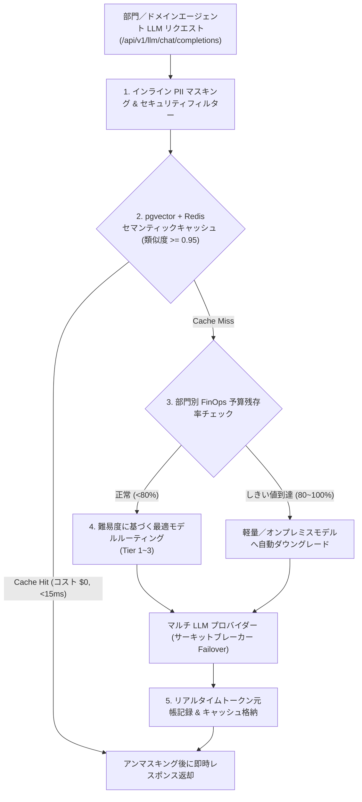

# SyncLLM エンタープライズ導入 FAQ

全社 AI モデルゲートウェイおよび FinOps コスト統制プラットフォームである `SyncLLM` を導入する際、インフラアーキテクト、情報セキュリティチーム、財務・購買部門から頻繁に寄せられる主要な質問と技術仕様です。

---

## 1. コスト削減および FinOps 予算統制



### Q1. セマンティックキャッシュ (Semantic Cache) を導入すると、実際にコストはどのくらい削減されますか？
- **回答**: エンタープライズ社内業務アシスタント、技術ドキュメント検索 (RAG)、自動回帰テスト (`SyncETA`)、反復コード分析など定型化されたクエリが頻繁に発生する環境では、**平均 35% ~ 55% の LLM API トークンコスト削減**が実測されています。
- `SyncLLM` のセマンティックキャッシュは単純な文字列一致ではなく、**PostgreSQL 18.6 `pgvector` HNSW インデックスと Redis インメモリキャッシュ**を組み合わせて埋め込みベクトルのコサイン類似度 (デフォルトしきい値 \(\ge 0.95\)、ドメインごとに調整可能) を基準に判定するため、語尾や助詞、文の語順が多少異なっていても検証済みのキャッシュレスポンスを即座に返却します。

### Q2. 部門別の月間予算上限を超過した場合、業務用の AI サービスは即座に停止しますか？
- **回答**: デフォルトポリシーはビジネスの継続性を保証する**段階別ソフトガードレール (Graduated Soft-Limit)** として動作し、部門別ポリシー (`llm_budget_policy`) に応じて精密に設定できます。

| 予算消化区間 | ゲートウェイ自動制御動作 | 通知およびガバナンス措置 |
| :--- | :--- | :--- |
| **正常区間 (`0% ~ 79%`)** | リクエストされたモデル Tier またはインテリジェントルーターが選択した最適モデルをそのまま呼び出し | リアルタイムトークン元帳 (`llm_usage_ledger`) への記録 |
| **注意区間 (`80% ~ 94%`)** | 一般的な要約・分類リクエストを高機能商用モデルから軽量モデル (Tier 1) へ自動切り替え | 部門管理者および PMO へ Slack／メールで予算警告を送信 |
| **上限到達 (`95% ~ 100%`)** | 外部有料商用 API の呼び出しを遮断し、**社内オンプレミス vLLM モデル (限界費用 0 円) へ 100% 自動フォールバック** | `hardLimitEnabled: true` 設定時のみ `429 Too Many Requests` (RFC 7807) を返却 |

---

## 2. セキュリティおよび個人情報 (PII) 非識別化ガードレール

### Q3. 外部商用 LLM (OpenAI, Anthropic, Google) の呼び出し時、社内の顧客個人情報や機密コードが漏洩しませんか？
- **回答**: `SyncLLM` のインラインセキュリティパイプラインが、外部ネットワークへパケットが送出される直前にリクエストペイロードをインターセプトし、以下の二重保護を実行します:
  1. **双方向可逆 PII トークン化 (Reversible Tokenization)**: 住民登録番号、外国人登録番号、携帯電話番号、クレジットカード番号、口座番号、メールアドレス、社内 API シークレットキー (`sk-...`, `Bearer ...`)、JWT トークンなどを正規表現および NER フィルターでリアルタイムに検知し、`<PII_PHONE_01>`、`<PII_ACCOUNT_01>` 形式の使い捨てプレースホルダーに置換したうえで外部 LLM へ送信します。
  2. **インメモリ・アンマスキング (Unmasking) および Zero-Retention 監査**: 外部 LLM からレスポンスが返却されると、ゲートウェイメモリ内の隔離されたセッションマッピングテーブルを通じて元の値へ復元してクライアントに引き渡すため、外部 LLM ベンダーの学習データやログに機密情報が露出することは一切ありません。
  3. **機密レベル強制ルーティング**: プロンプト内に社外秘キーワードやソースコードブロックが含まれている場合、外部商用 API への送信を自動的に拒否し、社内閉域網オンプレミス LLM へのみ強制ルーティングします。

---

## 3. インフラ性能、高可用性 (HA) および閉域網デプロイ

### Q4. ゲートウェイ経由によるネットワークレイテンシ (Latency) のオーバーヘッドと、特定 LLM ベンダー障害時の対応方式はどうなっていますか？
- **回答**:
  - **セマンティックキャッシュヒット (Hit) 時**: 外部 LLM の推論時間 (`1,200ms ~ 3,500ms`) を完全に省略してインメモリから即座に応答するため、**全体のレスポンス時間が `5ms ~ 15ms` 以内**に短縮されます。
  - **キャッシュミス (Miss) 時**: インライン PII マスキングとルーティングルールの評価に要するゲートウェイ自体のオーバーヘッドは **`8ms ~ 12ms` 未満**であり、Java 25 Virtual Threads ベースの非同期 SSE ストリーミング (`text/event-stream`) パススルーに対応しているため、初回トークン到達時間 (TTFT) の遅延がありません。
  - **無停止サーキットブレーカーフェイルオーバー**: 特定のクラウド LLM プロバイダー (例: OpenAI) で `5xx` サーバーエラー、タイムアウト、または `429 Rate Limit` が連続して検知された場合、サーキットブレーカーが `50ms` 以内に次順位のプロバイダー (例: Anthropic Claude または Azure OpenAI / 社内 vLLM) へトラフィックを自動迂回します。

```json
{
  "model": "sync-auto-tier2",
  "messages": [
    {
      "role": "user",
      "content": "山田太郎様(090-1234-5678)の注文キャンセル・返金案内メッセージを作成してください。"
    }
  ],
  "metadata": {
    "departmentCode": "CS_OPS",
    "agentCode": "SYNC_SHOP",
    "piiMaskingApplied": true,
    "maskedEntities": ["PERSON_NAME", "PHONE_NUMBER"],
    "routedProvider": "anthropic-claude-3-5-haiku",
    "failoverStandby": "onprem-vllm-llama3-70b"
  }
}
```

### Q5. 既存の OpenAI SDK や LangChain/AgentScope のコードを変更せずに、そのまま SyncLLM へ接続できますか？
- **回答**: はい、`SyncLLM` は **OpenAI 互換標準 REST API 規格 (`/api/v1/llm/chat/completions`, `/api/v1/llm/embeddings`)** および `AgentScope Java` 標準モデルクライアントを 100% サポートしています。既存のアプリケーションでは `baseUrl` のみを `SyncLLM` ゲートウェイアドレスに変更し、部門別の仮想 API キー (`X-SyncLLM-Key`) を注入するだけで、コードを変更することなく即座にセマンティックキャッシング、PII マスキング、FinOps 予算統制の適用を受けられます。

### Q6. 金融・防衛・公共機関などの完全閉域網 (Air-Gapped) オンプレミス環境に単独構築できますか？
- **回答**: 可能です。外部インターネット接続が一切ない閉域網環境においても、`docker-compose-dev.yml` または Kubernetes Helm チャートを通じてインストールでき、社内 GPU クラスター上で稼働する **vLLM、Ollama、TGI (Text Generation Inference)** 推論エンジンのロードバランサー兼セキュリティ・監査管制ゲートウェイとして体系的に動作します。

---

## 4. ゲートウェイ主要運用パラメータおよび API 仕様サマリー

| 設定キー (`sys_config` / `application.yml`) | デフォルト値 | 説明 |
| :--- | :---: | :--- |
| `sync.llm.cache.similarity-threshold` | `0.95` | `PostgreSQL 18.6 pgvector` + Redis セマンティックキャッシュヒット判定用のコサイン類似度しきい値 |
| `sync.llm.cache.ttl-seconds` | `86400` | セマンティックキャッシュレスポンスの基本有効期間 (24 時間、ドメイン別に個別設定可能) |
| `sync.llm.pii.masking-enabled` | `true` | インバウンドプロンプトの 8 大個人・金融機密情報 (PII) のリアルタイムトークン化およびアンマスキングの有効化 |
| `sync.llm.circuit-breaker.failure-threshold` | `3` | 特定 LLM ベンダーの連続失敗時に次順位プロバイダーへ即座に Failover するエラー回数しきい値 |
| `sync.llm.finops.soft-limit-ratio` | `0.80` | 部門別の月間予算に対する軽量モデル自動ダウングレードおよび警告通知発動比率 |
| **標準プロキシ & MCP エンドポイント** | `/api/v1/llm/*` | `POST /api/v1/llm/chat/completions`, `POST /api/v1/llm/embeddings`, `POST /api/v1/llm/mcp` |
