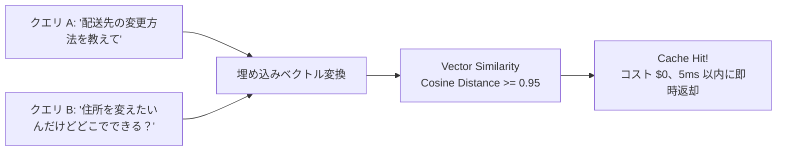

# FinOps トークン予算管理 & セマンティックキャッシュ

生成 AI の導入が拡大するにつれ、企業にとって最大の課題となるのが **予測不可能な API コストの増大** です。SyncLLM は精密なセマンティックキャッシングとリアルタイムのコストガバナンスによってこの課題を解決します。

---

## 1. ベクトルベースのセマンティックキャッシング (Semantic Cache)

従来の Web キャッシュ (Key-Value) は、文字列が 1 文字でも異なるとキャッシュミス (Cache Miss) が発生します。これに対し、**SyncLLM セマンティックキャッシュ**はプロンプトの意味的埋め込みを比較します。



- **しきい値ベースの類似度検証**: コサイン類似度が \(\ge 0.95\) 以上の場合にのみキャッシュを再利用することで、歪曲された回答の返却を防止します。
- **TTL および無効化ポリシー**: データの更新周期に応じてキャッシュの有効期間 (TTL) を柔軟に設定でき、特定のドメイン知識が更新された際には該当タグのキャッシュを即座に無効化できます。

---

## 2. FinOps トークン予算元帳 (Token Budget Ledger)

SyncLLM は、消費されるすべてのトークンに対してリアルタイムで会計処理を実行します。

| 管理階層 | 制御項目 | ポリシー例 |
| :--- | :--- | :--- |
| **組織単位** | 月間固定予算の上限 | 全社で月額 $10,000 超過時、新規プロンプトを承認モードへ移行 |
| **部門／プロジェクト** | チーム別クォータおよび通知しきい値 | マーケティングチームで日次 500,000 トークン超過時、管理者へ Slack 通知 |
| **ユーザー／エージェント** | 単一リクエストのトークン上限 | 1 回のプロンプトで Max Input 16k、Max Output 4k を強制 |

```json
{
  "transaction_id": "tx_9f82a1c0",
  "tenant_id": "dept_sales_01",
  "model": "gpt-4o-mini",
  "tokens": {
    "prompt": 420,
    "completion": 180,
    "total": 600,
    "cached": 0
  },
  "cost_usd": 0.000171,
  "latency_ms": 342,
  "status": "SUCCESS"
}
```
