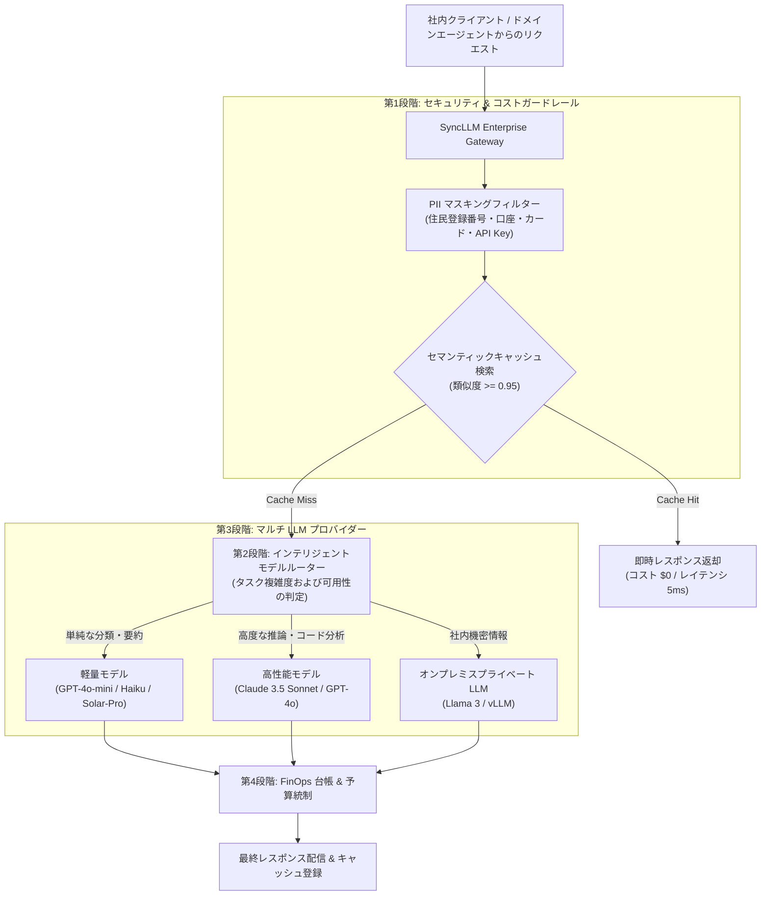
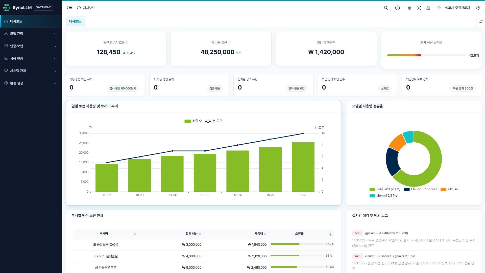
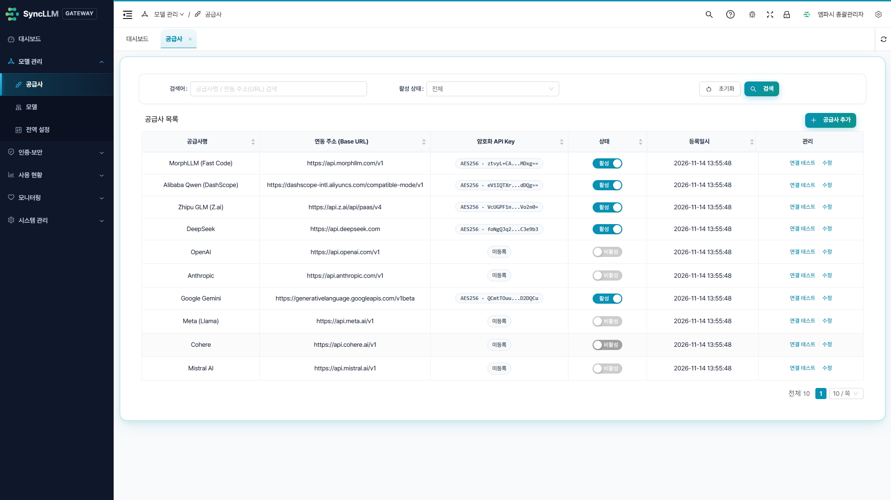
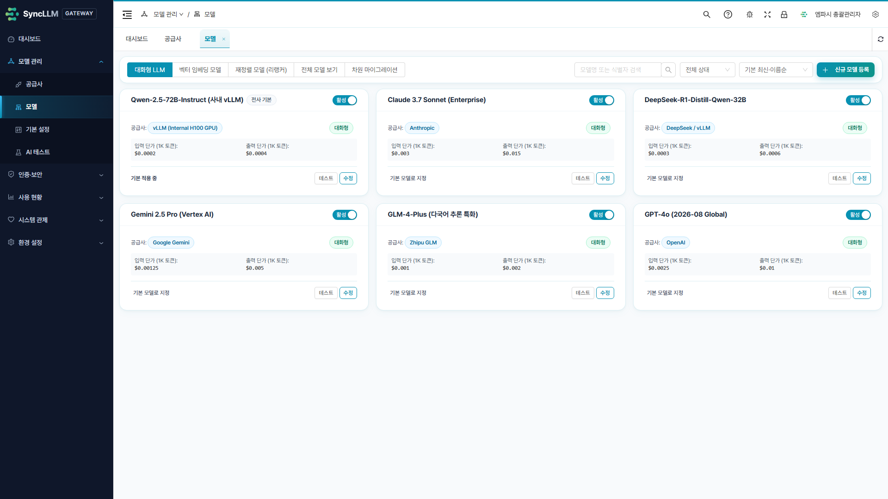
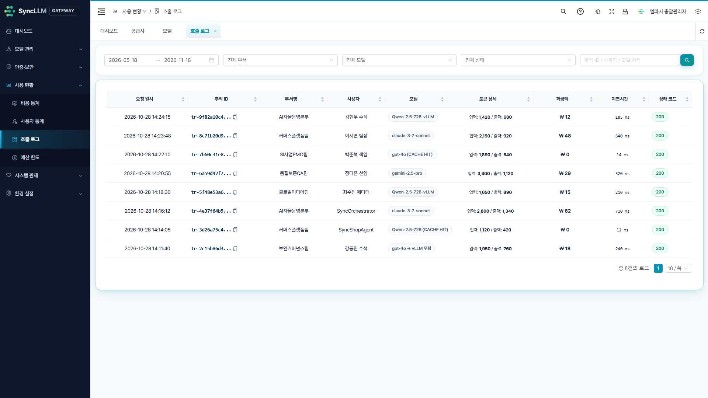

# SyncLLM: エンタープライズ AI ゲートウェイ & FinOps

> **非開発者・導入ご検討の方へのご案内**: わかりやすい製品紹介は [SyncLLM 製品ホームページ（llm.empasy.io）](https://llm.empasy.io/ja/){target="_blank" rel="noopener"}、インストール不要の画面体験は [統合デモポータル](https://sync.empasy.io/ja/products/sync-llm#demo){target="_blank" rel="noopener"} でご利用いただけます。また、紹介資料・提案書 PDF は [提案書資料室](/ja/proposals/) からダウンロードできます。

**SyncLLM** は、企業内に分散するすべての AI 呼び出しを一元管理する **エンタープライズ専用 AI ゲートウェイ（Enterprise AI Gateway）** です。

企業内の各組織やエージェントが個別に商用 LLM API（OpenAI、Anthropic、Google、ローカルオンプレミスモデルなど）を直接呼び出すことで発生する **コスト統制の分散、重複呼び出しによるトークンの浪費、機密性の高い個人情報（PII）の漏洩リスク** を防止し、単一エントリーポイントで体系的なガバナンスとコスト最適化を提供します。

---

## 主な導入メリット

1. **インテリジェントモデルルーティング（Intelligent Multi-LLM Routing）**:
   - プロンプトの難易度および意図をリアルタイムに分析し、最適なコストパフォーマンスのモデル（軽量モデル vs 高性能モデル）へ動的に振り分けます。
   - 特定ベンダーの API 障害や Rate Limit 到達時には、即座に次点のプロバイダーへ自動フェイルオーバー（Failover）を実行します。

2. **セマンティックキャッシング（Vector-based Semantic Caching）**:
   - 単なる文字列一致にとどまらず、埋め込みベクトルのコサイン類似度（\(\ge 0.95\)）に基づくキャッシングに対応しています。
   - 類似した意味を持つ反復クエリに対して外部 API を呼び出すことなくキャッシュ済みレスポンスを返すことで、トークンコストとレイテンシを削減します。

3. **エンタープライズ FinOps トークン予算管理（Token Budget Ledger）**:
   - 組織・プロジェクト・ユーザー単位でトークン消費量をリアルタイムに集計し、日次・月次のクォータ上限を強制適用します。
   - 予算のしきい値に達した際のアラート通知および使用量遮断ポリシーを適用できます。

4. **徹底した個人情報保護とガードレール（PII Masking & Safety Guardrails）**:
   - 住民登録番号（マイナンバー等）、携帯電話番号、クレジットカード番号、社内認証キーなどの機密情報を前処理段階でリアルタイムにマスキングします。
   - 悪意のあるプロンプトインジェクションや不正なデータ持ち出しの試みをゲートウェイレベルで事前に遮断します。

---

## 4大機能サマリー

| 領域 | 主な機能 | 期待される効果 |
| :--- | :--- | :--- |
| **ゲートウェイ & ルーティング** | OpenAI 互換エンドポイント、動的モデルスイッチング、ロードバランシング | 単一 API 規格の維持、ベンダーロックインからの脱却 |
| **セマンティックキャッシング** | ベクトル類似度ベースのキャッシュヒット、TTL 有効期限管理、インメモリ / Redis 連携 | トークンコスト最大 40% 削減、レスポンスタイムの短縮 |
| **FinOps 台帳** | リアルタイムのトークン使用量トラッキング、クォータ制御、予算超過防止 | 予測可能な AI 運用コスト管理 |
| **セキュリティガードレール** | 正規表現 / NER ベースの PII 自動マスキング、プロンプトインジェクション遮断 | 企業コンプライアンスの遵守、データ漏洩の防止 |

---

## 実際の動作画面および主要ワークフロー

### 1. AI ゲートウェイ統合トラフィック & トークン予算ダッシュボード
全社エージェントおよび部門別の LLM API 呼び出し量、セマンティックキャッシュのヒット率、トークン消費コスト、レスポンスレイテンシをリアルタイムで監視します。

### 2. マルチ LLM プロバイダールーティング & 障害迂回管理
商用クラウドモデルおよび社内オンプレミス推論サーバーの稼働状態や呼び出し上限、障害発生時の自動迂回（Failover）優先順位を設定します。

### 3. ランク別モデルカタログ & セマンティックキャッシュポリシー設定
クエリの複雑度に応じたモデルマッピング、入出力 1K トークンあたりの単価台帳、意味ベース応答キャッシュの類似度しきい値を制御します。

### 4. リアルタイムプロンプト監査ログ & 個人情報マスキング追跡
単一ゲートウェイを通過するすべてのリクエスト・レスポンスにおけるトークン使用量、キャッシュヒット有無、および住民登録番号・口座番号・API キーなどの機密情報自動マスキングの監査証跡を照会します。

