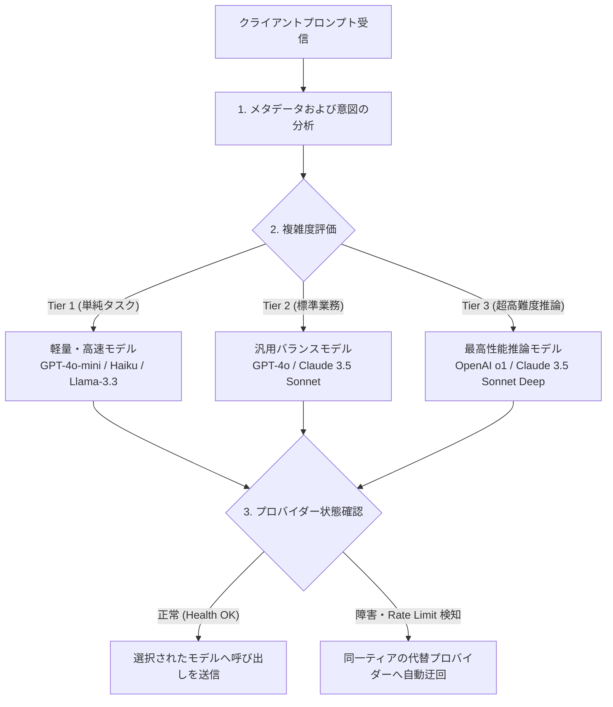

# インテリジェントモデルルーティング & ロードバランシング

企業のあらゆる AI 業務に最高スペックの高コストなフラッグシップモデルを使用することは、不要な予算の浪費を招きます。一方で、過度に軽量化されたモデルのみを使用した場合、回答品質の低下が発生します。

**SyncLLM Intelligent Router** は、入力プロンプトの複雑度、サービスレベル合意（SLA）、およびコスト効率を総合的に考慮して、最適なモデルを動的に割り当てます。

---

## 3段階ルーティング戦略

### 1. タスク複雑度に基づくティアリング（Complexity-based Tiering）
- **単純加工（Tier 1）**: 定型 JSON 変換、スペル・文法チェック、テキスト要約、感情分析などは、トークン単価が数十倍安価な小型モデルへ即座に振り分けます。
- **高度な推論（Tier 2/3）**: マルチステップのビジネス計画策定、複雑なアルゴリズム実装、SQL クエリ最適化など、精緻な論理構造が求められるリクエストは高性能モデルへ安全に割り当てます。

### 2. 可用性に基づく自動フェイルオーバー（Automatic Failover）
商用クラウド AI サービスでは、間欠的な Rate Limit（429）やサーバーの過負荷（503）が発生することがあります。
- SyncLLM はサーキットブレーカー（Circuit Breaker）を内蔵しており、特定プロバイダーの障害発生時には 0.1 秒以内に同一ランクの代替モデルへトラフィックを自動迂回します。
- ユーザーにはエラーを返すことなく一貫した正常レスポンスを返却し、サービスの無停止性を保証します。

### 3. 重み付けベースロードバランシング（Weighted Round-Robin）
- 同一モデルに対して複数のプロバイダーアカウント（例: Azure OpenAI リージョン 1、リージョン 2、オリジナル OpenAI API）を登録し、重み付けに応じてトラフィックを分散処理することで、クォータ上限の制約を解消します。
