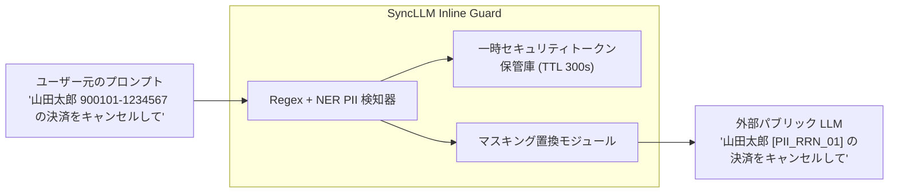

# エンタープライズセキュリティ & PII 個人情報保護

企業環境において外部パブリック LLM を活用する際の最重要課題は、**顧客の個人情報（PII）および社内機密情報の漏洩防止** です。

SyncLLM は、すべてのデータパケットが外部ネットワークへ送信される前に、ゲートウェイレベルで強力なインラインセキュリティフィルターを適用します。

---

## 1. リアルタイム PII 自動マスキングパイプライン

### 主な検知およびマスキング対象
- **個人識別情報**: 住民登録番号（マイナンバー等）、外国人登録番号、パスポート番号、運転免許証番号。
- **金融情報**: クレジットカード・デビットカード番号、銀行口座番号。
- **連絡先情報**: 携帯電話番号、一般電話番号、メールアドレス。
- **システム認証キー**: AWS Access Key、OpenAI API Key、DB Connection String、社内 JWT Token。

---

## 2. プロンプトインジェクション & 情報窃取防御（Prompt Defense）

悪意のあるユーザーがシステムプロンプトを窃取したり（Jailbreak）、エージェントの権限を不正利用しようとするパターンを検知します。
- **インジェクションヒューリスティック検知**: `Ignore previous instructions`、`System prompt bypass` などの既知のインジェクションシグネチャを事前に遮断します。
- **監査および追跡可能性（Full Audit Trail）**: すべての遮断イベントと API アクセス履歴はセキュリティ運用チーム（SIEM）へリアルタイムに転送され、即座の対応を支援します。
