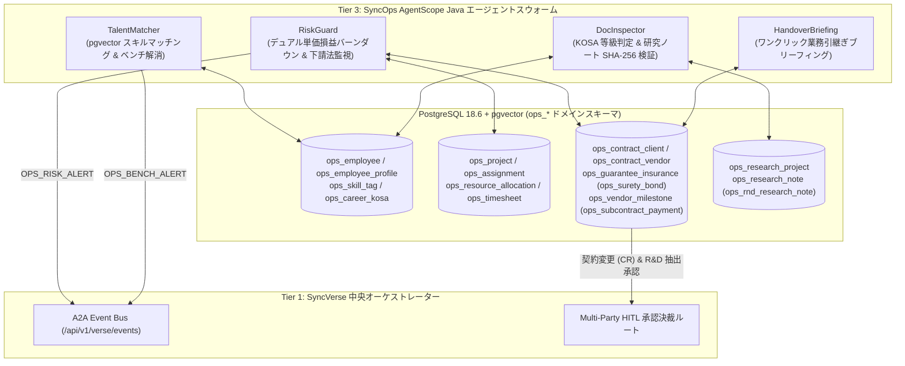

# SyncOps システムアーキテクチャおよびデータベース設計

`SyncOps` は、**Java 25**、**Spring Boot 4.0**、**AgentScope Java（`io.agentscope:agentscope-harness`）**、**PostgreSQL 18.6（`pgvector`）**、**Vue 3 + Vben Admin（`@empasy/sync-ops-admin`）** の標準技術スタック上に構築されたエンタープライズ PMO ドメインエージェントプラットフォームです。

---

## 1. 内蔵自律エージェントスウォーム（Intra-Agent Swarm）アーキテクチャ

SyncOps は単なる CRUD バックオフィスを超え、ドメイン内部で 4 つの専門サブエージェントが協調して人員配置の最適化、赤字および下請法違反の検知、業務引継ぎブリーフィングの生成、研究ノートの整合性検証を自律的に遂行します。



### 1.1 `TalentMatcher`（人材マッチングおよび待機ベンチ解消エージェント）
- 要求される KOSA 技術等級（`SPECIAL`、`ADVANCED`、`INTERMEDIATE`、`BEGINNER`）および投入可能期間による一次ハードフィルタリングを実行します。
- `ops_employee.embedding`（`VECTOR(1536)`）と要求技術スタック間のコサイン類似度を計算し、発注元請求単価に対する会社実原価（`base_monthly_cost`）のマージンスプレッドをシミュレーションして、最適な待機（Bench）人材を推薦します。

### 1.2 `RiskGuard`（リアルタイム損益バーンダウンおよび下請法遵守監視エージェント）
- 週間タイムシート（`ops_timesheet`）の承認時に、計画工数（`budgeted_total_mm`）に対する実投入工数の消化率を計算し、目標営業利益率を下回るリスクを `ops_ai_risk_log` に記録します。
- 外注下請出来高（`ops_vendor_milestone` / `ops_subcontract_payment`）における **元請受領後 15 日ルール** および **検収後 60 日ルール** の違反・期限切迫（D-7）案件と年 15.5% の法定遅延利息をリアルタイムで監視します。

### 1.3 `HandoverBriefing`（退職・異動時ワンクリック業務引継ぎエージェント）
- 引継元（`predecessor_id`）が担当していたすべての顧客・協力会社の連絡先（`ops_contact`）および未処理タスク（`ops_contact_task`）を、引継先（`successor_id`）へ単一トランザクションで移管します。
- 直近の業務協議履歴（`ops_contact_interaction`）を統合し、後任者向けの主要引継ぎブリーフィング要約文（`ai_summary_briefing`）を自動生成します。

### 1.4 `DocInspector`（KOSA 経歴および研究ノートタイムスタンプ認証検証エージェント）
- 学歴、国家技術資格、経歴日数に基づき、韓国ソフトウェア産業振興法基準の KOSA 等級を自動算出します。
- 租税特例制限法第 10 条の研究開発税額控除用電子研究ノート（`ops_research_note` / `ops_rnd_research_note`）における本文・作成者・タイムスタンプに基づく **SHA-256 タイムスタンプ認証ハッシュ** および Git コミット整合性を検証します。

---

## 2. コアビジネスエンジン設計

### 2.1 デュアル単価（Dual-Rate）損益計算エンジン
受注型 SI プロジェクトのリアルタイム貢献利益および営業利益率は、発注元契約請求単価と雇用形態別の実投入原価を分離して算出されます。

\[
\text{Operating Margin (\%)} = \frac{\text{Net Contract Revenue} - \sum (\text{Actual M/M}_i \times \text{Cost Unit Price}_i) - \text{Direct Expenses}}{\text{Net Contract Revenue}} \times 100
\]

- **正社員（`FULL_TIME`）**: 基本給（`base_salary`）+ 固定手当（`fixed_allowance`）+ 4 大社会保険会社負担金（`social_insurance_cost`）+ 月次退職給付引当金（`severance_reserve_monthly`）
- **フリーランス（`FREELANCER`）**: 月次契約単価（精算時に事業所得税 3.0% + 地方所得税 0.3% の源泉徴収を控除）
- **協力会社外注（`SUBCONTRACT`）**: 下請契約（`ops_contract_vendor`）の供給価額基準で算入
- **直接経費（`Direct Expenses`）**: 4 大履行保証保険の納付手数料（`premium_amount`）および瑕疵担保引当負債（`warranty_reserve_amount`）

### 2.2 下請法法定支給期日決定アルゴリズム
韓国「下請取引公正化に関する法律（下請法）」第 6 条（前払金）および第 13 条（下請代金の支給）に基づき、法定支給期限（`statutory_deadline_date`）を自動算定します。

```java
LocalDate inspectionLimit = inspectionDate.plusDays(60); // 検収完了日 + 60日
LocalDate StatutoryDeadline = (clientPaymentReceivedDate != null)
    ? Stream.of(clientPaymentReceivedDate.plusDays(15), inspectionLimit)
            .min(LocalDate::compareTo).get()
    : inspectionLimit;
```

期限超過時には遅延日数（`delay_days`）に対して法定遅延利率 **年 15.5%** を日割り計算し、財務リスクダッシュボードへ即時にアラートを発報します。

---

## 3. コアドメインデータベーススキーマ（`db/02_schema_domain.sql`）

SyncOps は全社 6 段階標準 DB スクリプト体系（`db/00_extensions.sql` ～ `05_sample_dev.sql`）に準拠しており、主要テーブル構造は以下のとおりです。

| 区分 | 物理テーブル名（カタログ別称） | 主要カラムおよび役割 |
| :--- | :--- | :--- |
| **プロジェクトマスター** | `ops_project` | `project_code`、`consortium_type`、`my_share_rate`、`net_contract_amount`、`target_margin_rate`、`budgeted_total_mm`、`warranty_reserve_amount` |
| **人材プロフィール & KOSA** | `ops_employee`<br/>（`ops_employee_profile`）、<br/>`ops_career_kosa`、`ops_skill_tag` | `emp_type`（`FULL_TIME`/`FREELANCER`/`SUBCONTRACT`）、`kosa_grade`、`base_monthly_cost`、`is_rnd_qualified`、`embedding VECTOR(1536)` |
| **人材 M/M 配分** | `ops_assignment`<br/>（`ops_resource_allocation`）、<br/>`ops_timesheet` | `roll_in_date`、`roll_out_date`、`input_rate`（M/M）、`billing_unit_price`（請求単価）、`cost_unit_price`（投入原価）、`billed_kosa_grade`、`work_nature` |
| **4 大保証保険** | `ops_guarantee_insurance`<br/>（`ops_surety_bond`） | `insurance_type`（`BID`/`PERFORMANCE`/`ADVANCE`/`DEFECT`）、`policy_no`、`issuer`（`SGI_SEOUL`/`KOSA_COOP`）、`guarantee_amount`、`premium_amount`、`end_date` |
| **下請出来高・精算** | `ops_vendor_milestone`<br/>（`ops_subcontract_payment`）、<br/>`ops_contract_vendor`、`ops_invoice` | `inspection_date`、`client_payment_received_date`、`statutory_deadline_date`（15日/60日）、`delay_days`、`delay_interest_amount`（年 15.5%） |
| **R&D 電子研究ノート** | `ops_research_note`<br/>（`ops_rnd_research_note`）、<br/>`ops_research_project` | `research_project_id`、`author_id`、`note_date`、`content_summary`、`git_commit_hashes`、`author_signed_at`、`witness_signed_at`、`tsa_timestamp`（SHA-256 ハッシュ） |
| **顧客・契約・業務引継ぎ** | `ops_client`、`ops_vendor`、<br/>`ops_contact`、`ops_handover_log`、<br/>`ops_official_letter` | 発注元・協力会社マスター、キーマン連絡先（`key_man_score`）、退職者一括引継ぎブリーフィングログ、対外公文書受発信社印付き PDF |

---

## 4. バックエンドモジュール構造および動的メニュールーティング

- **Maven 座標系**:
  - ルート親 POM: `com.empasy.sync.ops:sync-ops-parent`
  - バックエンド親 POM: `com.empasy.sync.ops:sync-ops-server-parent`
  - システムコアモジュール: `Server/sync-ops-module-system`（`/api/v1/ops/sys/...`）
  - ビジネスドメインモジュール: `Server/sync-ops-module-ops`（`/api/v1/ops/...`）
- **DB 単一ソース動的ルーティング**:
  - フロントエンド（`admin/`）は静的ルートのハードコーディングを行わず `PermissionModeEnum.BACK` モードで動作し、ログイン時に `/api/v1/ops/sys/permission/getUserPermissionByToken` を呼び出して `db/04_seed_domain.sql` に定義された 6 大ディレクトリ・26 画面の権限ツリーを動的に構成します。
