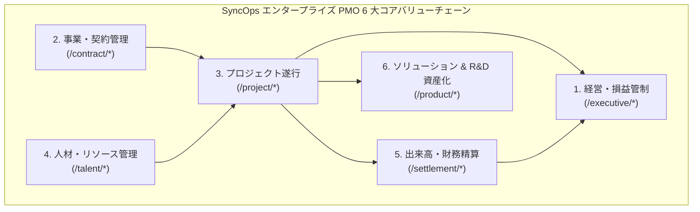
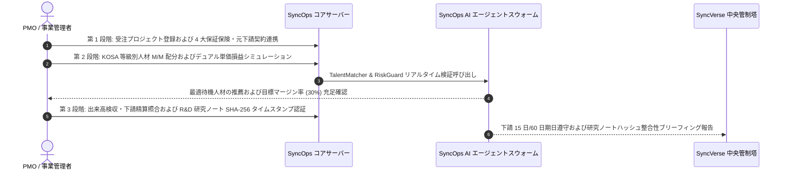
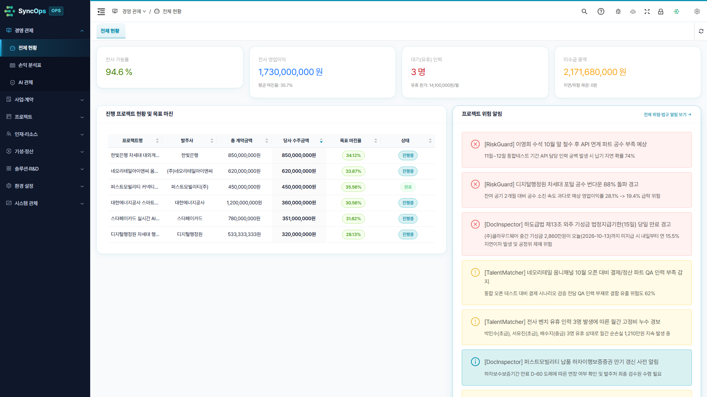
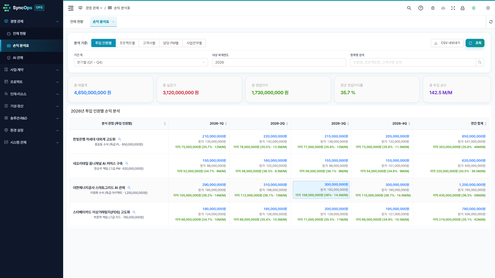
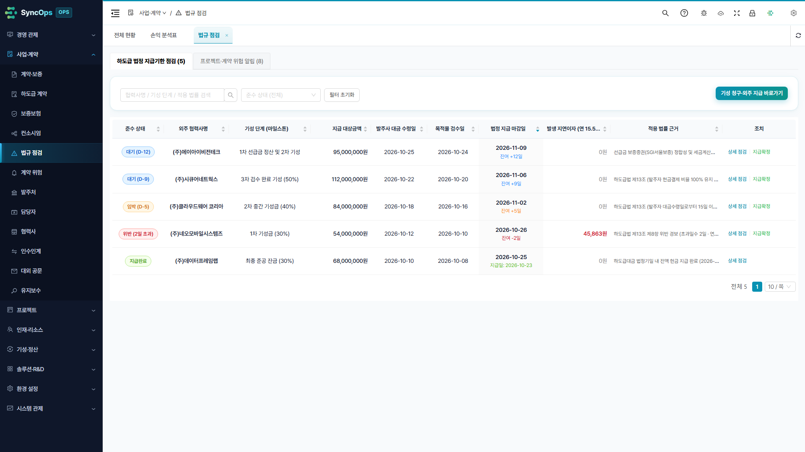
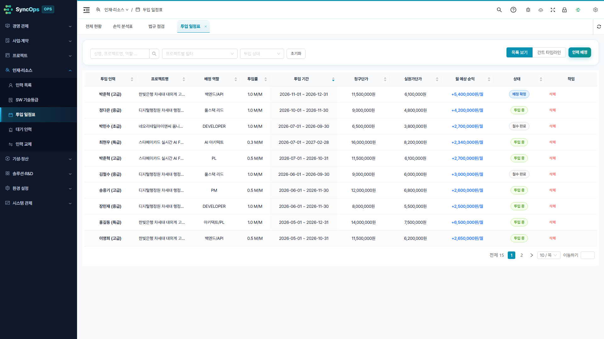

# SyncOps: 韓国型 SI / ソリューション事業運営 & 損益・コンプライアンス管制プラットフォーム

> **非開発者・導入検討向け案内**: 分かりやすい製品紹介は [SyncOps 製品ホームページ（ops.empasy.io）](https://empasy.io/ja/solutions/sync-ops.html){target="_blank" rel="noopener"} で、インストール不要の画面体験は [統合デモポータル](https://demo.empasy.io/ja/products/sync-ops#demo){target="_blank" rel="noopener"} でご利用いただけます。紹介資料・提案書 PDF は [提案書資料室](/ja/proposals/) からダウンロードできます。

> **Tier 3 Enterprise SI PMO & Profit/Compliance Agent Platform**  
> サービスドメイン: `https://empasy.io/ja/solutions/sync-ops.html` · 標準 API Prefix: `/api/v1/ops`

**SyncOps** は、受注型 SI（システムインテグレーション）および SW ソリューション企業の主要経営指標である **発注元契約単価対実投入原価デュアル損益**、**KOSA ソフトウェア技術者等級および月別 M/M 稼働率マトリックス**、**入札・契約・前払金・瑕疵の 4 大履行保証保険満期追跡**、**下請法 15 日 / 60 日支給期日監視**、**租税特例制限法 R&D 税額控除用 SHA-256 タイムスタンプ認証電子研究ノート** を単一プラットフォームで自律管理するエンタープライズ事業運営（PSA / PMO）エージェントです。

---

## 1. 主な導入背景および解決課題

従来の Excel 手作業管理や一般製造業向け ERP では、受注型 IT サービス企業特有の **デュアル単価（発注元請求単価 vs 正社員・フリーランス・外注実原価）の乖離**、**複雑なコンソーシアム持分精算**、**下請法法定支給期日の遵守** をリアルタイムに追跡することが困難でした。

| 比較項目 | 従来の Excel および分断された ERP 運用 | SyncOps 韓国型 SI 事業運営プラットフォーム |
| :--- | :--- | :--- |
| **プロジェクト損益算出** | 発注元契約単価と実投入人材原価が分離管理されず、プロジェクト終了後に初めて赤字を認識 | **契約単価対実投入原価デュアル単価エンジン**により、週間タイムシート承認と同時にリアルタイム貢献利益・営業利益率を自動算出 |
| **人材配分および稼働率** | スプレッドシートの手動管理により、人材の重複配分（>1.0 M/M）および待機（Bench）人材の把握が遅延 | **KOSA 技術等級自動算定および月別 M/M 稼働率ヒートマップマトリックス**と、`pgvector` ベースの最適代替人材 AI 推薦 |
| **保証保険および下請法** | 入札・契約・前払金・瑕疵保証保険の更新日および下請 15 日 / 60 日支給期日の手動管理による法的ペナルティリスク | **4 大保証保険満期 D-Day アラート**および **下請代金法定支給期日・遅延利息（年 15.5%）自動計算機**により法務リスクを事前遮断 |
| **R&D 研究ノート証跡** | 国策課題および企業付設研究所の税額控除用研究ノートを手書きで作成し、事後監査対応が脆弱 | **SHA-256 ハッシュタイムスタンプ認証電子研究ノート**および Git コミットハッシュ自動マッピングにより、租税特例制限法第 10 条の R&D 税額控除要件を充足 |
| **担当者の退職・業務引継ぎ** | PM・営業担当者の退職時、顧客キーマン（Key-man）の連絡先や口頭協議履歴が散逸 | **ワンクリック業務引継ぎセンター**および AI 引継ぎ要約ブリーフィング（`HandoverBriefing`）により顧客業務の継続性を安定的に支援 |

---

## 2. 6 大コアバリューチェーンドメイン

### 2.1 経営・損益管制（`/executive/dashboard`、`/executive/profit-matrix`、`/executive/ai-control`）
- **デュアル単価リアルタイム損益管制**: 発注元基準の契約請求単価（`billing_unit_price`）と内部給与・4 大社会保険・退職給付引当金・外注費基準の実投入原価（`cost_unit_price`）を二元化し、プロジェクト別のリアルタイム売上原価（COGS）と営業利益率をシミュレーションします。
- **5 次元多次元損益ピボットマトリックス**: 顧客、プロジェクト、遂行部門、雇用形態（正社員 / フリーランス / 下請）、期間別に損益をドリルダウン分析します。
- **AI 人材マッチング・リスク管制**: 予算バーンダウン超過および赤字転落リスクのあるプロジェクトを早期検知し、解決ガイドを提示します。

### 2.2 事業・契約管理（`/contract/list`、`/contract/clients`、`/contract/vendors`、`/contract/compliance-alerts`）
- **元請・下請統合契約および次数別変更契約（Addendum）**: 単独受注および共同受給（共同履行・分担履行）の持分率、契約変更（CR）連携の変更契約履歴を体系的に管理します。
- **4 大履行保証保険統合追跡**: ソウル保証保険（SGI）・ソフトウェア共済組合の入札（`BID`）、契約履行（`PERFORMANCE`）、前払金（`ADVANCE`）、瑕疵担保（`DEFECT`）保証証券の満期日と保険料直接経費を追跡します。
- **顧客・協力会社キーマン CRM およびワンクリック引継ぎ**: 発注元・協力会社担当者の連絡先、協議履歴、対外公文書受発信の社印付き PDF を管理し、人事異動時には単一トランザクションで後任者へ一括継承します。

### 2.3 プロジェクト遂行および損益シミュレーション（`/project/list`、`/project/profit-simulator`、`/project/timesheet-approval`）
- **週間タイムシートおよび工数承認**: 週間の実投入工数（M/M）を顧客 SI 原価（`CLIENT_SI`）とコア R&D 資産化（`CORE_RD`）に区分して集計します。
- **契約変更（CR）統制**: 顧客の追加要件に伴う追加工数および増額請求規模を算定し、変更契約と連携します。

### 2.4 人材・リソース管理（`/talent/employee`、`/talent/kosa-grade`、`/talent/assignment-gantt`、`/talent/bench-monitor`）
- **KOSA ソフトウェア技術者等級算定**: 学歴、国家技術資格、KOSA 認定経歴日数に基づき、特級（`SPECIAL`）・高級（`ADVANCED`）・中級（`INTERMEDIATE`）・初級（`BEGINNER`）等級を自動判定します。
- **月別 M/M 稼働率ガントチャート & ベンチモニタリング**: 人材別のプロジェクト投入率を可視化して 100%（`1.0 M/M`）超過配分を防止し、待機（Bench）人材および撤収予定者をリアルタイムでモニタリングします。
- **投入人材交代承認ガバナンス**: 人材交代時に同等・上位の KOSA 等級要件充足を自動検証し、発注元承認公文書を管理します。

### 2.5 出来高・財務精算（`/settlement/milestone`、`/settlement/ar-aging`）
- **下請法第 6 条・第 13 条支給期日自動監視**: 元請出来高金の受領後 **15 日以内**、目的物検収後 **60 日以内** の法定支給期限を自動計算して違反・期限切迫（D-7）アラートを発報し、遅延時には法定遅延利息（年 15.5%）を自動算出します。
- **電子税金計算書および売掛金（AR Aging）精算**: 前払金の按分控除、フリーランス 3.3% 源泉徴収控除、売掛金経過日数を管理します。

### 2.6 ソリューション & R&D 資産化（`/product/releases`、`/product/rnd-notes`）
- **租税特例制限法第 10 条 R&D 税額控除用電子研究ノート**: KOITA（韓国産業技術振興協会）研究専任要員の研究遂行内容、Git コミットハッシュ、作成者・確認者の電子署名および **SHA-256 タイムスタンプ認証（TSA）ハッシュ** を結合し、改ざん不可能な電子研究ノートを保存します。
- **SI カスタム機能コアバックポートハブ**: SI プロジェクトで開発された優良機能を自社ソリューション（`SyncBoot`、`SyncCMS` 等）のコアへ資産化（Backport）するレビューパイプラインと、顧客別デプロイ構成（Installed Base）を管理します。

---

## 3. 3 段階標準事業運営プロセス

---

## 実稼働画面およびコアワークフロー

### 1. 経営陣統合ダッシュボードおよび受注プロジェクト損益管制
全社の受注契約総額、プロジェクト別リアルタイム営業利益率、人材稼働率（M/M）および法務コンプライアンスアラートを単一の経営ダッシュボードで管制します。

### 2. 発注元契約単価対実投入原価デュアル単価損益マトリックス
発注元請求単価と正社員・フリーランス・下請の実投入原価を分離集計し、顧客・プロジェクト・部門・期間別の貢献利益をリアルタイム分析します。

### 3. 4 大履行保証保険満期追跡および下請法支給期日監視
入札・契約・前払金・瑕疵保証証券の更新 D-Day と下請代金の法定支給期限（受領後 15 日、検収後 60 日）および遅延利息を自動計算し、法的リスクを遮断します。

### 4. KOSA 技術等級人材マトリックス、稼働率ガントおよび電子研究ノート
KOSA ソフトウェア技術者等級別のプロジェクト投入スケジュール（ガントチャート）と超過配分の有無を可視化し、タイムスタンプ認証電子研究ノートを管理します。

---

## 4. 公式技術ドキュメント目次

- **[システムアーキテクチャおよび DB スキーマ](./architecture)**: AgentScope Java 4 大内部エージェントスウォーム、デュアル単価損益エンジン、PostgreSQL 18.6 ドメインスキーマ（`ops_*`）詳細仕様
- **[MCP ツールおよび REST API リファレンス](./mcp-tools)**: `ops_analyze_project_profitability`、`ops_check_allocation_overload`、`ops_audit_subcontract_payment`、`ops_verify_rnd_note_hash` ツール仕様および `/api/v1/ops/...` API ガイド
