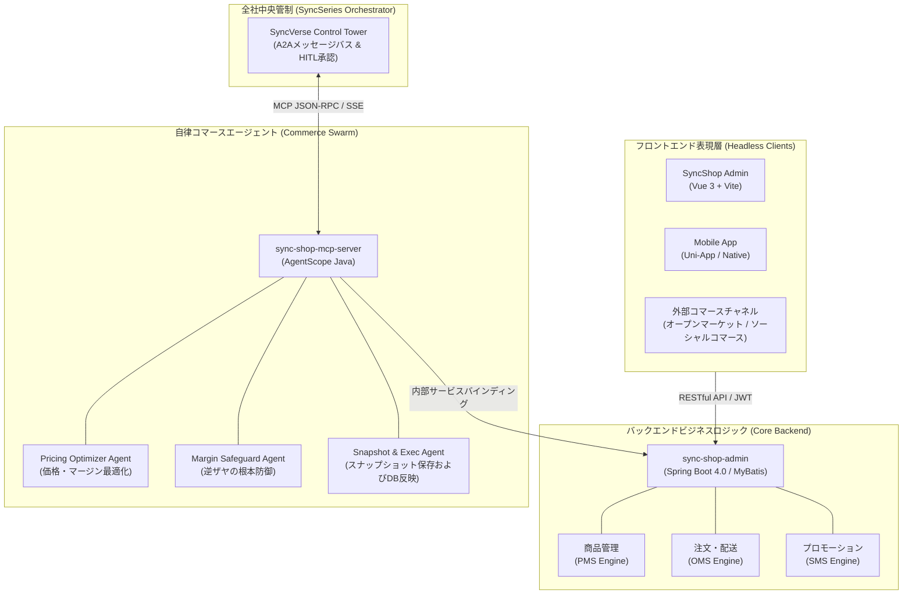
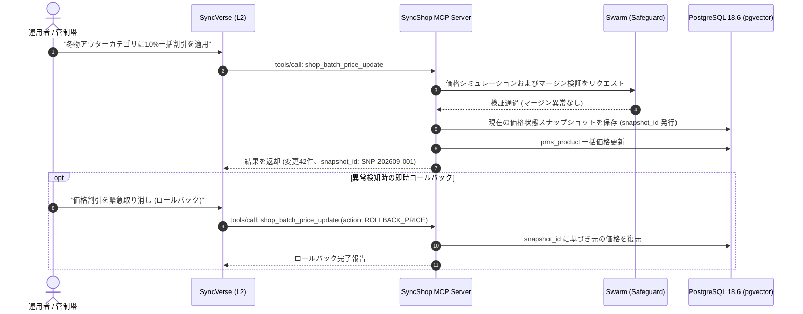

# システムおよびAIエージェントアーキテクチャ

SyncShopは、フロントエンドとバックエンドの完全な分離を保証する**Headlessアーキテクチャ**と、自律的なコマース運用のための**AgentScope Javaベースのマルチエージェントスウォーム**を採用しています。

---

## 1. 全社システム階層構造

---

## 2. コマース内部エージェントスウォーム (Intra-Agent Commerce Swarm)

SyncShopエージェントサーバーは、単一のLLM呼び出しではなく、細分化された3段階のエージェントスウォーム構造によって安全な自律運用を実行します。

1. **Pricing Optimizer Agent（価格分析エージェント）**:
   * カテゴリ別の在庫回転率、売上推移、競合他社の価格データを分析し、最適な割引率と調整目標価格を算出します。
2. **Margin Safeguard Agent（マージン保護エージェント）**:
   * 算出された価格が商品別の原価（Cost Price）および最低マージン率基準に違反していないかを全数検証します。
   * 逆ザヤのリスクを検知した場合は即座に処理を遮断し、警告事由を記録します。
3. **Snapshot & Execution Agent（スナップショットおよび実行エージェント）**:
   * DB反映の直前に、元の価格状態をスナップショット（`TB_SHOP_PRICE_SNAPSHOT`）として保存します。
   * `pms_product`テーブルにトランザクションを適用し、変更結果を管制塔へ報告します。

---

## 3. ダイナミックプライシングおよび無損失ロールバックシーケンス

---

## 4. セキュリティおよびトランザクション整合性

* **A2Aインバウンドセキュリティ**: `A2ASessionKeyHolder`による秘密鍵およびインバウンドトークンの検証を通じて、未認可エージェントからの制御リクエストを事前に遮断します。
* **Sagaパターンによる一貫性**: 作業単位ごとに固有の`task_id`を追跡し、連携失敗時には補償トランザクションを通じて直前の一貫性状態を維持します。
* **Zero-Mock原則**: すべてのツール呼び出しはインメモリのダミーデータを排除し、実際の永続データベースと100%連携します。
