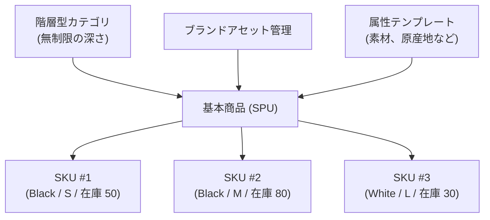
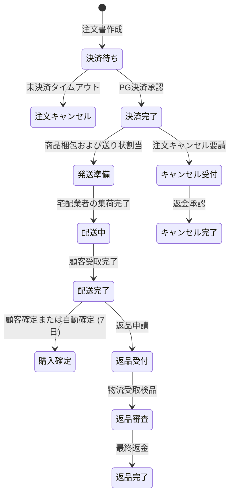

# 商品カタログおよび注文・物流管理

SyncShopの商品管理（PMS）と注文管理（OMS）は、大規模なEC運用環境においてデータの整合性と迅速な処理速度を保証するよう設計されています。

---

## 1. 商品カタログ管理 (PMS)

### 1.1 階層型カテゴリおよびブランド
* **無制限の階層構造**: 大分類・中分類・小分類へと連なる多段カテゴリに対応しており、上位カテゴリの変更時には下位マッピングが動的に再計算されます。
* **ブランドアセット管理**: ロゴ、ブランドストーリー、公式認証の有無を管理し、ブランド専用館のキュレーションと連携します。

### 1.2 動的SKUおよび在庫ロック (Inventory Lock)
* **オプション組み合わせ別のSKU分離**: カラー、サイズ、容量などのオプション組み合わせごとに固有のSKUコード、個別の販売価格、安全在庫数量を指定します。
* **在庫ロックメカニズム**: ユーザーが注文決済ステップに進むと、Redis分散ロックを通じて在庫を一時占有（Lock）し、決済完了時に実在庫を減算します。決済失敗またはタイムアウト（デフォルト15分）が発生した場合、占有は即座に自動解除されます。

---

## 2. 注文および物流管理 (OMS)

### 2.1 注文状態遷移ライフサイクル

### 2.2 注文処理の主要機能
* **送り状の一括自動登録**: Excelアップロードおよび宅配業者API連携による送り状番号の一括バインディングと配送中ステータスへの一括遷移。
* **返品・返金の2段階審査**: 顧客からの返品申請受付後、実物回収の検品と返金承認のステップを分離し、誤返金を防止。
* **配送発送センター管理**: 複数の物流倉庫（江南、松坡、板橋など）を登録し、注文流入時に最適な配送拠点を指定。

---

## 3. 関連管理画面コードマッピング

| 機能領域 | 画面識別子 | Vueコンポーネントパス | 説明 |
|:---|:---|:---|:---|
| **カタログ照会** | `SHOP-02` | `src/views/pms/product/index.vue` | 商品一覧検索、陳列ステータストグル、ダイナミック価格調整 |
| **新規商品登録** | `SHOP-03` | `src/views/pms/product/add.vue` | 基本情報、SKUマトリックス設定、属性テンプレート入力 |
| **カテゴリ・ブランド** | `SHOP-04` | `src/views/pms/productCate/index.vue` | ツリー型カテゴリ構成およびブランド一覧管理 |
| **注文・配送管制** | `SHOP-05` | `src/views/oms/order/index.vue` | リアルタイム注文受付、送り状処理、配送追跡 |
| **返品・返金審査** | `SHOP-06` | `src/views/oms/orderReturnApply/index.vue` | 返品事由の検討、物流ステータス確認、返金承認 |
