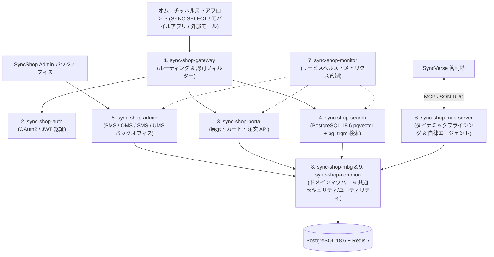

# SyncShop エンタープライズ導入FAQ

8つの独立マイクロサービス基盤の自律コマースプラットフォームである`SyncShop`を導入・運用する際、EC事業部、物流・ERP運用チーム、ITアーキテクトから最も多く寄せられる技術的な質問と回答をまとめました。

---

## 1. 8つのマイクロサービス (MSA) アーキテクチャおよび基幹系連携



### Q1. なぜ単一モノリスではなく、8つの独立マイクロサービス構造で構成されているのですか？
- **回答**: ECのワークロードは、平時のバックオフィスにおける商品・精算管理（`sync-shop-admin`）と、大規模プロモーションやタイムセール時に急増する顧客向け照会・注文トラフィック（`sync-shop-portal`、`sync-shop-search`、`sync-shop-gateway`）で特性がまったく異なります。
- `SyncShop`は、独立したモジュール群（`gateway`、`auth`、`admin`、`portal`、`search`、`monitor`、`mbg`、`mcp-server`、`common`）を物理的に分離しており、顧客向けトラフィックが急増した際には`portal`と`search`のコンテナのみを即座にスケールアウト（Scale-Out）し、バックオフィスとAIエージェント（`mcp-server`）の安定性を体系的に隔離します。

### Q2. 既存の社内ERP（SAP、Douzoneなど）、WMS（倉庫管理システム）、およびPG決済網とはどのように連携しますか？
- **回答**: `SyncShop`は、すべてのコマースドメインが`/api/v1/shop/*`標準Canonical REST APIおよびイベントWebhookとして公開されているHeadless Commerceアーキテクチャです。

| 連携領域 | 標準連携インターフェース | 同期周期およびトランザクション保証方式 |
| :--- | :--- | :--- |
| **ERP（統合基幹業務システム）** | `POST /api/v1/shop/pms/products/sync`<br>`GET /api/v1/shop/oms/settlements` | 品目マスタ・仕入原価・売上伝票のリアルタイムWebhookまたは日次バッチ双方向照合 |
| **WMS / 3PL 物流** | `manage_orders` MCPツール（`action: SHIP`）<br>`POST /api/v1/shop/oms/orders/delivery-callback` | 出荷指示書の自動送信、送り状番号の逆送信および配送状態遷移の自動化 |
| **PG（決済ゲートウェイ）** | 承認・取消Webhookおよび冪等性キー（`idempotency_key`）検証 | 通信取消および部分返金時の`oms_order_return`状態とPG元帳の1:1整合性検証 |

---

## 2. ダイナミックプライシングのマージン保護およびスナップショットロールバック

### Q3. AIエージェントがダイナミックプライシング（`shop_batch_price_update`）で価格を一括調整する際、逆ザヤが発生するリスクはありませんか？
- **回答**: 価格調整時には、内部の**3段階コマースエージェントスウォーム（`Pricing Optimizer` -> `Margin Safeguard` -> `Executor`）**と多重安全装置が作動し、逆ザヤを事前に防止します。
  1. **最低保証マージン率ガードレール**: 商品マスタ（`pms_product`）の仕入原価（`cost_price`）とカテゴリ別の最低マージン率基準（例：`15%`）を照合し、1品目でも下限を下回って算出された場合はバッチトランザクション全体を即座に拒否（Fail-Fast）します。
  2. **HITL事前決裁ゲート**: 一定の割引率（例：`10%`超）または大規模なカテゴリ一括価格変更は`SyncVerse`のHITL承認待機キューへ自動的に回付され、コマース責任者の承認を経てはじめて反映されます。
  3. **変更前価格スナップショットおよび1-Click即時復元**: 価格変更の直前に、対象となる全SKUの既存販売価格スナップショット（`SNP-YYYYMM-NNN`）がDBに自動保存され、必要時には`action: "ROLLBACK_PRICE"`の呼び出し1回で`1秒`以内に直前の価格へ100%原状回復されます。

```json
{
  "jsonrpc": "2.0",
  "id": "shop-pricing-rollback-01",
  "method": "tools/call",
  "params": {
    "name": "shop_batch_price_update",
    "arguments": {
      "action": "ROLLBACK_PRICE",
      "snapshotId": "SNP-202609-089",
      "reason": "タイムセールプロモーションの早期終了に伴う通常価格への即時復元"
    }
  }
}
```

---

## 3. 大規模トラフィック時の在庫同時実行制御および閉域網デプロイ

### Q4. タイムセール（Flash Sale）や大規模企画展の際、同時アクセスによる在庫の過剰販売（Overselling）はどのように防止しますか？
- **回答**: **Redisのアトミック分散ロックとPostgreSQL 18.6のSKU在庫ロック（`pms_sku_stock.lock_stock`）を組み合わせた2段階在庫占有アーキテクチャ**を使用しています。
  1. **第1段階（注文書進入時の先占）**: 顧客が決済リクエストを開始した瞬間、Redisのアトミック演算とDBの`lock_stock`加算クエリ（`WHERE stock - lock_stock >= :quantity`）により、利用可能在庫を即座に予約します。
  2. **第2段階（決済確定およびタイムアウト自動解除）**: PG決済承認の完了時に実在庫`stock`と`lock_stock`を同時に減算し、指定された決済制限時間（デフォルト`15分`）以内に決済が完了しない場合は遅延キューワーカーが先占在庫（`lock_stock`）を自動解除して利用可能在庫へ戻します。

### Q5. 別途検索エンジン（Elasticsearch）がなくても、高速な商品検索とAIセマンティックレコメンドは可能ですか？
- **回答**: はい、`sync-shop-search`マイクロサービスは**PostgreSQL 18.6の`pgvector` HNSWベクトルインデックスと`pg_trgm`全文検索インデックス**を組み合わせて運用しています。これにより、「秋 通勤コーデ 軽いジャケット」といった自然言語の意図に基づくセマンティック商品検索と、ブランド・SKUコードの完全一致検索を単一のPostgreSQL 18.6クラスタ上で超低遅延で提供し、異種検索エンジンのインデックス同期遅延やクラスタ二重管理のコストを排除します。

### Q6. オンプレミスまたはプライベートクラウド（VPC）環境に独立構築することは可能ですか？
- **回答**: 可能です。8つのマイクロサービス、バックオフィス（`admin/`）、フラッグシップストアフロント（`web/`）、および6-File DB SSOTスクリプト（`sync-shop/db/00_extensions.sql`〜`05_sample_dev.sql`）が標準コンテナ（`docker-compose-dev.yml`およびK8sマニフェスト）としてパッケージ化されて提供されるため、外部SaaSに依存することなく企業独自のインフラへ即座に構築できます。

---

## 4. 8つの独立マイクロサービスモジュールおよびポート構成表

| 順番 | モジュール ArtifactId (`Server/`) | デフォルトポート | 主要責務および技術的役割 |
| :---: | :--- | :---: | :--- |
| **1** | `sync-shop-gateway` | `8201` | Spring Cloud Gatewayベースの単一エントリーポイントルーティングおよびJWT認可フィルター |
| **2** | `sync-shop-auth` | `8401` | OAuth2 / JWTトークン発行および管理者・消費者統合認証サーバー |
| **3** | `sync-shop-admin` | `8080` (`18082`) | PMS（商品）、OMS（注文）、SMS（プロモーション）、UMS（会員）バックオフィスREST API（`/api/v1/shop/*`） |
| **4** | `sync-shop-portal` | `8085` | フラッグシップストアフロント（`SYNC SELECT`）展示・カート・注文決済の顧客向けAPI |
| **5** | `sync-shop-search` | `8081` | `PostgreSQL 18.6 pgvector` + `pg_trgm`ベースのハイブリッド商品検索およびセマンティックレコメンド |
| **6** | `sync-shop-monitor` | `8101` | Spring Boot Adminベースのマイクロサービスヘルスチェック、JVMメトリクスおよびログ管制 |
| **7** | `sync-shop-mcp-server` | `8086` | `AgentScope Java`ベースの自律プライシングスウォームおよびMCPツール（`/api/v1/shop/mcp/*`）サーバー |
| **8** | `sync-shop-mbg` | ライブラリ | ドメインエンティティおよびMyBatisマッパー層（`pms_*`、`oms_*`、`sms_*`、`ums_*`） |
| **9** | `sync-shop-common` | ライブラリ | 全社共通レスポンスラッパー、RFC 7807例外処理、Redisキャッシュおよびセキュリティユーティリティ |
