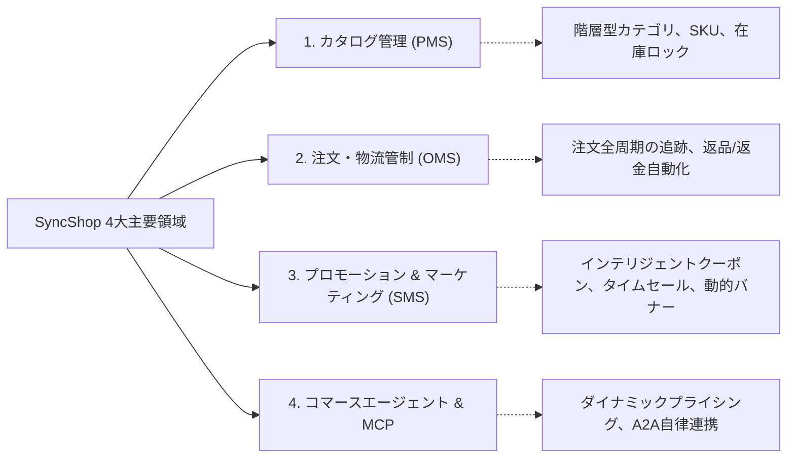
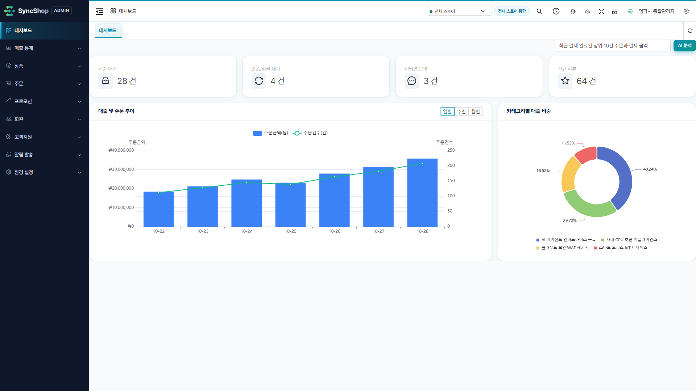
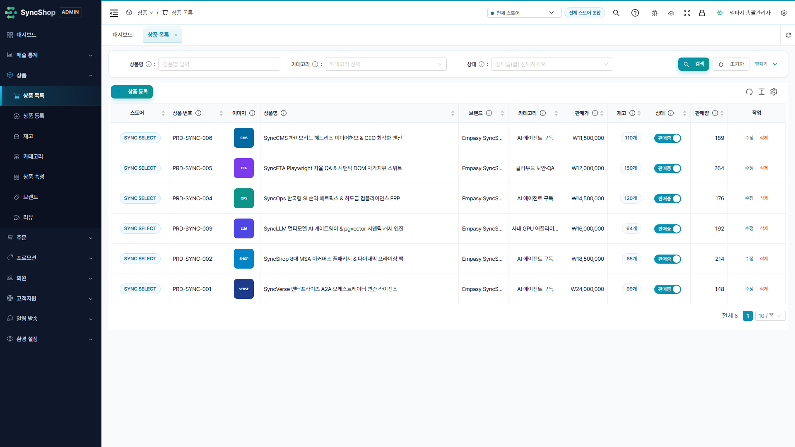
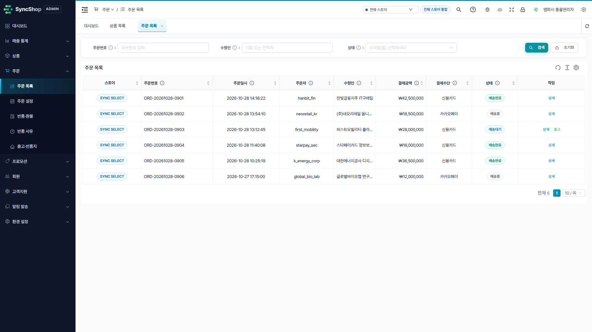
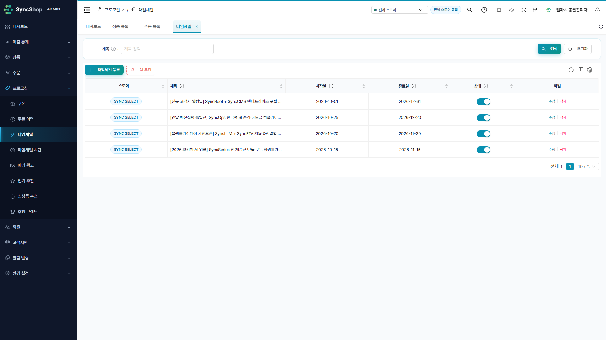

# SyncShop: インテリジェントコマース運用プラットフォーム概要

> **非開発者・導入検討のご案内**: 分かりやすい製品紹介は[SyncShop製品ホームページ（shop.empasy.io）](https://shop.empasy.io/ja/){target="_blank" rel="noopener"}で、インストール不要の画面体験は[統合デモポータル](https://sync.empasy.io/ja/products/sync-shop#demo){target="_blank" rel="noopener"}でご利用いただけます。また、紹介書・提案書PDFは[提案書資料室](/ja/proposals/)からダウンロードいただけます。

SyncShopは、ビジネスの柔軟性とチャネル拡張性のために、バックエンドのコマースロジックとフロントエンドの表現層を分離した**Headless eCommerce**プラットフォームです。

すべての主要機能をRESTful APIおよび標準MCP（Model Context Protocol）ツールとして提供し、Web、モバイルアプリ、キオスク、ソーシャルコマースなど多様な顧客接点を統合制御するとともに、Spring Boot 4.0ベースのMSA構造とAgentScope Javaエージェントハーネスを通じて自律的なコマース運用を支援します。

---

## 4大主要機能領域

1. **商品カタログ管理 (PMS - Product Management System)**:
   * 無制限の深さを持つ階層型カテゴリとブランドアセット管理。
   * カラー、サイズ、容量などのオプション組み合わせ別のSKU単価および在庫の分離制御。
   * リアルタイム在庫ロック（Lock）および低在庫アラートによる欠品・過剰在庫の防止。

2. **注文および物流管制 (OMS - Order Management System)**:
   * 決済待ちから発送準備、配送中、受取完了までの全ステータス追跡。
   * 返品および返金申請の審査プロセスの標準化。
   * マルチ配送先および複数物流発送センターの統合管理。

3. **プロモーションおよびマーケティング (SMS - Sales Management System)**:
   * 条件付きターゲット発行クーポン（登録、会員ランク、特定商品群）エンジン。
   * 特定時間帯の数量限定特価タイムセール（Flash Sale）セッション運用。
   * メインディスプレイの推奨ブランドおよび戦略商品の陳列順序制御。

4. **自律コマースエージェントおよびMCP連携 (Commerce Agent & MCP)**:
   * `shop_batch_price_update`ベースのリアルタイムDBダイナミックプライシングおよびスナップショット原状回復。
   * `manage_product_catalog`、`manage_orders`を通じた在庫および注文ステータスの自律制御。
   * AgentScope JavaベースのエージェントスウォームおよびSyncVerse中央管制塔とのA2A協業。

---

## ソリューション構成概要

| 領域 | 構成要素 | 主要技術スタック | 説明 |
|:---|:---|:---|:---|
| **バックエンドサーバー** | `sync-shop-admin` | Java 25, Spring Boot 4.0, MyBatis | RESTfulコマースAPI、トランザクションおよびセキュリティ（JWT、RBAC） |
| **エージェントサーバー** | `sync-shop-mcp-server` | AgentScope Java, Spring Web, MCP SDK | A2Aツール提供、ダイナミックプライシング、非同期管制連携 |
| **管理画面UI** | `SyncShop Admin` | Vue 3, Vite, TypeScript, Ant Design Vue | コマース総合運用ダッシュボードおよびバックオフィス管制画面 |
| **モバイル/クライアント** | `SyncShop App` | Vue / Uni-App | オムニチャネルモバイルコマースフロントエンド |

---

## 実稼働画面および主要ワークフロー

### 1. オムニチャネル売上、注文、在庫およびエージェント管制ダッシュボード
9つの分散マイクロサービスのリアルタイム売上、注文処理率、利用可能在庫およびダイナミックプライシングエージェントのステータスを一目で管制します。

### 2. 多階層商品カタログ、在庫ロックおよびダイナミックプライシング
階層型カテゴリ・ブランドアセットとオプション別のSKU在庫ロックを制御し、最低マージン率ガードレール内でダイナミックプライシングを実行します。

### 3. 注文全周期のライフサイクル追跡およびクレーム・精算自動化
決済待ちから物流発送、配送完了、返品・返金審査に至る注文の全周期をリアルタイムで追跡し、異常注文を自動検知します。

### 4. タイムセール・ターゲットクーポンプロモーションおよび価格スナップショット1-Click復元
時間帯別の数量限定タイムセールや条件付きクーポンキャンペーンを運用し、価格一括調整前後のスナップショットを比較して1-Clickで即座に原状回復します。

---

## 主要ドキュメントへのショートカット

* [システムアーキテクチャおよびエージェントスウォーム](/ja/syncshop/architecture)
* [商品および注文・物流運用](/ja/syncshop/catalog-and-order)
* [プロモーション、クーポンおよび企画展](/ja/syncshop/promotion-and-marketing)
* [MCPツールおよびA2Aオーケストレーション](/ja/syncshop/mcp-and-agent)
* [よくある質問 (FAQ)](/ja/syncshop/enterprise-faq)
