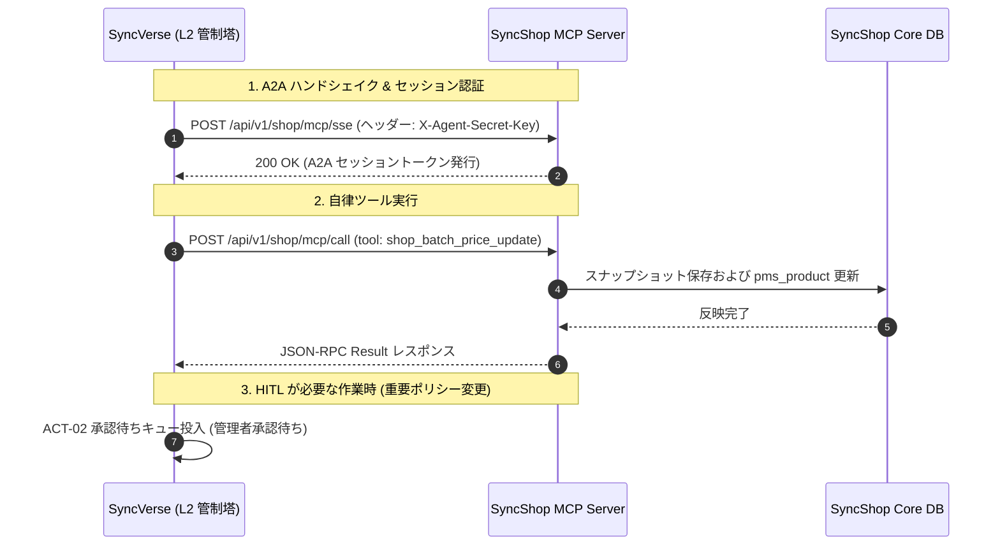

# MCP ツールおよび A2A オーケストレーション

SyncShop は、すべての管理機能と商取引制御インターフェースを標準 **Model Context Protocol (MCP)** ツールとして公開し、SyncVerse 中央管制塔および他ドメインエージェントとの自律的な協調動作を支援します。

---

## 1. MCP ツールレジストリ仕様

SyncShop MCP サーバー（`sync-shop-mcp-server`）が標準で提供するプロダクションツール一覧です。

| ツール名 (Tool Name) | 主な入力パラメータ | 戻り値型 (JSON) | 説明 |
|:---|:---|:---|:---|
| **`shop_batch_price_update`** | `action` (BATCH_UPDATE_PRICE / ROLLBACK_PRICE)<br>`categoryId` (Long、任意)<br>`rate` (Double、割引・値上げ率)<br>`snapshotId` (String、ロールバック時必須) | `PriceUpdateResult` | 実際の `pms_product` DB に基づく価格一括調整およびスナップショット復元 |
| **`manage_product_catalog`** | `action` (CREATE / UPDATE / DELETE / STOCK)<br>`productPayload` (Map) | `CatalogActionResult` | 商品マスター CRUD およびオプション別在庫数量の更新 |
| **`manage_orders`** | `action` (SEARCH / CONFIRM / CANCEL / REFUND / SHIP)<br>`orderSn` (String)<br>`payload` (Map、任意) | `OrderActionResult` | 注文ステータス遷移、配送処理および返品審査承認 |
| **`shop_update_checkout_policy`** | `policyKey` (String)<br>`policyValue` (String) | `PolicyUpdateResult` | 送料無料基準、最低注文金額、決済ポリシーの変更 |
| **`shop_fetch_commerce_logs`** | `logLevel` (INFO/WARN/ERROR)<br>`orderSn` (String、任意)<br>`limit` (Integer) | `List<CommerceLogRecord>` | 決済異常、PG 社連携障害、在庫不足の追跡ログ収集 |
| **`revert_data_state`** | `taskId` (String)<br>`snapshotId` (String) | `RevertResult` | 分散 Saga トランザクション失敗時の直前安定状態への補償復元 |

---

## 2. 詳細ツールパラメータ仕様

### 2.1 `shop_batch_price_update` (ダイナミックプライシング)

リアルタイム商取引データベースと直接バインディングして価格を一括変更し、変更直前のスナップショットを自動発行します。

```json
{
  "name": "shop_batch_price_update",
  "arguments": {
    "action": "BATCH_UPDATE_PRICE",
    "categoryId": 104,
    "rate": 0.9,
    "reason": "シーズンオフ アウタープロモーション適用"
  }
}
```

* **成功レスポンス例**:
```json
{
  "status": "SUCCESS",
  "snapshotId": "SNP-202609-089",
  "affectedCount": 42,
  "backupTimestamp": "2026-09-24T10:15:30Z",
  "message": "カテゴリ 104 番対象 42 品目の価格一括値下げ完了 (10% 割引)"
}
```

### 2.2 `manage_orders` (注文ステータス制御)

```json
{
  "name": "manage_orders",
  "arguments": {
    "action": "SHIP",
    "orderSn": "ORD-20260924-0012",
    "payload": {
      "deliveryCompany": "CJ大韓通運",
      "deliverySn": "6892019482"
    }
  }
}
```

---

## 3. SyncVerse 管制塔との A2A 連携仕様



* **セキュリティハンドシェイク**: `A2ASessionKeyHolder` によるインバウンドセキュリティ検証を通じて、権限のない外部リクエストを遮断します。
* **ガバナンス承認連携**: 全社決済ポリシー変更（`shop_update_checkout_policy`）など影響範囲の大きい操作は、SyncVerse の HITL 承認ゲートウェイを必須で経由して実行されます。
