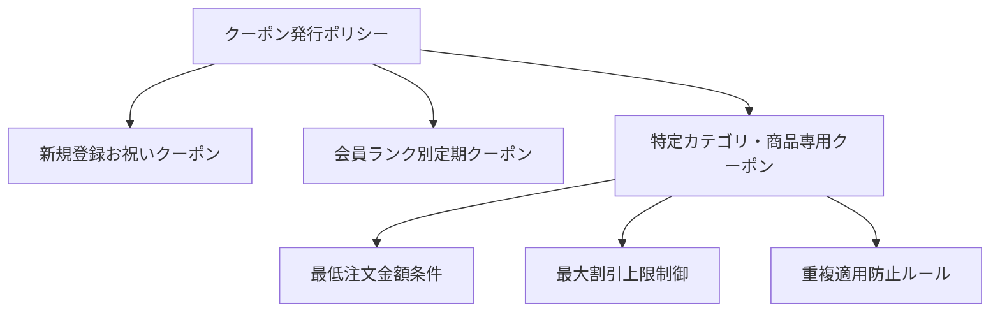

# プロモーション、クーポンおよびマーケティング管理

SyncShop のマーケティング管理（SMS）は、売上コンバージョン率を最大化し、マーケターの企画意図を迅速に画面へ反映できる強力なプロモーションツールを提供します。

---

## 1. インテリジェントクーポンエンジン

* **精密なターゲット発行**: 新規会員、特定会員ランク、長期未購入顧客を対象としたパーソナライズクーポンの発行。
* **適用制限制御**: 特定カテゴリまたは指定商品への限定適用、最低決済金額制限、最大割引金額上限の設定によるマージン防衛。
* **利用履歴追跡**: クーポンごとの発行数量に対する実利用率をリアルタイム集計し、プロモーション ROI を測定。

---

## 2. タイムセール (Flash Sale) セッション運用

特定の時間帯に限定数量のみを特別価格で販売するタイムセール機能を提供します。

* **時間帯別セッション管理**: 日付別・時間帯別（例: 10:00〜14:00、20:00〜24:00）の独立セッション作成および運用。
* **数量限定販売およびカウントダウン**: セッション別の販売可能上限数量の指定およびフロントエンドでのリアルタイム残余時間・数量カウントダウン連携。
* **同時アクセス制御**: セッション開始時に発生するトラフィック集中状況において、Redis のアトミック演算によるオーバーセル（超過販売）を根本的に防止。

---

## 3. 展示およびコンテンツマーケティング

* **戦略的商品陳列**: ホーム画面のおすすめ商品、新規ローンチ、週間ベストセクションの商品表示順序をドラッグ＆ドロップで即時再配置。
* **動的バナー管理**: 静止画バナーに加えて HTML5 および動画ベースの動的バナーをサポートし、表示位置別のクリック率（CTR）とコンバージョン売上を追跡。
* **マガジン型テーマ企画展**: 特定テーマ（例: 春のホームスタイリング、オフィスデスクセットアップ）を題材に、コンテンツと商品を組み合わせたキュレーションページを公開。

---

## 4. 関連管理画面コードマッピング

| 機能領域 | 画面識別子 | Vue コンポーネントパス | 説明 |
|:---|:---|:---|:---|
| **プロモーションクーポン** | `SHOP-07` | `src/views/sms/coupon/index.vue` | クーポン作成、発行履歴、実利用統計の照会 |
| **タイムセール企画展** | `SHOP-08` | `src/views/sms/flash/index.vue` | タイムセールセッション構成および特価商品マッピング |
| **メインバナーディスプレイ** | `SHOP-09` | `src/views/sms/advertise/index.vue` | ホーム・カテゴリ別バナー登録および表示順序制御 |
| **売上統計分析** | `SHOP-10` | `src/views/sms/statistic/index.vue` | 日別・商品別売上推移、客単価、コンバージョン率レポート |
