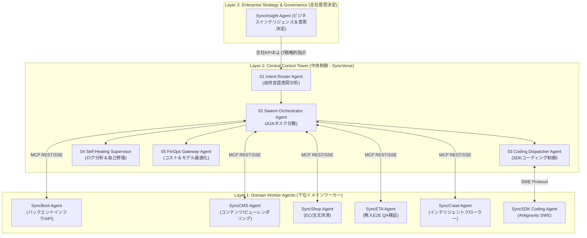
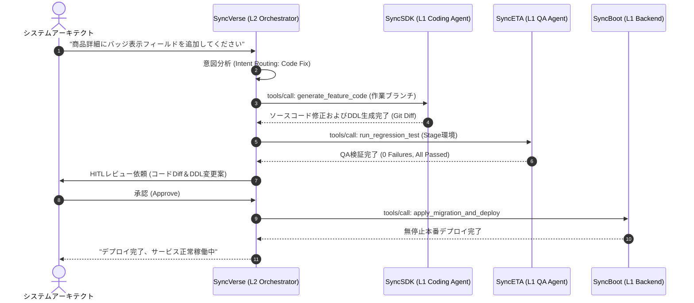
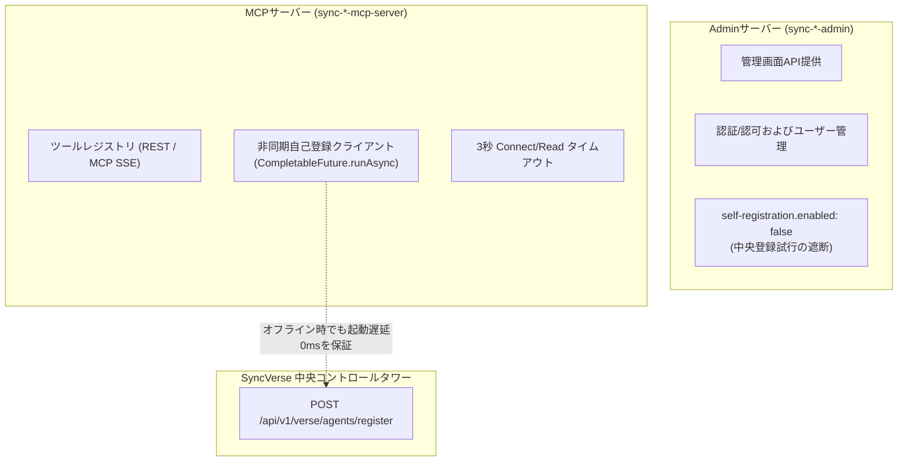

# 4-Tier自律エージェント連携アーキテクチャおよびA2A通信

SyncVerseは、複雑なエンタープライズシステムを体系的に運用するため、**4-Tier自律エージェント連携アーキテクチャ**と**標準MCP（Model Context Protocol）ベースのAgent-to-Agent（A2A）通信網**を採用しています。

---

## 1. 4-Tier自律エージェント連携の階層構造

エージェント間の責任と権限を各階層で明確に分離することで、単一障害点（SPOF）を防止し、セキュリティと実行の信頼性を確保します。



### 階層別の詳細ロール

1. **Layer 3: 全社ガバナンスおよび戦略的意思決定（Strategic Layer）**
   - **主要エージェント**: `SyncInsight Agent`
   - **役割**: 全社ビジネスメトリクス、トラフィック変化、マーケティングデータを分析し、上位レベルの運用戦略およびアクションプランをLayer 2コントロールタワーへ伝達します。

2. **Layer 2: 中央コントロールタワーおよびオーケストレーション（Control Tower Layer - SyncVerse）**
   - **主要エージェント**: `Intent Router`, `Swarm Orchestrator`, `Coding Dispatcher`, `Self-Healing Supervisor`, `FinOps Gateway`
   - **役割**: 自然言語の要件を具体的なシステムアクションプランへ変換し、下位ワーカーエージェント間の依存関係や順次・並列作業を調整するとともに、トランザクションとコストを管理します。

3. **Layer 1: ドメイン特化ワーカーエージェント（Domain Worker Layer）**
   - **主要エージェント**: `SyncBoot`, `SyncCMS`, `SyncShop`, `SyncETA`, `SyncCrawl`, `SyncSDK`
   - **役割**: 各ドメインのコアビジネスロジック（DB CRUD、ページレンダリング、注文処理、無人QAテスト、コード修正など）を直接実行します。

---

## 2. A2A通信プロトコル（Model Context Protocol）

SyncVerse内のすべてのエージェント間通信は、標準の**REST API (`/api/v1/*`)**および**MCP（Model Context Protocol）SSE**ストリーミング仕様に基づいて動作します。

### 通信シーケンス図



### 標準MCPリクエスト/レスポンスペイロード仕様

#### エージェントツール呼び出しリクエスト（Request Payload）
```json
{
  "jsonrpc": "2.0",
  "id": "req-syncverse-98213",
  "method": "tools/call",
  "params": {
    "name": "syncboot_apply_migration",
    "arguments": {
      "targetService": "product-service",
      "ddlScript": "ALTER TABLE tb_product ADD COLUMN badge_type VARCHAR(20) DEFAULT 'NONE';",
      "safeMode": true,
      "timeoutSeconds": 30
    }
  }
}
```

#### エージェント実行結果レスポンス（Response Payload）
```json
{
  "jsonrpc": "2.0",
  "id": "req-syncverse-98213",
  "result": {
    "content": [
      {
        "type": "text",
        "text": "Migration successfully applied. 0 rows affected. DDL lock released."
      }
    ],
    "isError": false,
    "metadata": {
      "executionTimeMs": 142,
      "affectedTables": ["tb_product"]
    }
  }
}
```

---

## 3. 技術スタックおよびランタイムアーキテクチャ

SyncVerseは、エンタープライズ環境の大規模トラフィックと無停止運用を支援するため、以下の技術スタックを採用しています。

| 階層 | 技術スタック | 導入目的 |
| :--- | :--- | :--- |
| **Backend Core** | Java 25, Spring Boot 4.0 | エンタープライズランタイム、仮想スレッド（Virtual Threads）、トランザクション管理 |
| **AI Framework** | **AgentScope Java** (`io.agentscope:agentscope-harness`) | 全社標準AIフレームワーク、マルチエージェント協調MsgHub、ReActAgent自律Tool実行 |
| **Frontend UI** | Vue 3, TypeScript, Vite, **Vue Flow** | ノード・エッジのトポロジー可視化、管制ダッシュボード |
| **State & Cache** | Redis 7.x (Cluster) | エージェントリアルタイム状態共有、セマンティックキャッシング、分散ロック |
| **Database** | PostgreSQL 18.6 (`pgvector`) | RDBMSデータ整合性、JSONB監査ログおよびベクトル埋め込みの永続化 |
| **Infrastructure** | Docker, Kubernetes, GitHub Actions | コンテナベースの隔離実行、CI/CDデプロイパイプライン |

---

## 4. AdminサーバーおよびMCPサーバーの役割分離（0ms起動遅延の保証）

SyncSeries配下のすべてのサブプロジェクトは、管理画面を担当するAdminサーバーと、エージェント協調ツールを提供するMCPサーバーの責務を厳密に分離して運用します。



1. **AdminサーバーのSyncVerse依存性の事前遮断**:
   * 各サービスのAdminサーバーは画面レンダリングおよびビジネスREST APIの提供に専念し、`self-registration.enabled: false` 設定によって不要なコントロールタワー登録試行を遮断します。
2. **MCPサーバーの非同期自己登録およびタイムアウト**:
   * MCPサーバー起動時に `AgentSelfRegistrationClient` が `CompletableFuture.runAsync` バックグラウンドスレッドで登録処理を実行します。
   * `SimpleClientHttpRequestFactory` ベースの3秒接続/読み取りタイムアウトを強制することで、SyncVerseコントロールタワーが停止中または未起動の場合でもメインプロセスをブロックせず、0ms遅延で即座に起動します。
