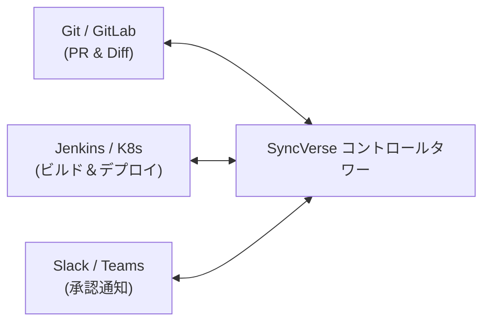

# エンタープライズ導入FAQおよびプライベートAIセキュリティ

SyncVerseを実際の企業環境に導入するにあたり、顧客企業のアーキテクトおよびセキュリティ担当者から多く寄せられる質問と技術的な回答をまとめました。

---

## 1. セキュリティおよびプライベートAI環境

### Q1. 社内のソースコードやデータが外部AIベンダー（OpenAIなど）へ送信されないように構成できますか？
> **A. 社内閉域網（Air-Gapped）およびオンプレミス構成が可能です。**  
> SyncVerseは、社内に構築されたオープンソースLLM（vLLM、Ollama、社内ファインチューニング済みLlama 3 / Solar-Proなど）および社内GPUサーバーとの連携に対応しています。また、商用クラウドLLMを利用する場合でも、**PII自動マスキングフィルター**および**エンタープライズ専用データ非学習（Zero Data Retention）エンドポイント**により、データを安全に保護します。

### Q2. AIが誤って本番データベースを破損させるリスクはありませんか？
> **A. HITL（Human-In-The-Loop）ガバナンスにより事前に遮断されます。**  
> `ALTER TABLE`、`DROP` などすべてのスキーマ変更DDLおよび本番（Production）デプロイはエージェント単独では実行できず、システムアーキテクトの明示的な承認および2要素認証（2FA）を経て初めて実行されます。

---

## 2. 既存インフラおよびシステム連携

### Q3. 現在使用しているGit、CI/CD、社内メッセンジャーと連携できますか？
> **A. 標準エンタープライズインフラとの連携インターフェースを提供しています。**  
> - **構成管理**: GitHub、GitLab、Bitbucket（作業ブランチ作成、PR発行、コードDiff照合）
> - **CI/CDパイプライン**: Jenkins、GitHub Actions、GitLab CI、ArgoCD
> - **コンテナオーケストレーション**: Kubernetes、Docker Compose
> - **コラボレーションツール**: Slack、Microsoft Teams、Jira、Dooray（承認リクエスト通知およびステータス照会）

### Q4. Java Spring Boot以外の言語で開発されたレガシーシステムにも対応していますか？
> **A. はい、対応しています。**  
> SyncVerseは標準の **Model Context Protocol（MCP）** および **REST/JSON-RPC** 通信を使用しているため、Python（FastAPI）、Node.js（NestJS）、Go、C# などどの言語で記述されたマイクロサービスであっても、標準MCP Serverラッパーを接続することでコントロールタワーに組み込むことができます。

---

## 3. 導入手順およびPoCロードマップ

### ステップ1: 準備およびPoC（2週間〜4週間）
- 対象ドメインサービス1件を選定し、SyncVerseコントロールタワーと連携
- 対象サービスのGitリポジトリおよびSyncBoot、SyncCMS、SyncETAエージェントをMCP登録
- インテントルーティング精度および自然言語指示の実行テスト

### ステップ2: パイロット運用（4週間〜8週間）
- 開発/ステージング（Dev/Stage）環境で無人QAおよび自己修復パイプラインを稼働
- アーキテクトHITL承認コンソールを適用し、機能デプロイのリードタイム（TTM）短縮を測定

### ステップ3: 全社AI DLCエコシステムへの展開（以降）
- 全社マイクロサービスへコントロールタワーの適用を拡大
- SyncInsight連携によるビジネスデータと開発実行の連動

---

## 4. ライセンスおよび技術サポート

SyncVerseは、オープンソースのコミュニティエディションと企業向けのエンタープライズエディションを提供しています。
- **導入のお問い合わせおよびPoC支援**: `poh@empasy.com`
- **公式技術サポートポータル**: [https://doc.empasy.com](https://doc.empasy.com)
