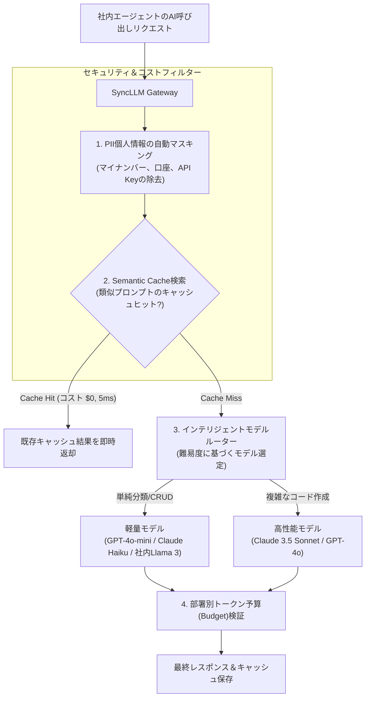

# SyncLLMゲートウェイ & FinOpsコスト最適化

社内の複数のチームやエージェントがそれぞれ個別に商用LLM API（OpenAI、Anthropic、Googleなど）を呼び出すと、**コスト統制の分散、重複呼び出しによるトークンの浪費、機密個人情報（PII）の漏洩リスク**が発生する可能性があります。

SyncVerseの **FinOps Gateway Agent（SyncLLM）** は、すべてのAIリクエストを一元化されたゲートウェイで管理することで、**セキュリティを強化しAPIコストを体系的に最適化**します。

---

## 1. FinOpsゲートウェイの4大コア機能



---

## 2. セマンティックキャッシング（Semantic Cache Lookup）

従来の単純な文字列一致（Exact Match）キャッシングは、語尾やスペースの違いによって再利用率が高まりません。

SyncLLMは、**埋め込みベクトル類似度（Cosine Similarity $\ge 0.95$）** に基づくセマンティックキャッシングをサポートしています。
- *「商品一覧取得APIを作成して」*
- *「商品リストを取得するAPIコードを書いて」*

2つのリクエストの意味的な類似度を判定し、外部LLMを呼び出すことなく既存のキャッシュ済み結果を即座に返却することで、応答遅延とトークンコストを削減します。

---

## 3. PII（個人情報）のリアルタイム自動マスキング

外部LLMベンダーへデータが送信される前に、ゲートウェイ層で機密情報（住民登録番号・マイナンバー、電話番号、メールアドレス、クレジットカード番号、内部DB接続パスワードなど）を正規表現およびNER（固有表現抽出）によって検出し、仮名化・マスキング処理を行います。

```json
// LLM送信前の自動マスキング変換例
{
  "originalPrompt": "顧客 山田太郎(010-1234-5678, 900101-1234567)の注文キャンセルを処理してください",
  "sanitizedPrompt": "顧客 [MASK_USER_1]([MASK_PHONE_1], [MASK_RRN_1])の注文キャンセルを処理してください"
}
```

---

## 4. 部署別トークン予算（Budget）上限統制

管理コンソールから部署別・プロジェクト別に月間AIトークン消費上限を設定できます。
- **警告しきい値（80%）**: 管理者へ通知を送信
- **最大上限到達（100%）**: 非中核エージェントの高度なモデル呼び出しを制限し、軽量モデルへダウングレード
