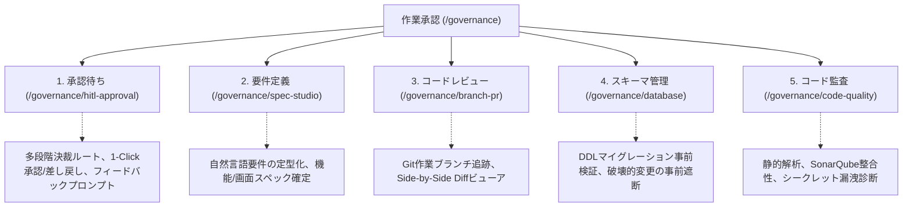

# エンタープライズ作業承認（HITL）ガバナンスコンソール

SyncVerseは、AIエージェントの生成スピードを最大化しつつデータ損失やサービス障害を防止するため、**作業承認（Governance）** 専用の管制体制を独立した大分類として昇格させ運用しています。

---

## 1. 5大作業承認管制ビューの構成

SyncVerse Adminコンソールは、複雑な承認プロセスを実務中心の直感的な5大専門画面に分離して提供します。

### 1.1 承認待ち（`HitlApprovalView.vue`）
* エージェントがリクエストした重要変更（デプロイ、一括価格変更、権限昇格など）に対してアーキテクトの承認を待機するリアルタイムキューです。
* 多段階決裁ルート（Multi-Approval Chain）をサポートしており、承認/差し戻し時に差し戻し理由を入力することでエージェントへ自動フィードバックを伝達します。

### 1.2 要件定義（`SpecStudioManageView.vue`）
* ユーザーの非定型な自然言語要件を標準の機能仕様書および画面仕様書へと定型化するスペックスタジオです。
* 確定されたスペックのみがコーディングエージェントの作業指示書としてディスパッチされます。

### 1.3 コードレビュー（`BranchPrManageView.vue`）
* エージェントが生成したGit作業ブランチとPull Request（PR）の変更履歴をリアルタイムに管制します。
* 変更前後のソースコードをSide-by-Side方式で可視化し、人間のレビュアーが変更点を迅速に把握できるよう支援します。

### 1.4 スキーマ管理（`DatabaseGovernanceView.vue`）
* 新規テーブル作成、カラム変更などのDDLマイグレーションスクリプトを事前に検証します。
* `DROP TABLE` や大規模な `TRUNCATE` など非可逆的な破壊的DDLを事前に遮断し、論理削除または段階的なDeprecationを強制します。

### 1.5 コード監査（`CodeQualityAuditView.vue`）
* コンパイル整合性、Zero-Mock準拠状況、SonarQubeルールセット、シークレット漏洩検査を自動実行し、監査レポートを出力します。

---

## 2. AIとシステムアーキテクト間のR&R

| 運用フェーズ | AIエージェントの担当作業 | システムアーキテクト（人間）の担当作業 |
|:---|:---|:---|
| **01. 要件分析** | 自然言語指示の解釈、影響範囲分析、機能/画面仕様のドラフト作成 | 要件の提示およびスペックスタジオでの最終承認 |
| **02. コード生成およびDDL** | 作業ブランチの分岐、コード作成、6-File SQL（`db/00_extensions.sql ~ 05_sample_dev.sql`）スクリプトの導出 | *（介入なし - 自律実行）* |
| **03. テストおよび品質監査** | 無人QA回帰検証、静的解析、Zero-Mockハーネス検証 | 監査レポートおよび指標の確認 |
| **04. レビューおよび承認ゲート** | 変更Diffサマリーレポート、ERD変更ダイアグラムの提供 | **コードレビューおよびスキーマの承認/差し戻し決定** |
| **05. 本番デプロイおよび監査** | 無停止ロールアウト、Sagaトランザクションコミット、監査履歴の保持 | 緊急時の緊急停止（Kill-Switch）トリガー |

---

## 3. エンタープライズ安全ガードレール

* **本番デプロイの2要素認証**: 本番デプロイパイプラインのトリガー時に2要素認証（2FA/OTP）の通過が必須となります。
* **破壊的DDLの事前遮断**: データ損失を引き起こす破壊的なSQLコンテキストを検出した際、即座に作業を中断します。
* **全社緊急キルスイッチ（Kill-Switch）**: 異常なトランザクションを検知した際、1クリックで全エージェントの稼働を安全に停止（Safe Halt）し、コネクションを隔離します。
