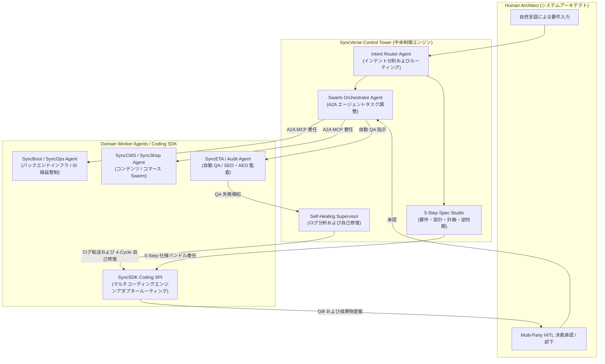
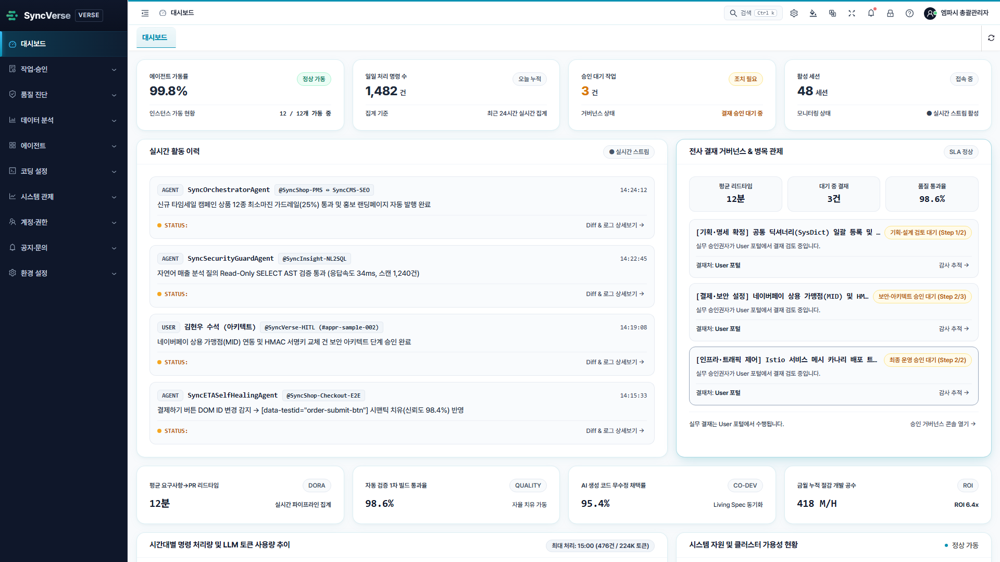
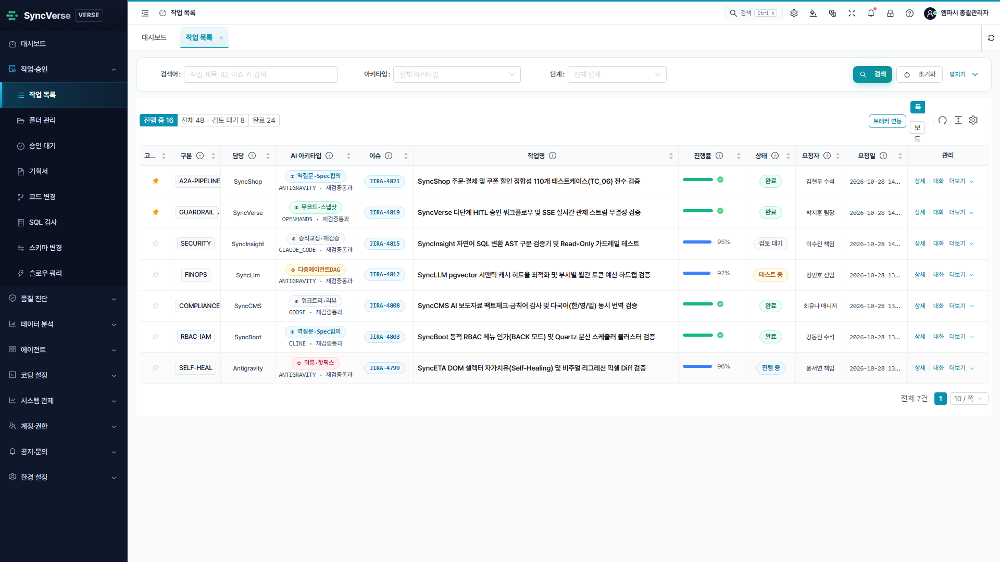
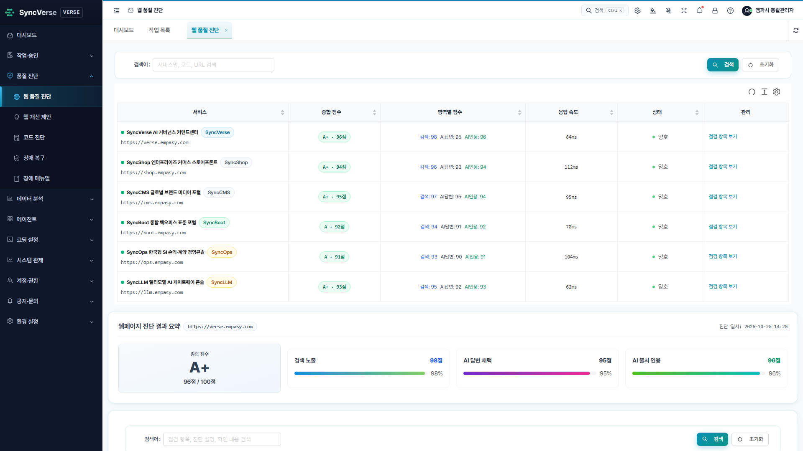
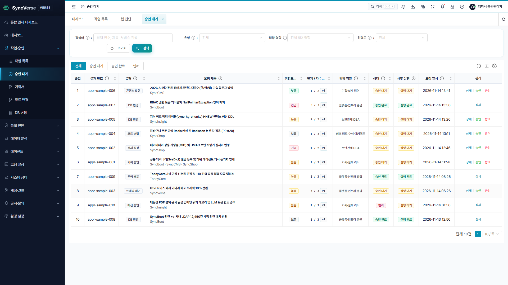

# SyncVerse: マルチエージェント中央管制・オーケストレーションプラットフォーム

> **非開発者・導入検討のご案内**: 分かりやすい製品紹介は [SyncVerse 製品ホームページ (empasy.io)](https://empasy.io/ja/solutions/sync-verse.html){target="_blank" rel="noopener"} で、インストール不要の画面体験は [統合デモポータル](https://demo.empasy.io/ja/products/sync-verse#demo){target="_blank" rel="noopener"} でご利用いただけます。紹介資料・提案書 PDF は [提案書資料室](/ja/proposals/) からダウンロードできます。

**SyncVerse** は、個別に動作する分散ドメインソリューションを標準インターフェースで接続し、要件整理、タスク配分、品質検証の照会、段階別の決裁承認を統合管理する **中央オーケストレーションプラットフォーム (Control Tower)** です。

SyncVerse 中央オーケストレーターは、下位ドメインモジュール (`SyncWatch`, `SyncAPIM`, `SyncBoot`, `SyncCMS`, `SyncShop`, `SyncOps`, `SyncLLM`, `SyncInsight`, `SyncETA`, `SyncCrawl`) と標準 **[MCP](/ja/glossary/#mcp)** および **[A2A](/ja/glossary/#a2a)** プロトコルで通信します。また、[`SyncWatch`](/ja/syncwatch/) から受信した `VerseAuditPack` (SCA 依存関係・SAST コード・DAST 点検ルールパック) をベースにリポジトリの脆弱性を点検し、パッチ PR のドラフトを生成します。

---

## 1. 4大コア構成要素

SyncVerse は、ソフトウェア開発・運用ライフサイクル (AI DLC) を支援するために 4 つのコアエンジンを提供します。

| コアエンジン | 役割および機能 | 主な技術メカニズム |
| :--- | :--- | :--- |
| **01. 自然言語インテント分類および A2A 委任** | 入力されたリクエストが運用データ操作かソース変更作業かを判別し、下位ドメインモジュールへ委任 | `A2ASwarmDelegationStrategyHandler`, ドメインコンテキスト Tri-Hybrid RAG 注入 |
| **02. 5-Step Spec Studio** | 受入基準 (AC) 精製 -> 詳細技術仕様 -> 実装計画 -> ブランチ作業委任 -> 4大標準成果物への逆同期 | Decision Queue, Living Spec, 要件カバレッジマトリクス |
| **03. マルチコーディングエンジン SPI ルーティング (`SyncSDK`)** | ソースコード修正時、社内ポリシーとして登録された有効なコーディングアダプターを選択し、隔離ブランチでパッチを生成 | `CodingAgentRoutingProxy` (`ICodingAgentClient` プラグインアダプター構造) |
| **04. 自動デプロイ連携 & 自己修復リカバリ** | 4-Cycle ビルドエラー分析・補正およびデプロイ失敗時のスナップショットベース補償ロールバック | `sync-module-deploy`, [Multi-Party HITL](/ja/glossary/#hitl) 承認ルート, スナップショット補償ロールバック |

---

## 2. 6-Step AI DLC ライフサイクル

SyncVerse は、要件受付から承認・デプロイまでの 6 段階パイプラインのステータスを追跡します。

1. **要件分析および仕様精製 (Spec Studio Step 1~3)**: 要件プロンプトを分析し、受入基準 (AC)、技術仕様、実装計画、および要件カバレッジマトリクスを生成します。
2. **隔離ブランチでのコード作成 (Spec Studio Step 4)**: `SyncSDK` アダプターを通じて隔離された作業ブランチでソースコードおよび 6-File DB SSOT (`db/00_extensions.sql` ~ `05_sample_dev.sql`) DDL 変更案を作成します。
3. **自動回帰検証 (Automated QA)**: 自動ビルドと Playwright/`SyncETA` E2E 回帰テストを実行します。
4. **ビルド・テストエラー補正 (4-Cycle Self-Healing Loop)**: コンパイルまたはテスト失敗時に分散ログを収集し、原因分析およびパッチ再試行を行います。
5. **多者間アーキテクト承認 (Multi-Party HITL Approval)**: システムアーキテクトがコード Diff と影響度分析レポートを確認し、多段階決裁の承認または却下を決定します。
6. **デプロイおよび成果物逆同期 (Spec Studio Step 5)**: 承認された変更をデプロイパイプラインへ引き渡し、4大標準成果物 (要件定義書、画面設計書、DB 設計書、テスト結果書) を更新します。

---

## 3. 運用構造比較 (個別手動運用 vs SyncVerse 中央管制)

| 区分項目 | 個別手動開発・運用方式 | SyncVerse 中央管制アーキテクチャ |
| :--- | :--- | :--- |
| **要件仕様の追跡** | 企画書・課題・コードが分離され、変更履歴の不一致が発生 | 5-Step Spec Studio ベースの仕様・実装・成果物逆同期 |
| **コード変更ワークフロー** | 開発者ごとに異なるツールおよび手動ブランチ・検証手順 | `SyncSDK` 標準 SPI による隔離ブランチ作成および一貫した検証ゲートの適用 |
| **障害原因分析および再検証** | エラー発生時にサーバーログを手動収集して再現 | クラスターログ収集と 4-Cycle ビルド・テスト再検証の自動連携 |
| **LLM コスト統制** | チーム別の個別 API キー利用によりコスト追跡・制限が困難 | `SyncLLM` 単一ゲートウェイ、[セマンティックキャッシュ](/ja/glossary/#semantic-cache)、[FinOps](/ja/glossary/#finops) 予算上限の適用 |
| **ツール・モジュールガバナンス** | 個別ツールが断片化し、監査やアクセス統制が不可能 | 標準 [MCP](/ja/glossary/#mcp) レジストリおよび [RBAC](/ja/glossary/#rbac) ベースの一元管理 |
| **デプロイ安全装置** | 障害発生時の手動ロールバックおよび夜間対応の負担 | Multi-Party HITL 事前承認ゲートおよびスナップショット補償ロールバック |

---

## 4. エンタープライズセキュリティおよび信頼性原則

SyncVerse は、企業の重要なビジネス資産を保護するために、以下のガバナンスルールを遵守します。

- **プライベート AI セキュリティ環境**: 社内ネットワークから外部へ持ち出してはならない機密データ向けに、オンプレミス (On-Premise) およびプライベートクラウド (VPC) 環境に対応
- **Multi-Party HITL 安全ゲート**: DDL 変更、権限変更、本番デプロイなどの重要作業は多者間承認ルートを経由するようポリシー化
- **実サービス直接連携 (Zero-Mock)**: ハードコードされたダミーロジックなしで、実際の PostgreSQL 18.6 データベースおよびバックエンドサービスと 100% 直接連携
- **全社監査証跡 (Audit Trail) & KMS**: 作業指示者、承認履歴、エージェントのツール呼び出し履歴を全数記録し、AES-256 マスターキーのワンクリックローテーションに対応

---

## 実稼働画面および主要ワークフロー

### 1. 統合コマンドセンターおよびエージェントトポロジ管制
自然言語のビジネス命令を受け取り、下位ドメインエージェント (`SyncBoot`, `SyncCMS`, `SyncShop`, `SyncOps`, `SyncAPIM`, `SyncWatch` など) へインテントをルーティングし、リアルタイムの A2A 協調状態を管制します。

### 2. 全社エージェント自律作業および品質検証パイプライン管制
ドメインエージェントに委任された自律作業一覧、AI アーキタイプ (逆質問・Spec 合意、ノーコード・スナップショット、視覚回帰・自己修復など)、品質検証パイプラインの進捗率およびステータスを単一画面で追跡します。

### 3. Web 品質およびリポジトリセキュリティ統合監査
ヘッドレスブラウザレンダリングとセキュリティ点検ルールを組み合わせ、Web 品質スコア (SEO/AEO/GEO) およびリポジトリのセキュリティ脆弱性を常時診断します。

### 4. 多者間承認決裁およびスナップショットロールバックセンター
高リスクの DDL 変更、ソースコードパッチ PR、本番デプロイ作業について、変更前後の Diff と影響度を確認し、多者間決裁承認またはワンクリックスナップショットロールバックを実行します。

