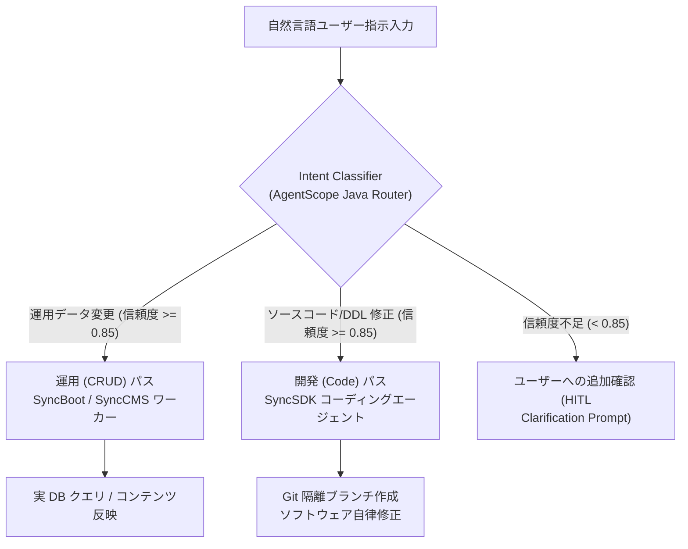
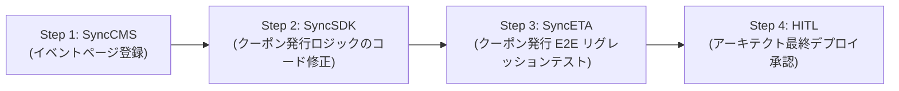

# インテントルーティングエンジン (Intent Routing Engine)

SyncVerse の **インテントルーティングエンジン (Intent Routing Engine)** は、システムに流入するすべての自然言語指示を分析してタスクの性質を見極め、最も適切なドメインエージェントとツールチェーンへ分配する中核エントリーポイント (Entry Point) です。

---

## 1. 運用 (CRUD) vs 開発 (Code) の分離

SyncVerse は、システムの安定性を確保するため、**データ運用作業** と **ソースコード変更作業** のパスを明確に分離して運用します。



### カテゴリ別分類基準

| タスク分類 (Intent Type) | 説明および例 | 呼び出しエージェント | コードアクセス権限 |
| :--- | :--- | :--- | :---: |
| **`OPS_DATA_CRUD`** | 「VIP 会員ランク基準を 100 万円に修正して」 | `SyncBoot`, `SyncShop` | 制限 (DB DML のみ許可) |
| **`OPS_CONTENT_UPDATE`**| 「メインバナーの文言をサマープロモーションに変更して」 | `SyncCMS` | 制限 (コンテンツ API のみ許可) |
| **`DEV_CODE_FIX`** | 「決済キャンセル時にポイント返還が漏れるバグを修正して」 | `SyncSDK`, `SyncETA` | 許可 (作業ブランチ内) |
| **`DEV_NEW_FEATURE`** | 「会員登録時に Kakao 簡易ログイン OAuth 連携を追加して」| `SyncSDK`, `SyncBoot` | 許可 (作業ブランチ内) |
| **`QA_VERIFICATION`** | 「カート決済フローの E2E テストを再実行して」 | `SyncETA` | 制限 (テストランタイムのみ) |

---

## 2. 信頼度スコア (Confidence Score) ガバナンス

意図分析の誤りによってタスクが誤ったパスへ転送されるのを防ぐため、**Confidence Score 閾値 (デフォルト 0.85)** ポリシーを適用します。

- **信頼度 $\ge 0.85$**: 指定されたエージェントパイプラインへ自動ディスパッチ
- **信頼度 $< 0.85$**: 曖昧な指示と判定し、ユーザーに確認モーダルを提示して追加入力を要求

---

## 3. 複合要件のマルチタスク自動分解 (Task Decomposition)

業務担当者が複数の作業を複合的にリクエストした場合、エンジンがこれを単位タスクに分解し、実行チェーン (DAG) を構成します。

### 複合リクエスト例:
> *「新規イベントページを登録し、クーポン発行ロジックに 1 人 1 回制限のバリデーションコードを追加したうえで、テストを実行して。」*

### 分解結果 (DAG チェーン):


---

## 4. 社内 RAG アーキテクチャコンテキスト注入

正確な意図分類およびコード修正を実現するため、システムは社内プロジェクトのアーキテクチャ仕様書、DB スキーマ DDL、ドメイン用語集 (Glossary) をプロンプトに結合 (Prompt Augmentation) してモデルに伝達します。

```java
// SyncVerse 内部 IntentRouterService (AgentScope Java ベース)
@Service
@RequiredArgsConstructor
public class IntentRouterService {

    private final ChatModel chatModel;
    private final ProjectContextRetriever contextRetriever;

    public RoutingResult route(String userPrompt, Long projectId) {
        // 1. 社内プロジェクトコンテキストおよび DB スキーマ RAG 検索
        String domainContext = contextRetriever.retrieveContext(projectId, userPrompt);

        // 2. 構造化プロンプト生成および AgentScope Java ReActAgent 推論
        ReActAgent routerAgent = ReActAgent.builder()
                .name("IntentRouter")
                .sysPrompt(IntentPromptTemplate.createSystemPrompt(domainContext))
                .model(chatModel)
                .build();

        Msg response = routerAgent.call(Msg.builder().role(MsgRole.USER).textContent(userPrompt).build()).block();
        return RoutingResult.fromJson(response.getTextContent());
    }
}
```
