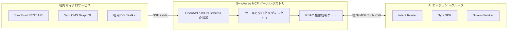

# MCP ツールレジストリおよび RBAC 権限管理

SyncVerse は、社内のマイクロサービスと外部ツールを **Model Context Protocol (MCP)** 標準インターフェースで統合して管理します。

コントロールタワーの **MCP ツールレジストリ (MCP Tool Registry)** を通じて全社ツールカタログを参照し、各ツールの入出力スキーマを検証し、実行権限 (RBAC) を統制できます。

---

## 1. 標準 MCP ツール登録およびアーキテクチャ



---

## 2. JSON Schema ベースのパラメーターバリデーション

登録されたすべての MCP Tool は厳格な JSON Schema に基づいて定義され、不正なパラメーターでの呼び出しを事前に遮断します。

### ツール仕様例 (`syncboot_create_entity`):
```json
{
  "name": "syncboot_create_entity",
  "description": "指定されたドメインモジュールに新規 JPA Entity クラスおよび DDL スクリプトを生成します。",
  "inputSchema": {
    "type": "object",
    "properties": {
      "moduleName": {
        "type": "string",
        "enum": ["member", "order", "product", "coupon"]
      },
      "entityName": {
        "type": "string",
        "pattern": "^[A-Z][a-zA-Z0-9]+$"
      },
      "fields": {
        "type": "array",
        "items": {
          "type": "object",
          "properties": {
            "name": { "type": "string" },
            "type": { "type": "string", "enum": ["String", "Long", "Integer", "LocalDateTime", "Boolean"] },
            "nullable": { "type": "boolean" }
          },
          "required": ["name", "type"]
        }
      }
    },
    "required": ["moduleName", "entityName", "fields"]
  }
}
```

---

## 3. ツール別細分化権限管理 (Fine-grained RBAC)

すべてのエージェントがすべてのツールを実行できるわけではありません。システムのセキュリティレベルに応じて、エージェントおよびユーザーロール単位で実行権限を制御します。

| ツールセキュリティレベル | ツール例 | 許可エージェント | 管理者承認要否 |
| :--- | :--- | :--- | :---: |
| **Level 1 (Read-Only)** | `query_schema`, `get_logs`, `search_api` | すべてのワーカーエージェント | 自動許可 |
| **Level 2 (Data Write)** | `insert_record`, `publish_content` | `SyncBoot`, `SyncCMS` | ポリシーに基づく許可 |
| **Level 3 (Code Edit)** | `checkout_branch`, `modify_source` | `SyncSDK Coding Agent` | 自動ビルド後に検証 |
| **Level 4 (Critical DDL)**| `alter_table`, `deploy_production` | なし (エージェント単独実行不可) | **アーキテクト承認必須** |

---

## 4. OpenAPI / Swagger ベースの MCP 変換

すでに社内で運用中の Spring Boot REST API を標準 MCP ツールへ変換して登録できます。

1. コントロールタワーのコンソールで社内マイクロサービスの `swagger.json` または `openapi.yaml` URL を入力
2. エンドポイントの選択および MCP ツール名のマッピング
3. `[MCP サーバー登録]` をクリックすると、全社エージェントが呼び出し可能なツールとして有効化
