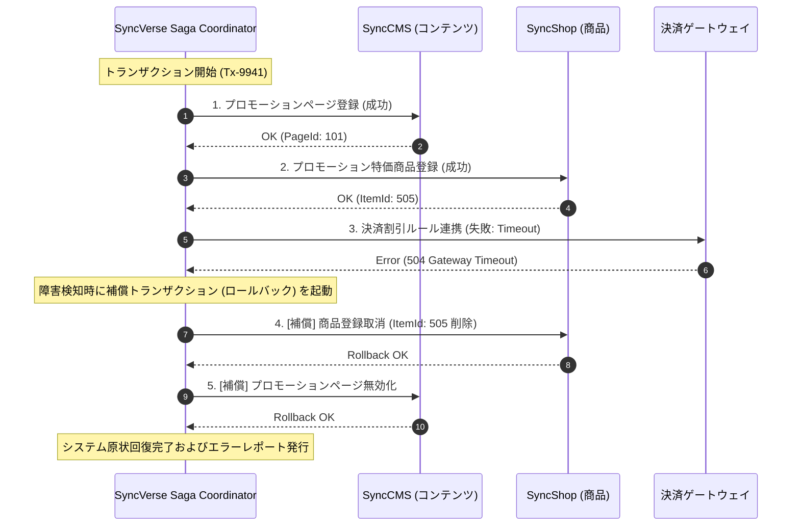

# Saga分散トランザクション & 全社監査証跡

マルチエージェント環境では、1つのユーザー指示が複数のシステム（`SyncBoot`、`SyncCMS`、`SyncShop`など）のAPIを連続して呼び出します。このとき、中間ステップでエラーが発生すると**一部のシステムにのみデータが反映され、データの不整合（Data Inconsistency）が発生する**可能性があります。

SyncVerseは、**Sagaオーケストレーションパターン**と**全数監査証跡（Audit Trail）**によってシステムのデータ整合性とコンプライアンスの信頼性を管理します。

---

## 1. Saga分散トランザクションおよび補償ロールバックメカニズム

SyncVerseの中央オーケストレーターは、作業チェーンを段階的なトランザクションとして定義し、各ステップに対応する**補償トランザクション（Compensating Transaction）**を事前に登録します。



---

## 2. 作業状態（State）の永続化と障害復旧

オーケストレーション中にサーバーが不意に再起動したりネットワークが切断されたりしても作業状態が失われないよう、**Redis ClusterおよびPostgreSQL**にトランザクションスナップショットを永続化します。

- **State Machineの永続化**: `PENDING` $\rightarrow$ `EXECUTING` $\rightarrow$ `COMPENSATED` $\rightarrow$ `COMMITTED`
- **冪等性（Idempotency）の保証**: すべてのエージェントツール呼び出しに一意の`Idempotency-Key`を付与し、重複実行を防止
- **タイムアウト & サーキットブレーカー**: 個別ツール呼び出しの遅延時に自動タイムアウト処理を行い、ロールバック経路へ遷移

---

## 3. 全社A2A監査証跡（Audit Trail & Compliance）

セキュリティ規制の遵守に向けて、システム内で発生したすべてのアクティビティを監査ログとして記録します。

```json
{
  "auditId": "audit-20260823-0091",
  "timestamp": "2026-08-23T07:15:00Z",
  "actor": {
    "type": "USER",
    "userId": "architect_kim",
    "ipAddress": "10.0.12.44"
  },
  "action": "HITL_APPROVE_DEPLOYMENT",
  "targetService": "syncboot-product-api",
  "changes": {
    "commitHash": "a7b8c9d",
    "ddlExecuted": "ALTER TABLE tb_product ADD COLUMN discount_rate NUMERIC(5,2);",
    "approverOtpVerified": true
  },
  "subAgentTraces": [
    {
      "agent": "IntentRouterAgent",
      "model": "gpt-4o-mini",
      "tokensUsed": 340
    },
    {
      "agent": "SyncSDKCodingAgent",
      "model": "claude-3-5-sonnet",
      "tokensUsed": 2150
    }
  ]
}
```

### 監査コンソールで照会可能な情報：
1. **指示者および承認者の情報・IP**: どのユーザーが作業を指示し、本番デプロイを承認したか
2. **エージェント別のプロンプトおよびツール呼び出し全数記録**: エージェントがどのような判断を下し、どのようなパラメーターでツールを実行したか
3. **トークン消費量および所要時間**: 各ステップ別のコストおよびレイテンシ
