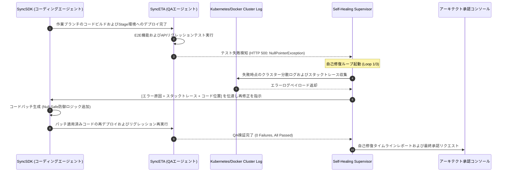

# 自己修復パイプライン（Self-Healing Pipeline）

従来のソフトウェア開発では、QAフェーズで不具合が検出されると、**[開発者の呼び出し $\rightarrow$ ログの手動収集 $\rightarrow$ ローカルデバッグ $\rightarrow$ コードの再修正 $\rightarrow$ 再ビルド $\rightarrow$ 再デプロイ]**へと続く手順が必要でした。

SyncVerseの**自己修復パイプライン（Self-Healing Pipeline）**は、このプロセスをエージェント間のA2A連携によって自動化し、処理時間を大幅に短縮します。

---

## 1. 自己修復の4段階ループ（The Self-Healing Loop）



---

## 2. 詳細な動作メカニズム

### 1) 不具合の検知および異常兆候の捕捉（SyncETA）
SyncETAエージェントがStage環境にデプロイされたアプリケーションを対象に、API単体テストおよびUIシナリオE2Eテストを実行します。アサーション（Assertion）の失敗またはHTTP 5xx応答が検知されると、直ちに`Self-Healing Supervisor`エージェントへ障害イベントを発行します。

### 2) クラスター分散ログの自動収集（Log Harvester）
`Self-Healing Supervisor`は、コンテナクラスター（Docker/Kubernetes/Spring Boot Logback）からエラーが発生したトランザクションID（Trace-Id）に関連するすべてのログを抽出します。

```json
{
  "traceId": "trace-77a8-4c12-9901",
  "errorType": "java.lang.NullPointerException",
  "exceptionMessage": "Cannot invoke \"String.trim()\" because \"userCoupon.getCouponCode()\" is null",
  "culpritClass": "com.empasy.syncshop.service.CouponService",
  "culpritLine": 142,
  "stackTraceSnippet": "at com.empasy.syncshop.service.CouponService.applyCoupon(CouponService.java:142)..."
}
```

### 3) 原因分析およびSDKによるコード再修正（SyncSDK）
コーディングエージェントは、元のソースコード、失敗したテストケース、および収集されたログのスタックトレースを統合してバグの原因を分析し、防御コードを作成します。

```diff
// CouponService.java 修正例
- if (userCoupon.getCouponCode().trim().isEmpty()) {
+ if (userCoupon.getCouponCode() == null || userCoupon.getCouponCode().trim().isEmpty()) {
      throw new BusinessException(ErrorCode.INVALID_COUPON_CODE);
  }
```

### 4) 回帰検証および安全終了
修正されたコードを再度ビルドしてSyncETAへ渡します。SyncETAは失敗したテストだけでなくリグレッションテストスイート全体を再実行し、他の機能に副作用（Side-effect）がないことを検証します。

---

## 3. 無限ループ防止および安全装置（Safety Rails）

自己修復プロセスが繰り返されてトークンやサーバーリソースが不必要に消費されるのを防ぐため、以下のポリシーを適用します。

- **最大リトライ回数（Max Retry Limit）**: デフォルトで**最大3回**に制限。3回以内に解決されない場合は直ちにサーキットブレーカーが作動し、担当開発者へエスカレーションされます。
- **サーキットブレーカー（Circuit Breaker）**: 同一のエラーが2回連続して同じパターンで修正に失敗した場合、直ちに作業を中断します。
- **監査タイムラインの可視化**: 自己修復が発生した全プロセス（ログ $\rightarrow$ Diff $\rightarrow$ テスト結果）を管理者画面にタイムライン形式で詳細に記録します。
