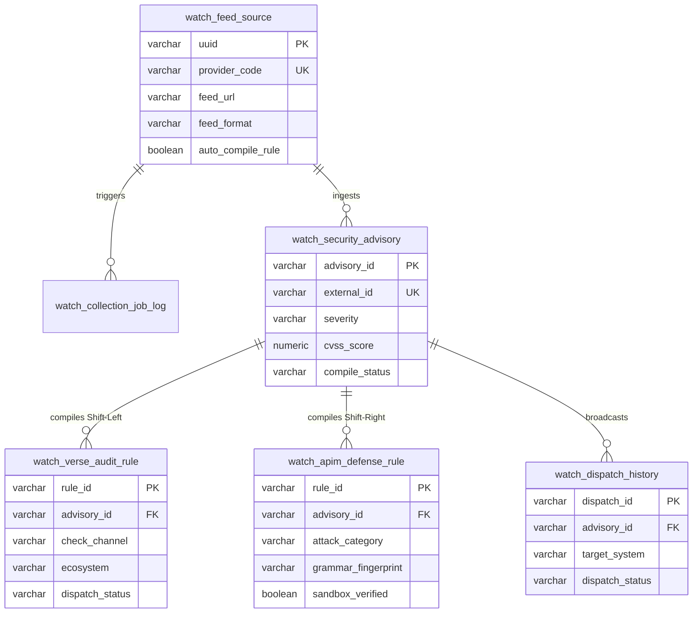

# SyncWatch DBスキーマおよび標準REST/MCP API仕様

`SyncWatch`は、全社6-File DB SSOTデータベース標準（`sync-watch/db/00_extensions.sql` ~ `05_sample_dev.sql`）、**PostgreSQL 18.6 (`pgvector/pgvector:pg18`)**、および`/api/v1/watch/*`単一URLマッピング原則に準拠し、**8大グローバル脅威フィード（OSV.dev、GitHub GHSA、NVD CVE、CISA KEV、Nuclei、OWASP CRS、MITRE ATT&CK、KISA）**の収集からデュアルルールコンパイル・配信までの全ライフサイクルを永続化します。

---

## 1. エンティティ関連図（ER図）および6大ドメインテーブル（`watch_*`）



### 1.1 ドメインテーブル詳細仕様（`sync-watch/db/02_schema_domain.sql`）

| 通番 | テーブル名 | 役割および主要カラム |
| :---: | :--- | :--- |
| **1** | **`watch_feed_source`** | **8大グローバル脅威フィード出典マスター**<br>• PK: `uuid` / UK: `provider_code` (`OSV_DEV_FEED`, `GITHUB_GHSA`, `NVD_CVE_FEED`, `CISA_KEV_CATALOG`, `NUCLEI_TEMPLATES`, `OWASP_CRS_FEED`, `MITRE_ATTACK_STIX`, `KISA_BOHO_NOTICE`)<br>• 主要カラム: `provider_name`, `site_url`, `feed_url`, `feed_format` (`REST_JSON`, `YAML_NUCLEI`, `CRS_CONF`, `STIX_TAXII`, `RSS_XML`), `source_channel`, `auth_type`, `sync_interval_min`, `auto_compile_rule`, `auto_broadcast`, `enabled`, `last_sync_time`, `last_sync_status`, `last_sync_count`, `total_ingested_count` |
| **2** | **`watch_security_advisory`** | **正規化されたセキュリティイシュー台帳**<br>• PK: `advisory_id`<br>• 主要カラム: `source_channel`, `feed_provider`, `external_id`（CVE/GHSA/KISA番号）, `cwe_id`, `mitre_code`, `title`, `severity` (`CRITICAL`, `HIGH`, `MEDIUM`, `LOW`), `cvss_score`, `exploit_status`, `affected_ecosystem`, `affected_packages`, `vulnerable_version_range`, `patched_version`, `summary_text`, `raw_payload_json` (`jsonb`), `matched_asset_count`, `matched_repo_count`, `compile_status` |
| **3** | **`watch_verse_audit_rule`** | **SyncVerse供給用セキュリティ点検ルール（`VerseAuditPack`）**<br>• PK: `rule_id` / FK: `advisory_id`<br>• 主要カラム: `external_id`, `rule_title`, `severity`, `check_channel` (`SCA_DEPENDENCY`, `SAST_CODE`, `DAST_PENTEST`), `ecosystem`, `package_name`, `vulnerable_version_range`, `patched_version`, `sast_pattern_regex`, `dast_probe_method`, `dast_probe_path`, `dast_probe_payload`, `remediation_guide_md`, `target_agent_code`, `verified`, `dispatch_status` |
| **4** | **`watch_apim_defense_rule`** | **SyncAPIM供給用攻撃パターンルール（`ApimDefensePack`）**<br>• PK: `rule_id` / FK: `advisory_id`<br>• 主要カラム: `external_id`, `rule_name`, `attack_category` (`SQLI`, `XSS`, `SSRF`, `RCE`, `PATH_TRAVERSAL`), `mitre_tactic`, `severity`, `target_locations` (`HEADER,URI,QUERY,BODY`), `target_method`, `target_path`, `detection_regex`, `defense_expression`, `grammar_fingerprint`, `positive_samples_json`, `negative_samples_json`, `sandbox_verified`, `tp_rate`, `fp_rate`, `dispatch_status` |
| **5** | **`watch_dispatch_history`** | **全社配信および適用フィードバック台帳**<br>• PK: `dispatch_id` / FK: `advisory_id`<br>• 主要カラム: `target_system` (`SYNC_VERSE`, `SYNC_APIM`), `rule_id`, `target_endpoint_url`, `dispatch_mode` (`PUSH_BROADCAST`, `PULL_SYNC`), `dispatch_status`, `response_summary`, `dispatched_by`, `dispatched_time`, `feedback_time` |
| **6** | **`watch_collection_job_log`** | **収集バッチおよび診断ドキュメントアップロード実行ログ**<br>• PK: `job_id`<br>• 主要カラム: `provider_code`, `job_type` (`FEED_SYNC`, `DOC_UPLOAD`, `RULE_COMPILE`), `fetched_count`, `new_advisory_count`, `compiled_verse_rules`, `compiled_apim_rules`, `duration_ms`, `status`, `log_detail`, `executed_time` |

### 1.2 PostgreSQL 18.6 コアDDL例

```sql
-- sync-watch/db/02_schema_domain.sql
CREATE TABLE watch_apim_defense_rule (
    rule_id VARCHAR(64) PRIMARY KEY,
    advisory_id VARCHAR(64) NOT NULL REFERENCES watch_security_advisory(advisory_id),
    external_id VARCHAR(64) NOT NULL,
    rule_name VARCHAR(255) NOT NULL,
    attack_category VARCHAR(32) NOT NULL,
    mitre_tactic VARCHAR(32) NOT NULL DEFAULT 'T1190',
    severity VARCHAR(16) NOT NULL,
    target_locations VARCHAR(64) NOT NULL DEFAULT 'URI,QUERY,BODY',
    target_method VARCHAR(16) NOT NULL DEFAULT 'ANY',
    target_path VARCHAR(255) NOT NULL DEFAULT '/api/v1/*',
    detection_regex TEXT NOT NULL,
    defense_expression TEXT NOT NULL,
    grammar_fingerprint VARCHAR(128) NOT NULL,
    positive_samples_json JSONB NOT NULL,
    negative_samples_json JSONB NOT NULL,
    sandbox_verified BOOLEAN NOT NULL DEFAULT FALSE,
    tp_rate NUMERIC(5,2) NOT NULL DEFAULT 0.00,
    fp_rate NUMERIC(5,2) NOT NULL DEFAULT 0.00,
    dispatch_status VARCHAR(24) NOT NULL DEFAULT 'DRAFT',
    created_time TIMESTAMPTZ NOT NULL DEFAULT CURRENT_TIMESTAMP
);

CREATE INDEX idx_watch_apim_rule_category ON watch_apim_defense_rule (attack_category, severity);
CREATE INDEX idx_watch_apim_rule_fingerprint ON watch_apim_defense_rule USING gin (grammar_fingerprint gin_trgm_ops);
```

---

## 2. 標準REST API仕様（`/api/v1/watch/*`）

| ドメイン分類 | HTTPメソッド & Canonical URL | 説明 |
| :--- | :--- | :--- |
| **観測ダッシュボード** | `GET /api/v1/watch/overview` | 8大収集フィードの稼働状況、深刻度別セキュリティアドバイザリ統計、デュアルルールコンパイル・配信指標の照会 |
| **フィード出典管理** | `GET /api/v1/watch/feeds/list`<br>`GET /api/v1/watch/feeds/active`<br>`POST /api/v1/watch/feeds/add`<br>`PUT /api/v1/watch/feeds/edit`<br>`POST /api/v1/watch/feeds/test`<br>`POST /api/v1/watch/feeds/sync` | 8大グローバルセキュリティフィード出典一覧の照会・登録、5段階SSRFガードベースの接続診断および即時同期の実行 |
| **セキュリティアドバイザリ** | `GET /api/v1/watch/advisories/list`<br>`GET /api/v1/watch/advisories/detail`<br>`POST /api/v1/watch/advisories/register`<br>`POST /api/v1/watch/advisories/upload`<br>`POST /api/v1/watch/advisories/compile`<br>`POST /api/v1/watch/advisories/match-sbom` | 正規化されたセキュリティイシュー台帳の検索、セキュリティ診断ドキュメント・バンドルのアップロード解析、デュアルルールコンパイルおよび全社SBOM依存関係のクロス照合 |
| **デュアルルール & サンドボックス** | `GET /api/v1/watch/verse-rules/list`<br>`PUT /api/v1/watch/verse-rules/edit`<br>`GET /api/v1/watch/apim-rules/list`<br>`PUT /api/v1/watch/apim-rules/edit`<br>`POST /api/v1/watch/apim-rules/verify-sandbox` | `VerseAuditPack`点検ルールおよび`ApimDefensePack`防御ルールの照会・編集、Positive/Negativeサンプルに基づくサンドボックス検証 |
| **セキュリティパック & 全社配信** | `GET /api/v1/watch/packs/verse`<br>`GET /api/v1/watch/packs/apim`<br>`POST /api/v1/watch/dispatch/broadcast`<br>`POST /api/v1/watch/dispatch/feedback`<br>`GET /api/v1/watch/dispatches/list`<br>`GET /api/v1/watch/dispatches/jobs` | `SyncVerse`および`SyncAPIM`向けセキュリティパックの照会（Pull）、リアルタイムブロードキャスト配信（Push）、適用フィードバックの受信およびジョブログの照会 |
| **MCPサーバー & メニュー認可** | `GET /api/v1/watch/mcp/tools`<br>`POST /api/v1/watch/mcp`<br>`GET /api/v1/watch/sys/permission/getUserPermissionByToken` | JSON-RPC 2.0 MCPツール一覧・実行および現在の認証ユーザーのロール（`role_admin`、`role_secops`）に応じた動的メニューツリーの返却 |

### 2.1 サンドボックス検証リクエストおよびレスポンス例（`POST /api/v1/watch/apim-rules/verify-sandbox`）

```json
{
  "code": 200,
  "success": true,
  "result": {
    "ruleId": "arule-sqli-union-001",
    "sandboxVerified": true,
    "tpRate": 100.0,
    "fpRate": 0.0,
    "avgEvaluationTimeMs": 0.08,
    "maxEvaluationTimeMs": 0.21,
    "dispatchStatus": "READY"
  }
}
```

---

## 3. MCP（Model Context Protocol）公開ツール仕様（`/api/v1/watch/mcp`）

`SyncWatch`は、他のエージェント（`SyncVerse`、`SyncAPIM`、`SyncInsight`）がA2Aプロトコルで脅威インテリジェンスを即座に照会したり、ルールのコンパイル・配信をトリガーしたりできるよう、標準MCPツールを公開しています。

| MCPツール名 | 主要パラメーター | 機能説明 |
| :--- | :--- | :--- |
| **`watch_sync_security_feeds`** | `providerCode`（任意） | 8大グローバル脅威フィード（OSV.dev、GitHub GHSA、NVD CVE、CISA KEV、Nuclei、OWASP CRS、MITRE ATT&CK、KISA）の同期および正規化の実行 |
| **`watch_compile_dual_rules`** | `advisoryId` | 単一のセキュリティイシューから`SyncVerse`点検ルール（`VerseAuditPack`）および`SyncAPIM`攻撃パターン（`ApimDefensePack`）を同時にコンパイルし、サンドボックス検証を実行 |
| **`watch_dispatch_to_verse_and_apim`** | `advisoryId`, `targetSystem` | 検証済みのセキュリティ点検ルールおよびWAF仮想パッチルールを`SyncVerse`と`SyncAPIM`へ即座にブロードキャスト配信 |
| **`watch_match_enterprise_sbom`** | `ecosystem`（任意） | 全社マイクロサービスSBOMパッケージと脆弱性台帳をクロス照合し、影響を受ける資産・リポジトリを算出 |
| **`delegate_intent`** | `intent`, `instruction` | A2A自然言語セキュリティインテリジェンスの収集・コンパイル・全社配信の委任実行 |

### 3.1 JSON-RPC 2.0 MCP呼び出しペイロード例

```json
{
  "jsonrpc": "2.0",
  "id": "watch-rpc-901",
  "method": "tools/call",
  "params": {
    "name": "watch_compile_dual_rules",
    "arguments": {
      "advisoryId": "adv-cve-2026-41892"
    }
  }
}
```
