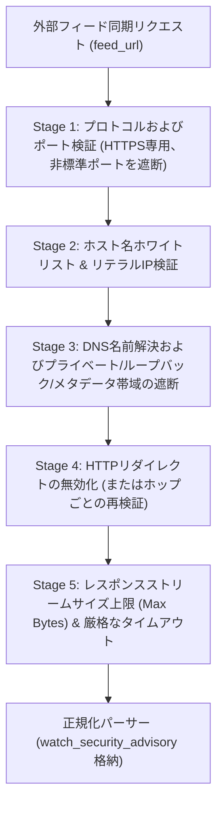

# SyncWatchシステムアーキテクチャおよびデュアルルールコンパイラ

`SyncWatch`は、外部の脅威インテリジェンスを安全に取り込み、誤検知（False Positive）のない高信頼な点検・防御ルールへ変換するために、**8大グローバル脅威フィード多チャネル正規化コレクター**、**5段階SSRFガード**、**`WatchRuleCompilerService`デュアルコンパイラ**、および**独自サンドボックス検証器**で構成されています。

---

## 1. 6大脅威収集チャネルおよび8大グローバル脅威フィードの正規化

`SyncWatch`は、**8大グローバル脅威フィード（OSV.dev、GitHub GHSA、NVD CVE、CISA KEV、Nuclei、OWASP CRS、MITRE ATT&CK、KISA）**および多様なフォーマット（`REST_JSON`、`STIX_TAXII`、`YAML_NUCLEI`、`CRS_CONF`、`RSS_XML`、`DOCUMENT_UPLOAD`）のセキュリティ情報を単一の標準台帳（`watch_security_advisory`）へ正規化します。

| 収集チャネル (`source_channel`) | 8大代表プロバイダー (`provider_code`) | 収集フォーマット | 主な正規化抽出項目 |
| :--- | :--- | :--- | :--- |
| **1. オープンソースエコシステム勧告** | `OSV_DEV_FEED` (OSV.dev), `GITHUB_GHSA` (GitHub GHSA) | `REST_JSON` | `MAVEN`、`NPM`、`PYPI`、`GO`、`DOCKER`パッケージ別の脆弱バージョン範囲およびパッチ適用済みバージョン |
| **2. グローバルCVEデータベース** | `NVD_CVE_FEED` (NIST NVD CVE) | `REST_JSON` | CVE ID、CVSS v3.1スコア、CWEコード、影響を受けるCPE/パッケージバージョン範囲 |
| **3. 実戦悪用確認済み脆弱性** | `CISA_KEV_CATALOG` (CISA KEV) | `REST_JSON` | 実際のハッキングで悪用中の脆弱性（`ACTIVE_EXPLOIT`）、必須対応期限、緩和策ガイドライン |
| **4. ペネトレーションテスト・脆弱性スキャナーテンプレート** | `NUCLEI_TEMPLATES` (Nuclei) | `YAML_NUCLEI` | HTTPリクエストメソッド・パス、攻撃ペイロードプローブ、マッチャー（Matcher）正規表現 |
| **5. WAF & 攻撃戦術マトリックス** | `OWASP_CRS_FEED` (OWASP CRS), `MITRE_ATTACK_STIX` (MITRE ATT&CK) | `CRS_CONF` / `STIX_TAXII` | SQLi/XSS/RCE/LFI検知正規表現、ターゲット位置（`HEADER`、`URI`、`QUERY`、`BODY`）、構文指紋、MITRE戦術コード（`T1190`など） |
| **6. 国内セキュリティ勧告および診断ドキュメント** | `KISA_BOHO_NOTICE` (KISA保護ナラ), 社内診断書アップロード | `RSS_XML` / `DOC` | KISAセキュリティ通知、外部ペネトレーションテスト結果報告書（PDF/Markdown）の解析および正規化 |

---

## 2. 5段階SSRF防御ガード（5-Stage SSRF Defense Guard）

外部フィードURLを同期したり、Webhookでセキュリティ勧告を収集したりする際に内部ネットワークへの侵入（SSRF）攻撃に悪用されないよう、`SyncWatch`のすべてのアウトバウンド収集リクエストは**5段階SSRF防御ガード**を通過する必要があります。

1. **Stage 1 — スキームおよびポートの強制**: `https://`スキーム（デフォルト443ポート）のみを許可し、`file://`、`gopher://`、`ftp://`、`ldap://`などの非標準スキームを即座に遮断します。
2. **Stage 2 — 登録済みプロバイダードメイン検証**: `watch_feed_source`に登録・承認されたプロバイダードメインであるかを確認し、URL内のユーザー資格情報（`user:pass@host`）の挿入を拒否します。
3. **Stage 3 — DNS Rebindingおよびプライベート帯域の遮断**: ソケット接続の直前にDNSを名前解決し、ループバック（`127.0.0.0/8`、`::1`）、プライベートネットワーク（`10.0.0.0/8`、`172.16.0.0/12`、`192.168.0.0/16`）、リンクローカルおよびクラウドメタデータ（`169.254.169.254`）IPへ解決された場合は即座に接続を拒否します。
4. **Stage 4 — リダイレクト（3xx）チェーンの統制**: 無秩序なオープンリダイレクトを通じた内部ネットワークへの迂回を防ぐため、自動リダイレクトを無効化するか、すべての遷移先URLに対してStage 1〜3を再実行します。
5. **Stage 5 — ペイロードボム防御**: レスポンス`Content-Type`検証とともに最大受信バイト上限（例：10MB）および読み取りタイムアウトを強制し、メモリ枯渇（OOM）を防止します。

---

## 3. `WatchRuleCompilerService`デュアルルールコンパイルおよび独自サンドボックス検証

正規化されたセキュリティアドバイザリ（`watch_security_advisory`）が格納されると、`WatchRuleCompilerService`はこれを分析して2種類の実行可能なセキュリティルールへと同時にコンパイルします。

### 3.1 デュアルコンパイル成果物
* **Shift-Left点検ルール (`watch_verse_audit_rule` → `VerseAuditPack`)**:
  - **SCA依存関係ルール (`SCA_DEPENDENCY`)**: エコシステム（`MAVEN`、`NPM`など）、パッケージ座標（`package_name`）、脆弱バージョン範囲（`vulnerable_version_range`）、安全なパッチバージョン（`patched_version`）を明記します。
  - **SAST静的コードルール (`SAST_CODE`)**: 脆弱なAPI呼び出しや安全でないデシリアライゼーション・クエリ組み立てをソースコードAST/行から検出する正規表現（`sast_pattern_regex`）と修正ガイド（`remediation_guide_md`）を含みます。
  - **DASTペネトレーションテストプローブ (`DAST_PENTEST`)**: 隔離されたステージング環境で脆弱性の再現可否を点検するHTTPメソッド（`dast_probe_method`）、パス（`dast_probe_path`）、ペイロード（`dast_probe_payload`）を生成します。
* **Shift-Right防御ルール (`watch_apim_defense_rule` → `ApimDefensePack`)**:
  - **構文トークン指紋 (`grammar_fingerprint`)**: `SqlXssLexicalTokenizer`が抽出するSQLi/XSS構文トークンシーケンス指紋（例：`s&1`、`sUE`、`;k`、`x_script`）をマッピングします。
  - **位置別精密正規表現 (`detection_regex` & `target_locations`)**: `HEADER`、`URI`、`QUERY`、`BODY`のうち検査が必要なターゲット位置とエンドポイントパスパターン（`target_path`）を指定します。
  - **Restricted SpEL防御表現式 (`defense_expression`)**: `SimpleEvaluationContext`ベースの安全なサンドボックス表現式により、複合条件（ヘッダー + クエリ + 構文指紋の組み合わせ）を評価します。

### 3.2 独自隔離サンドボックス検証（Self-Sandbox Verification）
コンパイルされたすべての`watch_apim_defense_rule`は、全社配信前に必ず独自サンドボックス検証器を通過する必要があります。
1. **Positive Samples検証 (`positive_samples_json`)**: 実際の攻撃ベクトルサンプルを注入し、100%検知（`tp_rate = 100.00`）されるかを確認します。
2. **Negative Samples検証 (`negative_samples_json`)**: 正常なビジネスAPIリクエストサンプルを注入し、誤検知が0件（`fp_rate = 0.00`）であるかを確認します。
3. **ReDoSタイムアウト検証**: 正規表現およびSpEL評価時間が1件あたり`0.5ms`を超過しないかを測定し、検証を通過したルールのみが`sandbox_verified = true`、`dispatch_status = 'READY'`状態へ昇格します。
