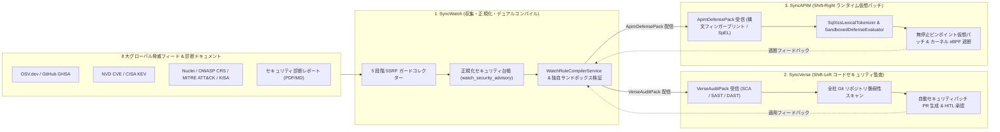
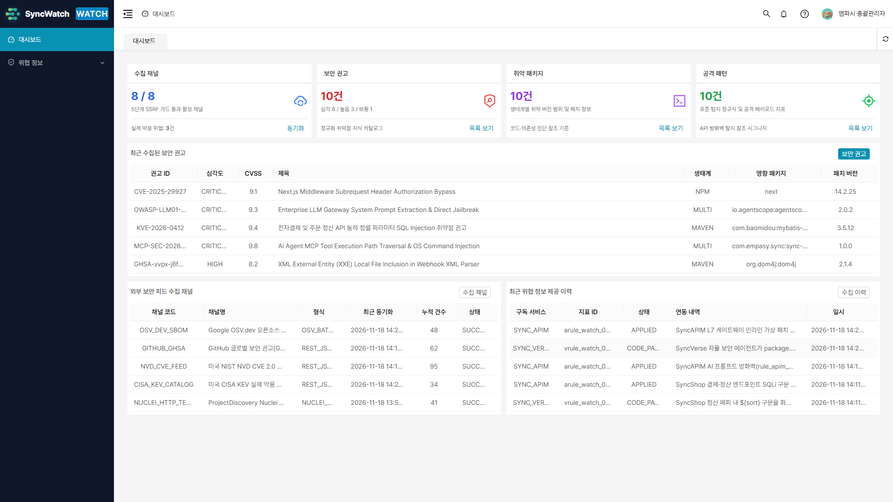
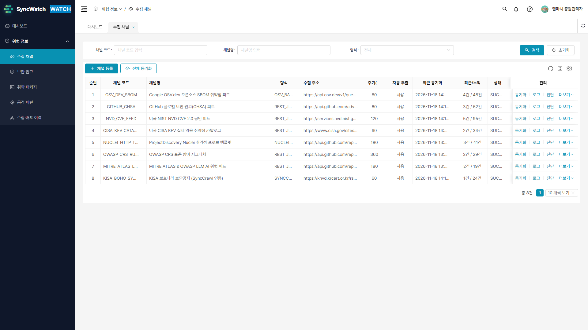
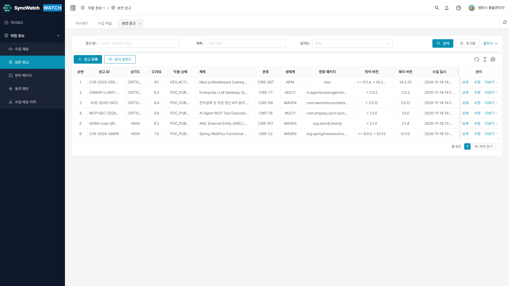
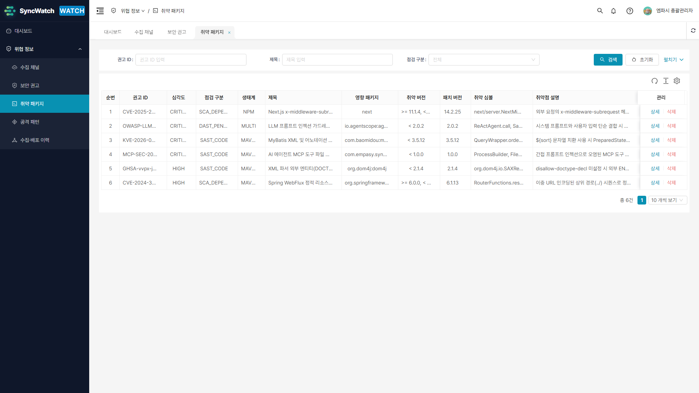
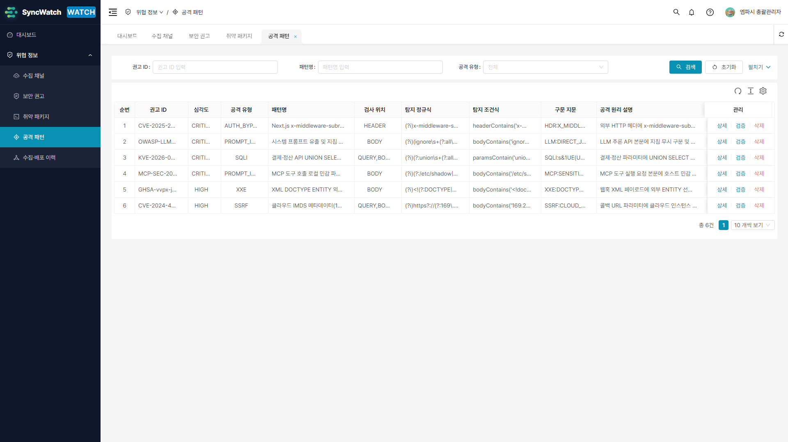
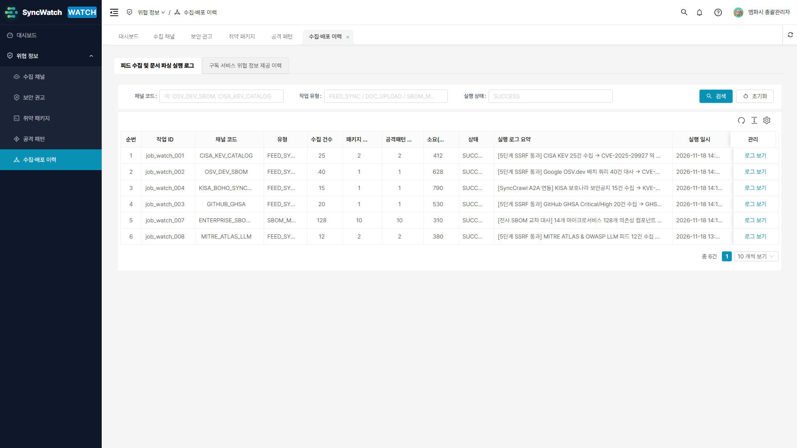

# SyncWatch 概要 (AI Security Threat Intelligence & Rule Compiler Agent)

> **非開発者・導入検討のご案内**: 分かりやすい製品紹介は [SyncWatch 製品ホームページ (empasy.io)](https://empasy.io/ja/solutions/sync-watch.html){target="_blank" rel="noopener"} で、インストール不要の画面体験は [統合デモポータル](https://demo.empasy.io/ja/products/sync-watch/#demo){target="_blank" rel="noopener"} でご利用いただけます。また、紹介資料・提案書 PDF は [提案書資料室](/ja/proposals/) からダウンロードできます。

**SyncWatch (`SYNC_WATCH`, `com.empasy.sync.watch`)** は、**8 大グローバル脅威フィード (OSV.dev、GitHub GHSA、NVD CVE、CISA KEV、Nuclei、OWASP CRS、MITRE ATT&CK、KISA)** と企業内部のセキュリティ診断ドキュメントを単一ハブへ収集・正規化し、**SyncVerse** にはコード・依存関係・ペネトレーションテストのセキュリティ点検パック (**`VerseAuditPack`**) を、**SyncAPIM** にはランタイム攻撃パターン防御パック (**`ApimDefensePack`**) をリアルタイムにコンパイル・配信する **全社セキュリティ観測所 (Security Threat Observatory & Dual Rule Compiler)** です。

---

## 1. 主要諸元および接続情報

| 項目 | 標準仕様 |
| :--- | :--- |
| **エージェント識別コード** | `SYNC_WATCH` (`sync-watch`) |
| **Maven 座標系** | `com.empasy.sync.watch:sync-watch-server` (Spring Boot 4.0.x, JDK 25) |
| **標準 API Prefix** | `/api/v1/watch/*` (権限 API: `/api/v1/watch/sys/permission/getUserPermissionByToken`) |
| **Admin 管理コンソール** | ローカル: `http://localhost:3107` / クラウド: `https://watch-admin.empasy.io` |
| **バックエンド API & ホームページ** | ローカル: `http://localhost:18087/api/v1/watch` / クラウド: `https://empasy.io/ja/solutions/sync-watch.html` |
| **データベース** | PostgreSQL 18.6 (`sync_watch`、6 大ドメインテーブル `watch_*`) |

---

## 2. 3 角自律 DevSecOps セキュリティアーキテクチャ (Triad Autonomous DevSecOps)

SyncSeries は、新たなゼロデイ脆弱性やセキュリティ勧告が公開された際、セキュリティ担当者の手動分析や正規表現の作成によって生じる防御空白期間 (Window of Exposure) を解消するため、**SyncWatch → SyncVerse → SyncAPIM** へと連携する 3 角自律 DevSecOps ループを運用しています。

1. **SyncWatch (Threat Ingestion & Dual Rule Compilation)**:
   - 外部脅威フィードやセキュリティ診断ドキュメントを収集し、CWE、MITRE ATT&CK、エコシステム (`MAVEN`、`NPM`、`PYPI`、`DOCKER` など) 基準で正規化します。
   - 単一のセキュリティ課題台帳から、開発段階の点検用 `VerseAuditPack` と本番ゲートウェイ防御用 `ApimDefensePack` を同時にコンパイルし、隔離サンドボックスで攻撃サンプル (Positive) と正常サンプル (Negative) を照合検証します。
2. **SyncVerse (Shift-Left Code Security Audit & Auto-Patch PR)**:
   - 受信した `VerseAuditPack` に基づき、全社マイクロサービスリポジトリの依存関係バージョン (`SCA_DEPENDENCY`)、ソースコード脆弱性パターン (`SAST_CODE`)、サンドボックスエンドポイントのペネトレーションテスト (`DAST_PENTEST`) を自動実行し、パッチ Pull Request を生成します。
3. **SyncAPIM (Shift-Right Runtime Defense & Pinpoint Virtual Patching)**:
   - コードパッチが本番環境にデプロイされる前であっても、受信した `ApimDefensePack` を `SqlXssLexicalTokenizer` (構文トークンフィンガープリント分析器) および `SandboxedDefenseEvaluator` (ピンポイント仮想パッチ評価器) に無停止ホットスワップで適用し、カーネル eBPF で攻撃元を即座に遮断します。

---

## 実稼働画面および主要ワークフロー

### 1. グローバルセキュリティ脅威インテリジェンス収集および観測ダッシュボード
OSV.dev、GitHub GHSA、NVD CVE、CISA KEV、Nuclei、OWASP CRS、MITRE ATT&CK、KISA など 8 大グローバル脅威フィードのリアルタイム収集状況と深刻度分布を統合管制します。

### 2. 8 大公認セキュリティフィード収集チャネルおよび接続診断
外部セキュリティフィード収集チャネルのポーリングスケジュール、5 段階 SSRF 防御ガード接続診断、即時同期および収集バッチ実行状態を管理します。

### 3. 正規化セキュリティ勧告台帳および全社 SBOM マッチング分析
多様なフォーマットの外部セキュリティ勧告や診断ドキュメントを単一標準スキーマへ正規化し、影響を受けるパッケージエコシステムと全社 SBOM 影響度を分析します。

### 4. エコシステム別脆弱パッケージおよびコードセキュリティ点検基準
開発管制塔に供給される依存関係バージョン範囲 (SCA)、静的コードパターン (SAST)、動的ランタイムプローブ (DAST) 点検基準および脆弱シンボル仕様を管理します。

### 5. ランタイム攻撃パターンおよびサンドボックス正・誤検知検証
API セキュリティゲートウェイに供給される HTTP 検査位置、検知正規表現、防御条件式およびサンドボックス誤検知ゼロ検証 (TP 100%、FP 0%) 結果を管理します。

### 6. フィード収集・パース実行ログおよび全社配信履歴
収集・コンパイル・サンドボックス検証バッチの実行ログと、購読サービス向けの脅威情報ブロードキャスト提供履歴を透明に追跡します。

---

## 3. ドキュメント構成のご案内

* **[アーキテクチャおよびデュアルルールコンパイラ](./architecture)**: 8 大グローバル脅威フィード収集チャネル、5 段階 SSRF 防御ガード、`WatchRuleCompilerService` デュアルルールコンパイルおよび独自サンドボックス検証メカニズムを説明します。
* **[SyncVerse & SyncAPIM 連携プロトコル](./devsecops-protocol)**: `VerseAuditPack` および `ApimDefensePack` のデータ契約とリアルタイムブロードキャスト・フィードバックプロトコルを解説します。
* **[DB スキーマおよび REST/MCP API 仕様](./api-and-schema)**: 6 大 `watch_*` テーブルの DDL 規格と `/api/v1/watch/*` REST API および MCP ツールをご案内します。
