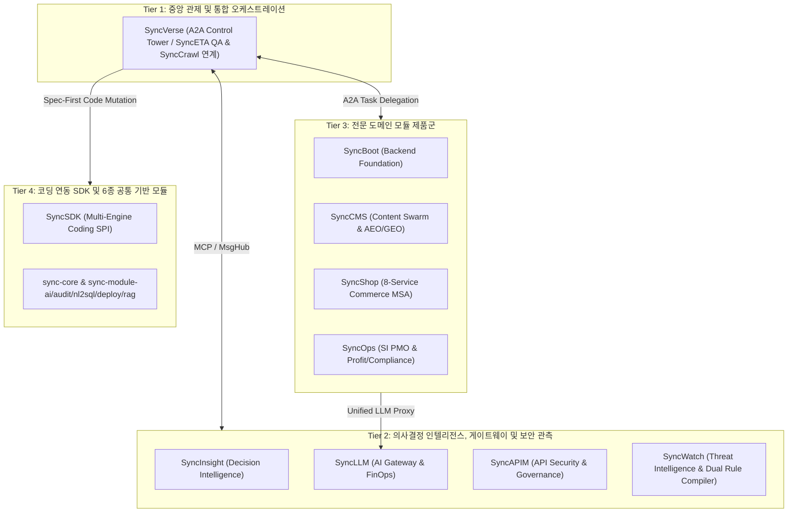
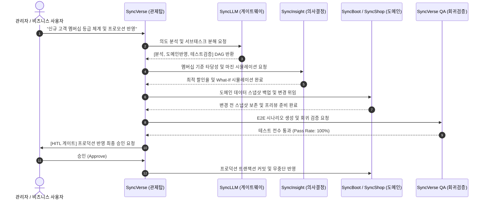

# SyncSeries 통합 아키텍처 및 모듈 연동 구조

> **독자 안내**: 본 문서는 개발자 및 시스템 아키텍트용 기술 개요입니다. 비개발자용 서비스 소개는 [엠파시 공식 홈페이지(empasy.io)](https://empasy.io/), 설치 없는 체험은 [통합 데모 포털(sync.empasy.io)](https://sync.empasy.io/), 도입 제안서 PDF는 [제안서 자료실(/proposals/)](/proposals/), 핵심 기술 용어 정의는 [전사 기술 용어집(/glossary/)](/glossary/)에서 확인하실 수 있습니다.

## 1. 아키텍처 개요 및 설계 원칙

**SyncSeries**는 개별 소프트웨어가 사일로 형태로 분리되어 운영되던 전통적인 IT 구조를 정비하여, 공통 백오피스·인증·감사 기반 위에서 각 도메인 모듈이 표준 프로토콜을 통해 상호 통신하고 협업하는 **모듈형 A2A(Agent-to-Agent) 운영 아키텍처**입니다.

전사 핵심 서비스 및 공통 모듈은 **Java 25**, **Spring Boot 4.0**, **AgentScope Java (`io.agentscope:agentscope-harness:2.0.2`)**, **PostgreSQL 18.6 (`pgvector`)** 단일 표준 기술 스택 위에서 구동되며, 세 가지 설계 원칙을 따릅니다:

1. **중앙 조율 기반 오케스트레이션**: 중앙 관제 모듈인 **SyncVerse**가 비즈니스 요청을 분석하고 하위 작업 단위로 분해하여 적절한 도메인 모듈에 위임합니다.
2. **표준 인터페이스 상호운용성**: 모든 모듈은 **[Model Context Protocol (MCP)](/glossary/#mcp)** 및 전사 단일 **[Canonical URL](/glossary/#canonical-url)** (`/api/v1/{product}/...`) 규격으로 도구와 API를 공개·호출합니다.
3. **사전 승인 및 복구 안전성**: 데이터 변경, 스키마 수정, 코드 배포 등 고위험 행위는 **[다자간 HITL(Human-in-the-Loop)](/glossary/#hitl)** 승인 게이트와 **스냅샷 기반 보상 트랜잭션**을 거쳐 데이터 정합성과 롤백 가용성을 확보합니다.

---

## 2. 4-Tier 전사 아키텍처 및 핵심 모듈 구성

SyncSeries는 역할과 책임에 따라 4개 계층의 11종 엔터프라이즈 모듈(`SyncVerse`, `SyncInsight`, `SyncLLM`, `SyncAPIM`, `SyncWatch`, `SyncBoot`, `SyncCMS`, `SyncShop`, `SyncOps`, `SyncETA`, `SyncCrawl`), 코딩 엔진 연동 SDK(`SyncSDK`), 그리고 6종 공통 기반 모듈(`sync-core`, `sync-module-ai`, `sync-module-nl2sql`, `sync-module-audit`, `sync-module-deploy`, `sync-module-rag`)로 구성됩니다.

### Tier 1: 중앙 관제 및 통합 오케스트레이션 계층
- **SyncVerse (`sync-verse`)**: 생태계의 중앙 오케스트레이션 계층입니다. 5-Step Spec Studio 기반 명세·작업 추적, 멀티 코딩 엔진 SPI 라우팅(`CodingAgentRoutingProxy`), 다자간 HITL 결재, 그리고 웹/모바일 QA(`SyncETA`) 및 웹 수집(`SyncCrawl`) 연계를 통합 관제합니다.

### Tier 2: 의사결정 인텔리전스, AI 게이트웨이 및 보안 관측 계층
- **SyncInsight (`sync-insight`)**: 내외부 이기종 데이터를 수집·분석하고, 2-Phase Deep Research와 Apache Calcite 기반 읽기 전용 Safe [NL2SQL](/glossary/#nl2sql)을 통해 근거 기반 리포트와 실행 제안을 생성합니다.
- **SyncLLM (`sync-llm`)**: 멀티 LLM 티어 라우팅, 실시간 PII 개인정보 마스킹, Redis [시맨틱 캐시](/glossary/#semantic-cache) 및 부서별 [FinOps](/glossary/#finops) 예산 가드레일을 전담합니다.
- **SyncAPIM (`sync-apim`)**: 4개 독립 JVM(`admin`, `receiver`, `detector`, `gateway`) 구조로 미등록 섀도우 API 식별, OpenAPI 3.0.1 명세 드리프트 진단, 6대 웹·API 공격 탐지([WAF](/glossary/#waf) / [eBPF](/glossary/#ebpf)) 및 8대 민감정보 동적 마스킹을 수행합니다.
- **SyncWatch (`sync-watch`)**: 8대 글로벌 보안 위협 피드(OSV.dev, GitHub GHSA, NVD CVE, CISA KEV, Nuclei, OWASP CRS, MITRE ATT&CK, KISA) 및 진단 문서를 수집·정규화([CVSS/CVE/STIX](/glossary/#cvss-cve-stix))하여 `SyncVerse`(`VerseAuditPack`)와 `SyncAPIM`(`ApimDefensePack`)에 보안 점검·방어 규칙을 배포합니다.

### Tier 3: 전문 도메인 실행 계층
- **SyncBoot (`sync-boot`)**: DB 단일 원천 동적 라우팅(`sys_permission`, [RBAC](/glossary/#rbac)), 무중단 환경설정 핫스왑(`sys_config`), 원격 소켓 진단기를 제공하는 전사 백오피스 표준 기반입니다.
- **SyncCMS (`sync-cms`)**: Nuxt 3 SSR, Copywriter-SEO-Publisher 3단계 콘텐츠 워크플로우와 SEO/AEO/GEO 웹 품질 점검 도구를 갖춘 하이브리드 헤드리스 CMS입니다.
- **SyncShop (`sync-shop`)**: Gateway, Auth, Admin, Portal, Search, Monitor, MBG, MCP Server 등 8개 독립 마이크로서비스([MSA](/glossary/#msa))와 스토어프론트(`SYNC SELECT`)로 구성된 이커머스 플랫폼입니다.
- **SyncOps (`sync-ops`)**: SI 프로젝트의 계약단가 대비 실투입원가 손익, KOSA 등급 인력 매트릭스, 4대 이행보증보험 만기, 하도급 지급기일 감시 및 조특법 SHA-256 전자연구노트를 통합 관리합니다.

### Tier 4: 코딩 연동 SDK 및 6종 공통 기반 모듈
- **SyncSDK (`sync-sdk`)**: `ICodingAgentClient` 표준 SPI를 통해 사내 정책에 맞는 CLI/코딩 에이전트 어댑터를 플러그인 방식으로 교체하고 4-Cycle 빌드 검증·복구 파이프라인을 연계하는 개발 SDK입니다.
- **6종 공통 모듈**: `sync-core`, `sync-module-ai`, `sync-module-nl2sql`, `sync-module-audit`, `sync-module-deploy`, `sync-module-rag`.

---

## 3. 에이전트 협업 생명주기

---

## 4. 아키텍처 관점 비교 (개별 구축 vs SyncSeries 통합 구조)

| 영역 | 개별 시스템 분산 운영 방식 | SyncSeries 공통 기반 통합 구조 |
|:---|:---|:---|
| **신규 기능 및 API 확장** | 인증·권한·로깅·감사 기반을 프로젝트마다 반복 구현 | `SyncBoot` 공통 기반, Canonical URL(`/api/v1/{product}/*`), 6종 공유 모듈 재사용 |
| **변경 반영 및 복구** | 수동 DB 백업 및 장애 시 로그 수동 추적·원복 | 변경 전 스냅샷 보존, 다자간 HITL 승인 게이트, 보상 트랜잭션 기반 롤백 |
| **LLM 비용 및 모델 관리** | 팀별 개별 API 키 발급으로 중복 호출 및 예산 추적 불가 | `SyncLLM` 단일 게이트웨이 경유, 시맨틱 캐시 및 부서별 FinOps 한도 정책 적용 |
| **회귀 검증 자동화** | 배포 전 수동 점검 누락 및 UI 변경 시 스크립트 파손 | `SyncETA` 시나리오 기반 자동 실행 및 시맨틱 DOM·비전 자가 치유 보정 |
| **보안 및 감사 증적** | 수동 코드 리뷰 중심, API 인벤토리 및 민감정보 유출 파악 지연 | `SyncAPIM`·`SyncWatch` 연동 위협 규칙 배포, PII 마스킹 및 감사 원장 전수 기록 |

---

## 5. 다음 단계

- **[전사 기술 용어집 (Glossary)](/glossary/)**: SyncSeries 핵심 기술 용어 공식 정의(SSOT)
- **[표준 MCP 프로토콜 명세](/ecosystem/mcp-protocol)**: 에이전트 간 도구 호출 및 메시징 규격
- **[AgentScope Java 표준 가이드](/ecosystem/agentscope-guide)**: Spring Boot 4.0 & Java 25 백엔드 에이전트 개발 표준
- **[공유 모듈 & SDK 아키텍처](/ecosystem/shared-modules-and-sdk)**: 6종 공통 모듈(`sync-core`, `sync-module-*`) 및 `SyncSDK` 구조
- **[엔드투엔드 워크플로우 실무](/ecosystem/e2e-workflow)**: 실제 시나리오 기반 모듈 간 연동 절차
- **[HITL 거버넌스 & Saga](/ecosystem/hitl-governance)**: 관리자 안전 승인 및 분산 롤백 메커니즘
- **[보안 백서 및 컴플라이언스](/ecosystem/security-and-compliance)**: 제로 데이터 보존 및 망분리 보안
- **[제품 소개서 · 제안서 PDF 모음](/proposals/)**: 도입 검토 및 제안용 문서 자료실
