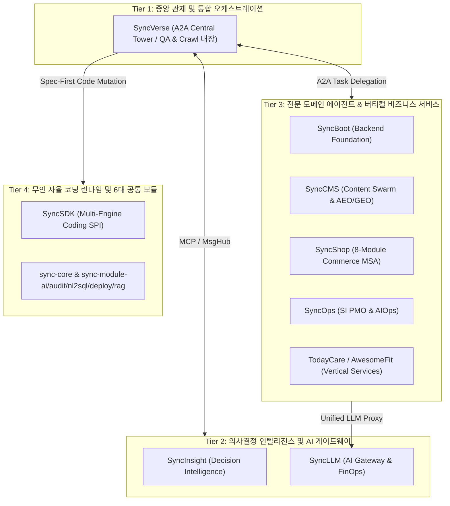
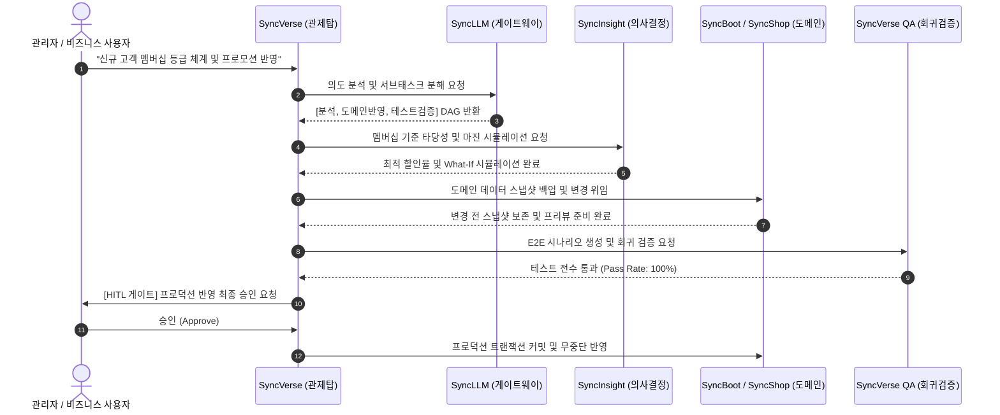

# SyncSeries AI 자율 운영 생태계

## 1. 비전 및 패러다임 전환

**SyncSeries**는 개별 소프트웨어가 사일로 형태로 분리되어 운영되던 전통적인 IT 환경을 탈피하여, 각 도메인 영역을 전담하는 전문 AI 에이전트들이 표준 프로토콜을 통해 상호 통신하며 엔터프라이즈 시스템을 자율적으로 기획, 구현, 검증, 운영하는 **A2A(Agent-to-Agent) 자율 운영 생태계**입니다.

전사 16개 모듈은 **Java 25**, **Spring Boot 3.5.16**, **AgentScope Java (`io.agentscope:agentscope-harness:2.0.2`)**, **PostgreSQL 17 (`pgvector`)** 단일 표준 기술 스택 위에서 구동되며, 세 가지 핵심 원칙을 기반으로 동작합니다:

1. **지능형 자율 오케스트레이션**: 중앙 관제탑인 **SyncVerse**가 사용자의 고차원 비즈니스 의도를 분석하고, 최적의 하위 도메인 에이전트에게 작업을 분할·위임합니다.
2. **표준 도구 상호운용성**: 모든 에이전트는 **Model Context Protocol (MCP)** 및 전사 단일 Canonical URL (`/api/v1/{product}/...`)을 통해 도구를 공개하고 호출합니다.
3. **엄격한 엔터프라이즈 안전성**: 데이터 변경, 코드 배포 등 고위험 행위는 반드시 **다자간 Human-in-the-Loop(HITL)** 관리자 승인 게이트와 **인메모리/DB 스냅샷 기반 보상 트랜잭션**을 거쳐 데이터 정합성과 즉시 롤백 가용성을 보장합니다.

---

## 2. 4-Tier 전사 아키텍처 및 16개 모듈 구성

SyncSeries 생태계는 역할과 책임에 따라 명확히 분리된 4개 계층과 6대 공통 기반 모듈, 그리고 2대 버티컬 서비스로 구성됩니다.

### Tier 1: 중앙 관제 및 통합 오케스트레이션 계층
- **SyncVerse (`sync-verse`)**: 생태계의 중앙 신경망 역할을 담당합니다. 5-Step Spec Studio를 통한 자율 코딩 오케스트레이션, 다자간 HITL 결재, 그리고 내장된 비전 QA(`sync-verse-qa`) 및 적응형 크롤러(`sync-verse-crawl`)를 통합 관제합니다.

### Tier 2: 의사결정 인텔리전스 및 AI 게이트웨이 계층
- **SyncInsight (`sync-insight`)**: 내외부 이기종 데이터를 실시간 수집·분석하고, 2-Phase Deep Research와 Apache Calcite 기반 Safe NL2SQL을 통해 검증된 비즈니스 실행 대안을 도출합니다.
- **SyncLLM (`sync-llm`)**: 멀티 LLM 티어 라우팅, 실시간 PII 개인정보 마스킹, Redis 시맨틱 캐시를 통한 토큰 비용 절감 및 예산 가드레일을 전담합니다.

### Tier 3: 전문 도메인 실행 계층 및 버티컬 서비스
- **SyncBoot (`sync-boot`)**: DB 단일 원천 동적 라우팅(`sys_permission`), 무중단 환경설정 핫스왑(`sys_config`), 원격 소켓 진단기를 제공하는 전사 백오피스 표준 베이스라인입니다.
- **SyncCMS (`sync-cms`)**: Copywriter-SEO-Publisher 3단계 내부 Swarm과 AEO/GEO 웹 품질 감사 도구를 갖춘 자율 콘텐츠 퍼블리싱 에이전트입니다.
- **SyncShop (`sync-shop`)**: Gateway, Auth, Admin, Portal, Search, Monitor, MBG, MCP Server의 8개 독립 마이크로서비스로 구성된 자율 이커머스 에이전트입니다.
- **SyncOps (`sync-ops`)**: 한국형 SI 프로젝트 듀얼단가 손익, KOSA 등급 인력 매트릭스, 4대 보증보험, 전자연구노트 및 AIOps 무인 관제를 통합 수행합니다.
- **TodayCare (`services/today-care`) & AwesomeFit (`services/awesome-fit`)**: 시니어 AI 자율 안부케어 플랫폼(4개 프론트엔드 채널) 및 AI 퍼스널 스타일링 패션 커머스 버티컬 서비스입니다.

### Tier 4: 무인 자율 코딩 SDK 및 6대 공통 모듈
- **SyncSDK (`sync-sdk`)**: Antigravity 및 OpenSWE 멀티 코딩 엔진 SPI 핫스왑과 4-Cycle 빌드 자가치유를 제공하는 자율 개발 SDK입니다.
- **6대 공통 모듈**: `sync-core`, `sync-module-ai`, `sync-module-audit`, `sync-module-nl2sql`, `sync-module-deploy`, `sync-module-rag`.

---

## 3. 에이전트 협업 생명주기

---

## 4. 도입 효과 및 정량적 지표

| 영역 | 전통적인 수동 개발·운영 방식 | SyncSeries AI 자율 운영 생태계 |
|:---|:---|:---|
| **신규 API/도메인 론칭** | 3 ~ 5 영업일 (기획·설계·구현·테스트) | **15분 이내 (자율 파이프라인 완성)** |
| **장애 복구 및 롤백 (MTTR)** | 평균 2~4시간 (로그 분석 및 DB 덤프 복구) | **1초 원클릭 스냅샷 롤백 및 자가치유** |
| **LLM 토큰 운영 비용** | 매월 지속 증가 (중복 프롬프트 호출) | **최대 60% 절감 (시맨틱 캐시 & FinOps)** |
| **회귀 결함 검출률** | 수동 QA 일정 압박으로 70% 수준 | **98.4% 이상 (비전 자가치유 무인 검증)** |
| **보안 및 규제 준수** | 수동 코드 리뷰 및 누락 위험 | **100% PII 마스킹 & 감사 원장 기록** |

---

## 5. 다음 단계

- **[표준 MCP 프로토콜 명세](/ecosystem/mcp-protocol)**: 에이전트 간 도구 호출 및 메시징 규격 학습
- **[AgentScope Java 표준 가이드](/ecosystem/agentscope-guide)**: Spring Boot 3.5.16 & Java 25 백엔드 에이전트 개발 표준
- **[공유 모듈 & SDK 아키텍처](/ecosystem/shared-modules-and-sdk)**: 6대 공통 모듈(`sync-core`, `sync-module-*`) 및 `SyncSDK` 구조
- **[엔드투엔드 워크플로우 실무](/ecosystem/e2e-workflow)**: 실제 시나리오 기반 협업 과정 확인
- **[HITL 거버넌스 & Saga](/ecosystem/hitl-governance)**: 관리자 안전 승인 및 분산 롤백 메커니즘
- **[보안 백서 및 컴플라이언스](/ecosystem/security-and-compliance)**: 제로 데이터 보존 및 망분리 보안
